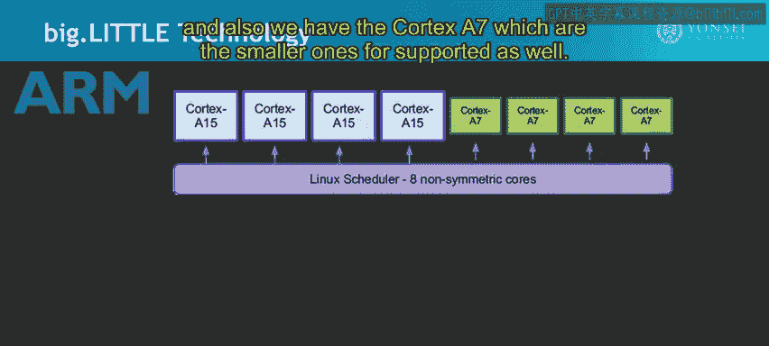
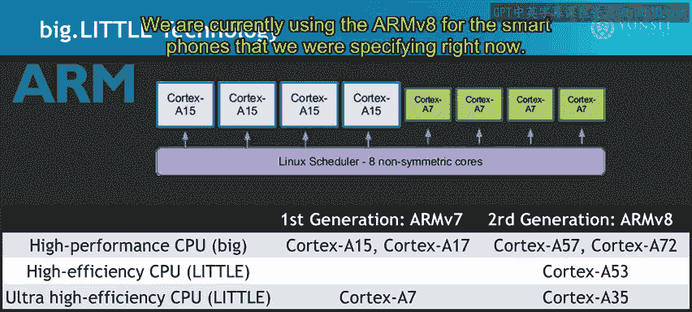
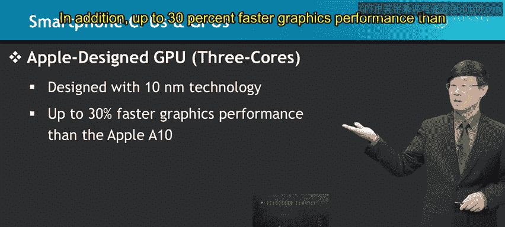
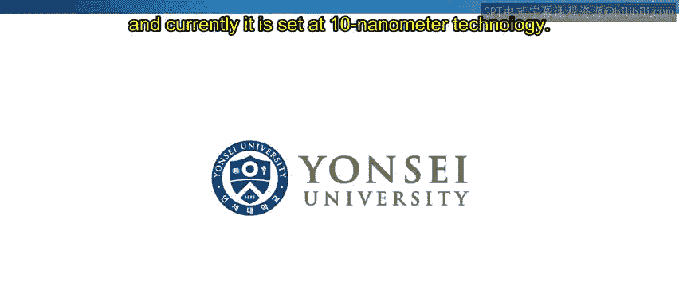

# 延世大学《新兴技术从智能手机到物联网再到大数据Emerging Technologies From Smartphone to IoT to Big Data》 - P40：4_2.2 智能手机芯片组（第1部分）.zh_en - GPT中英字幕课程资源 - BV18hpFewEcG

Yeah。🎼Yeah。🎼For smart devices， we are now going to focus on smartphone chipsets。 Really。

 the state of the art technology is in the chipsets， and as I mentioned before。

 not only does it do operations for the smartphone。

 it also conducts additional interneting technology for Bluetooth Wifi and mobile communications。

 The variety of these protocols will be explained later in the following lectures。😊。

And now we first go into the chipets in this lecture。

We will start our Chipset study based on the Samsung Exus Octa 8895。It was released in 2017。

 and it was developed and manufactured by Samsung。It is based on the arm V8 A architecture。

 which we will study now。The architecture is based on a big little heterogeneous computing architecture。

The Samsung Exonus Octa 8895 has four big cores and four little cores。

 so overall it is a multi corere processing unit that has eight cores inside。

What is the architecture of big little， where please take note that the big is written in small case letters and the little is written in large case letters。

It was launched by R。In 2011。It is a processing power optimization technology where high performance from Ar CPU cores are obtained through fast hardware processing speeds。

 very efficient firmware。And the characteristics are peak performance capacity。

 higher sustained performance。Increased parallel processing performance and significantly lower average power consumption。

The power consumption gain comes from intelligently using the big and the small cores based upon how much of a load of operation is required。

 we'll get into the details in the following。The big and faster course are used for computation intensive tasks。

 These tasks are also called threads。 What is a thread Just wait。

 I will explain that to you on the next page。What do you mean by computation intensive tasks。

 typically on your smartphone， if you're using a video game or augmented reality like application。

 then you are really using your device in a heavy way as in terms of a heavily processed way then the big cores need to take care of you these big cores are energy consuming they are using a lot of energy to get the process。

 the heavy burdened operations done within the fastest amount shortest amount of time。

Then comes a little the slower core。 These are less intensive task operated ones。 These also。

 of course， the tasks are threads。For example， Damons， what is a damon。

 a Damon is a program that runs in the background process of a smartphone typically when you look at your operating system。

 it runs in the back but when I say background process that also means that there is a foreground process the foreground process is the application that you see probably operated by your big course like the video game。

 the augmented reality or other type of video streaming and operations that are interactively working with a user that need to get done within a minimum amount of time as a developer for various smartphones myself。

 we target to get all interactive applications， meaning that when I touch the screen。

 when I touch the display to ask for something to get done。

 a user will be satisfied if it gets done within 50 to about 100 milliseconds if it goes beyond that the user will feel that their smartphone is a little bit slow if it crosses the 100。

50 millisecond operation bound， then the user will feel that it's really getting slow， maybe。

 even a little bit uncomfortable。Based on that， we want the foreground operations。

 which are the ones that need to get done quickly processed with more energy invested into it we're at a higher power ratio on the big course where we want the background operations that keep the smartphone alive。

 operating and continuously doing all the background work， we want them to be on the little course。

Then threads， what is the thread？A thread is a sequence of program instructions that are scheduled and processed independently by the scheduler。

 the scheduler on your smartphone， what is a scheduler。

 it is actually most commonly on your smartphone， the operating system。

As in terms of operating systems for smartphones， we are talking about Android and iOS。

And there are other ones as well。In this course， we will focus on these two Android and iOS for their entire evolution from the beginning。

 the first iOSos and the first Android all the way reaching to today。

 What are you using on your smartphone， and that will be included in the following lectures。

 So hang in there。😊，Advantages of using the big little software and platforms are you can save 75% of CPU energy in low to moderate performance scenarios。

And you can increase performance by 40% in highly threaded workloads。

When I say highly threaded workloads， that means that we have multiple threads coming down from the multiple applications that you're using on your smartphone。

 they will be processed in terms of having threads coming down and being assigned to the course。

 the multiple course in your system to the CPU to the GPU， and of course， to the chipet。

These cores are how many do you have It's based on what type of architecture your smartphone is as in terms of once again。

 the chipets that we were looking into in these versions of the smartphone had eight four big and four little ones then for the CPU we also had a version of either eight or six cores in the CPU as well and then in the GPUs we were talking about dual core devices being supporting the overall graphics processing for your smartphone。

Further details will follow in the following lectures。Looking into the arm architecture。

 as you can see here， this is one example that has a Linux scheduler with eight non-symmetric cores being supported by the scheduler beneath in the purple bar area what you can see is that these are called nonsymmetric that means that they're not symmetric this is because we have big cores which are represented by the cortex A15 units we have four of those big ones and also we have the cortex A7 which are the smaller ones for supported as well。

Looking into first generation RMV7 and second generation RMV8。

We are currently using the RV8 for the smartphones that we were specifying right now。

For the big little technology architecture， there's the first generation ones。

 which are the arm V7 ones， and also the second generation architectures， which are the arm V8 ones。

If you spot your smartphone recently， then it's using a second generation RMV8 as these devices that we're looking at right now for the smartphones from Samsung and Apple however。

 if you purchased your smartphone maybe a year or two ago。

 then it's probably using the ArV7 architecture， so we'll look at both。For the arm V7。

 it uses a cortex A15， like the picture above， and it has a cortex A17 option as well for high performance for the big CPUs。

 for second generation arm V8， it uses a cortex A57 in the position of where you see the A15s in the figure above or it can use the cortex A72 structure。

For high efficiencyency CPU on the little course， the arm V8 has the option of using the cortex A53 for U high efficiencyfiency CPU for the little course for the arm V7 module it's the cortex A7 and for the arm V8 it is the cortex A35 So for the figure above you can replace the specs in for the second generation modules such as using an A57 or an A72 as well as you can use for the small course instead of the A7。

 you can use the A35 or the A53 as listed in this table。We will now look into the Qualcomm MSM 89。

98 Snapdragon module， which is the 8351。This was released in 2017。

 and it was designed by Qualcomm and manufactured by Samsung。

It is based on the arm V8 A architecture。Of course。

 it uses the big little heterogeneous computing architecture。

And it has four big cores and four little cores。For the iPhone X。

 we have the Apple A 11 bionic chippset used inside。 It was introduced in 2017。

 and it was designed by Apple and manufactured by TSMC。It is based on the same arm V8 A architecture。

And it is a second generation Apple Design Per controller unit。

It has 70% faster multithed workloads once again， for all modules。

 the applications will generate multiple threads， and these threads will be assigned to the multiple cores。

If the thread， which is a sequence of operations that need to be done。

 if these are heavy and need a lot of processing power。

 they will go to the big cores if they are relatively light or background operations such as the operating systems demons。

 then they can go to little cores。Here I'm going to compare the A11 to the A10。 What is the A10。

 if you purchased a smartphone in 2016 or 2015， then most likely the A10 would be used inside。

It has 70% faster for efficiency cores in the A11 compared to the A10。

And it has 25% faster to performance cores as well。 So therefore。

 these are the advantages that the A11 provide compared to the A10， its former version。

For the smartphone， CPUs and GPUs we'll take a look in the cryo 280 first。

This was announced in November 2016， and it was announced with the Snapdragon 835 chipet。

 which you see right here。It has a customized derivative basis design from the arm cortex A73 architecture。

And it has enhanced IPS performance， which is instructions per second， so in other words。

 the cryot 280 is more enhanced in its performance when it comes down to integer operations as well as instructions。

 however， there is a slight tailoff in performance in floating point operations。

Which is why the fluxps， the floating point operations per second performance。

 is slightly degraded compared to the original cryocCps。

The cryot 280 is used in the Samsung Galaxy Note 8。Along with the Adreno，5，40。

This was introduced in early 2017。Which has improved clock speed at 7，10 megahertz。

And enhance stability。In addition， it was designed with 10 nanometer technology。

It has 256 ALU arithmetic logic units。An arithmetic logic unit is a logic unit that performs。Add。

 subtraction， in addition， logic binary operations such as and or， nor， N exclusive or。

 these type of logical binary operations are conducted by ALUs。In addition。

 the Adreno 540 has floating point operation capabilities as well， it has a 567 GFop。

 GF is Giapflps performance。For the Apple iPhone X， it uses the monsoon and Mial。For the monsoon。

 it has a high performance core that can run up to 2。

39 gigahertz also 25% faster than the Apple A10 chip。

 as you can see the Apple A 11 chip is what is being used and its former chip that was in the former versions of the phones basically it' 25% faster。

For the miststral， the energy efficient core can run up to 2。39 gigahHtz， in addition。

 up to 70% faster than the energy efficient core in the Apple A10， this is a significant improvement。

Also for the Apple Design GPUs with three cores。This is designed with 10 nanometer technology。

 in addition， up to 30% faster graphics performance than the Apple A10 chip。

And can provide A10 performance at half the power， that is a significant power reduction。

