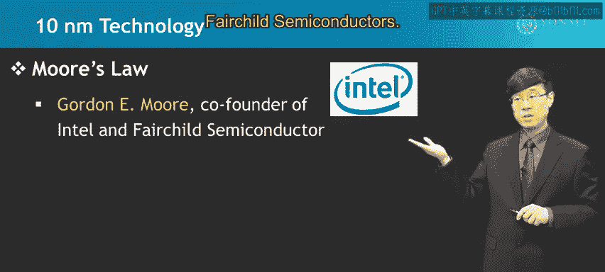
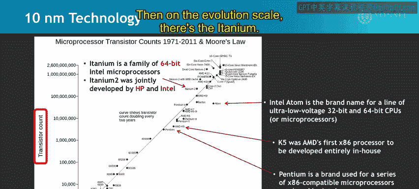
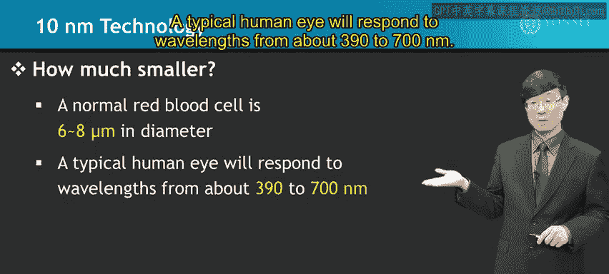
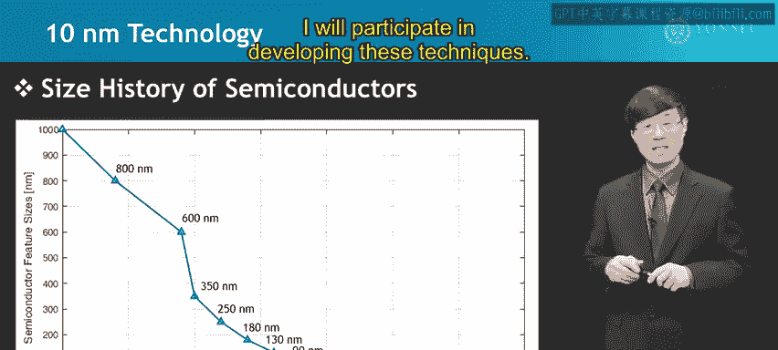
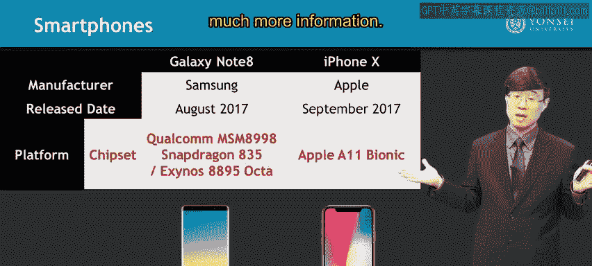

# 延世大学《新兴技术从智能手机到物联网再到大数据Emerging Technologies From Smartphone to IoT to Big Data》 - P41：5_2.2 智能手机芯片组（第2部分）.zh_en - GPT中英字幕课程资源 - BV18hpFewEcG

Yeah。🎼Yeah。In order to understand the chipets， as well as the CPU。

 you need to understand the state of the art in semiconductor development。

 and currently it is set at 10 nanometer technology。 So let's talk about this。Based on Bo's law。

Gordon E。 Boor is the co founder of Intel and Fairchild Semiducts， and I'm sure you heard of Intel。

In his 1965 paper， he wrote that the number of transistors in a dense integrated circuit will double approximately every two years。

And this rate of growth is projected to continue for at least another decade， and amazingly。

 this prediction was perfectly accurate。And based on that， the Moore's law became very famous。

 Does it apply to current state of the art technology for semiconductors as well， Let's take a look。

In 10 nanometer technology， how did we get there and this graph shows you a little bit where what we're going to look at is based upon the vertical axis。

 which is transistor count over there。 So how many transistors can you place on one semiconductor chip is what you will see the evolution growth right here。

Looking into just a couple of reference points， looking at the bottom right here。

The Pentium is a brand used for a series of X86 compatible microprocessors produced by Intel。

 The X86， the X position is where you can put the actual code number for the semiconductor device。

 A typical number for a pentium would be like an 80586。 so the 805 would go into the X position。

Just looking at the last three digits would be the 586。

 and therefore pentium processors would also be called 586 processors in some cases。

The Penttheium processor is an entry level product for a wide range of PCs。Afterwards， this。

 the evolution went into multicore processors， instead of having one that was really powerful。

 you wanted to have multiple ones that were somewhat independent and could conduct operations。

Continuing on with the evolution， K5 was AMD's first X86 processor to be developed entirely in else。

And also Intel Adam is the brand name for a line of ultra low voltage， 32 B and 64 bit CPUs。

Then on the evolution scale， there is the itanium is a family of 64 B intel microprocessors。

 The itanium2 was jointly developed by Heula Packard and Intel。😊。

Going up there， you'll see a Zion， which is a brand of X86 architecture microprocessors designed and manufactured by Intel。

The Zion is a target at non consumer workstation servers and embedded system markets。

What does this mean Well， when you talk about a consumer based product that is typically like a smartphone or a personal computer or a laptop where a company。

 a business will sell it directly to the consumer so we call that a B2 C relationship from business to the consumer。

Then on the other side， there is the business to business。

 which are corporate to corporate relations， and typically that's what this non-consumer is talking about where we have a B2B relation where typically a company that will need a lot of workstations servers and other group of embedded systems will purchase this directly from Intel and they will include it in their devices as well so the user typically is not going to directly buy a server。

 it is more like a company purchasing a server that's what they mean by non-consumer。

Before the 10 nanometer technology， we had 11 nanometers and 14 nanometers were the state of yard trend。

The original naming of 10 nanometers， who defines this， it's the ITRS。

 the International technology roadmap for semiconductors。 This is the institute。

 the organization that does these types of categorization。

Samsung first released their version of a 10 nanometer processor node in 2017。What is the IT。

It is sponsored by the five leading chip manufacturing regions in the world， which include Europe。

 Japan， Korea， Taiwan， and the United States。The object is to ensure cost effective advancements in the performance of integrated circuits and advanced products and applications that employ such devices to continue consistent growth and success of the semiconductor industry。

Evidently， it plays a significant role， as well as a standardization based reference so that we can categorize semiconductor technology。

Why 10 nanometers， what's the big deal of this smaller number？Well。

 by reducing the distance between the transistors。The power reduction gain is provided in single transfer from one unit to another and also transistor activation。

 activating it， turning it on。 This will take less energy to do that， which is great。

 What other advantages does this overall result in。😊，Slimmer and lighter chips。Longer battery life。

The smaller the transistors are， the more transistors can be designed into the same chip area。

 So more transistors in the same chip area means that you have more functionality。

 more processing capability。Transistor switch faster。Less energy is consumed。

And given an equal number of transistors that you have， then if you compare them。

 going to smaller transistor technology will make them less heat radiant。

That means that there is the heat component is a waste of energy。

Because you want processes to get done。 You don't want it to be used as a heater。 So therefore。

 having cooler operations。Means that you're wasting less energy means that you are saving more energy means that。

The device has a much longer lifeline。How much smaller can we go？Well。

 let's first take a reference at what does 10 nanometer really mean。 How small is that。 First。

 a normal red blood cell is about 6 to 8 microm in diameter。Micrometerters。

 this is different from a nanometer， which I will soon explain。

A typical human eye will respond to wavelengths from about 390 to 700 nanometers。

A bacterial ribvosome is about 20 nanometers bacterial。The units that we're talking about。

 for a red blood cell is in the range of 10 to the power of six。Meters， that's a micrometer。

 But these ranges that we're talking about from 20 to 390 to 700 nms。 That's 10 to the power -9。

 We're talking about transistors based on 10 nanometer technology。

 So you can see how small and how accurate and precise technology designs are possible。

Going back to a little bit about Moore's law and how the trends and where are we going in the future look over there based upon the year of 1985 going down this trend we reach these numbers over here and as you can see as we approach the lower part near after 2010 we have 32 nanometer。

22 nanometer，14 nanometer 10 nanometer and this is where we are 10 nanometer in the future what's going to happen now we're gonna to have a single digit nanometer technology8。

64 these numbers will soon appear in the future， be ready for them and make sure that they're in your smartphone and smartwatch right here this red part right down here that's where we're going and well observe and of course for my part I will participate in developing these techniques。

So overall， we first looked at just the chipet and in these tables， in the former lecture。

 there was so much more information。😊。

Hang in there because I'm going to explain much more in the following lectures in this course。

These are the references that I use， and I recommend them to you。 Thank you。

