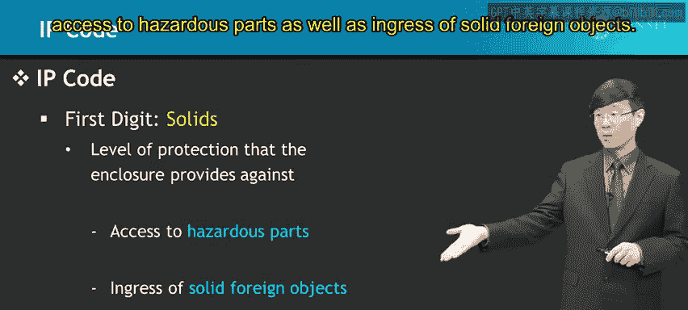
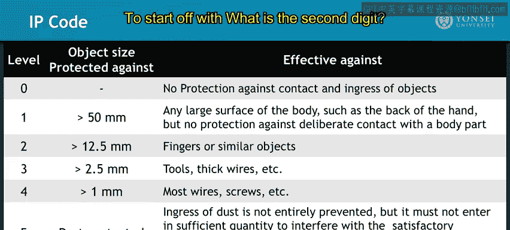
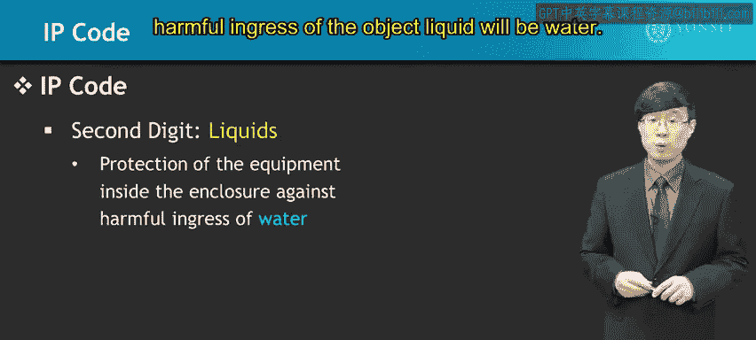
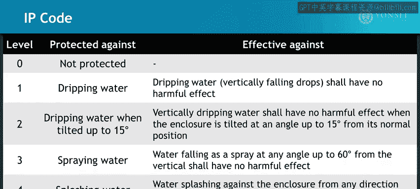
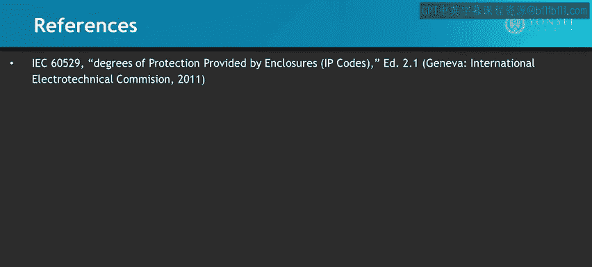

# 延世大学《新兴技术从智能手机到物联网再到大数据Emerging Technologies From Smartphone to IoT to Big Data》 - P42：6_2.3 IP防护等级.zh_en - GPT中英字幕课程资源 - BV18hpFewEcG

Yeah。🎼Yeah。For the newest smart devices， one very important thing is the dust and water protection mechanism。

How much and how far can they go That is specified in the I code， which we will study right now。

The IP code is the international protectionction marking， as well as Ingress protection marking。

 you will see it specified under these two categories。

It is used to classify and rate the degree of protection provided against intrusion of solid objects。

 dust， accidental contact， water by mechanical caing。Electrical enclosures。

The IP code is defined in the international standard IEC 60-529。

The code structure is based on an IP followed by two digits， and then optional letters。

The two digits indicate conformity with the conditions based on the solids and liquids。

The first digit is for solids。Typical small solids will go down to the dust level。

 so a lot of people say that the first digit is for dust because if you can protect it from dust。

 then typically all the bigger particles can be protected from， and then the second digit is liquids。

 they will typically say water because the representative water that is used in the experiments to see what level of protection the IP code is going to be based on is based on typical just water。

 pure water。First digit solids。Level of protection that the enclosures provide against。

Access to hazardous parts， as well as ingress of solid foreign objects。

Let's look into the details of the first digit of the IP code over here， we start at the top。

 which shows the level object size it is going to be protected against。

 and it is effective against what。Four level zero。This is typically just no protection。呵呵。

And therefore， you don't want your device to be at this level。Going down to level1， a higher level。

 this is for objects that are larger above 50 millimeters。

 any large surface of the body such as you know like the back of your hand， the front of your hand。

 as well as other things， typically you can protect it against that， but that's about it。

Going into level 2， fingers or smaller objects are what they are protected against。

 The object size is typically larger than 12。5 mm。 That's the smallest protection level that it will go down to。

In level three， it is above 2。5 millimeters， so tools。Relatively tools that have tip edges。

 as well as thick wires can be protected from level 3 devices。When you go to level four。

 then you can have protection against one millimeter and above。So most wires。

 even the more thinner ones and screws， you can have protection against them from them sliding in or contacting the inside of the device。

Then we go into dust protection below millimeter level。

 and this is really where our technology is going to exist， but yet level five it is weak as well。

Level 5 is dust protected， so dust is not entirely prevented， but it must not enter in quantity。

 so it's getting in， but not too much。And to interfere with satisfactory operations of the equipment。

 meaning that the device must be able to operate even if some does enter the system。

 complete protection against contact is done， and that contact is for objects with larger sizes。

 typically the above of the table between level zero to4。Then we come to the level that we want。

 in addition for the iPhone X and the Galaxy Note 8 type devices。Well。

 this is a level of satisfaction that these devices are providing， level 6。

 and this is the highest level when it comes to the first digit of the IP code， typically dust tight。

 No ingress of dust。 No dust can come in。 completele protection against contact。 Wo。

 This is what we want。 So we want our devices to be specified by I6 to start off with What is the second digit。

 The second digit is based on liquids， and protection of the equipment inside the enclosure against harmful ingress of the object liquid will be water。

😊。

And you can see here starting from the top， which we have level protected against and what is it effective against number one。

 starting at level zero， no protection。 Of course， we don't want this。Then， level 1。Dripping water。

 This is vertically falling drops of water on the top of your device。

Now this is yet just enough for it to roll off， but as you will see in level 2， when we tilt it。

 then we are making the device more vulnerable for water to slide in from it rolling down the sides of your device so tipping a device here at angles of up to 15 degrees。

 which is a slight tilt。It says that vertical dripping water has no harmful effect up to this level。

Then we go into a much more aggressive type approach of water protection testing。

 which is spraying water in level3 here， water falling as a spray at any angle up to 60 degrees from the vertical should have no harmful effect。

 So basically this is saying that as you tilt the device even much more that is even four times more then the level 2。

 15 degrees then either way of an angle of tilting 60 degrees this way or that way。

 which is almost like relatively a good shake could go into that angle of 60 degrees this way and that way。

 then still a vertical dropping stream of water or drops would not have any effect。

 that's pretty good but not sufficient for what we want。

Level 4 is protection against splashing water from any direction。

 This is a much higher level of protection。 Evidently。

 splashing water is not like you're actually shooting water at the device。

 but means that it's water that is being splashed somewhere and it is influencing it is getting on the device。

 but the critical component is that it's from any direction。

 It still has even from bottom up from left to right from right to left。 and of course。

 the option of from top to bottom that is， of course included。

 but typically from top to bottom water dropping vertical drops of water that is covered in level 0 through3。

 level 4 is a higher level So this is also including any direction。😊。

In level five， this is using water jets。This is much more aggressive because water here is being shot through a it is being projected through a nozzle。

 The nozzle size is a 6。3 millimeter nozzle and even from a nozzle of this size。

 you can get significant amounts of water， but because a nozzle is relatively small。

 the water pressure and the water amount is not that significant。

 but still the water is shot is projected towards the device and still protection can be made。

 meaning that it is the ceiling， the protection from water coming inside the device。

 it has no influence。At a higher level， level six。Powerful water jets。

 This is getting much higher in its protection level because the nozzle is now a 12。5 mm nozzle。

 That means that the amount of water that is going to be projected onto the device is significant。

It is in some cases， easily enough to put a lot of pressure on the surface of the device。

 such that water could be forced in if it is not protected the right way。

 So level6 means that you are well protected against water that is projected onto the device。

We now go into level seven， which is a much higher level because were going to talk about emerging the device into water。

When you put a device into water， then the water pressure will make water。

 try to smear or enter the device from all possible angles。

So immersing your device into water is a much higher level than having something projected or splashed onto。

Level7 is up to1 meter of submersion into water。However， the pressure， how many Gs。

 as well as the time for how many seconds or minutes can be sustained for this level of water protection has to be defined by the manufacturer。

So in the actual product specifications， when you buy your product， it should be listed in there。

Then we have level8， which is the highest level， and this is what we really want ultimately。

In this level， it is beyond 1 meters， typically meaning that you can go in and do operations at deeper levels within the water at locations which have much more higher pressure。

 G values that are much higher for longer periods of time， exactly how long or how much pressure。

 how deep that is specified by the manufacturer， so you have to read your manual on how this device can be used。

This type of protection is called hermetrically sealed， which means that。The device。

 if you put it into water at a deepness beyond 1 m， then the water may not enter the device at all。

 or in some cases， water may enter。 but it will have no influence on the device。

 So when you take it out of water， the water inside will just pour out and it will have no influence having a harmful effect on your smart device。

 So levelvel A is our ultimate goal of a device that we want。 Level 7 is the next one up。

 and these are the specifications that are used as the second digit of the IP code。 So。

One example is that we have an IP 67 code where the first digit 6 means that is dust tight。

 meaning that for dust or other solid objects， it has its highest level。

 that is level6 for the first digit。For the second digit level7。

 that is emergent up to1 meter based on the condition and time specified by the manufacturer。

IP code examples， well for the Samsung Galaxy Note 8， it is IP 68。

 meaning that it has the 8 at the end， which means that it can be submersed into water for over1 meter depth。

The gear S3 is also at the same IP 6A。 The iPhone X is at IP 67。Once again。

 six stands for Du T and seven stands for waterproof up to1 meter and eight stands for beyond1 meter。

These are the references that I used， and I recommend them to you。 Thank you。

