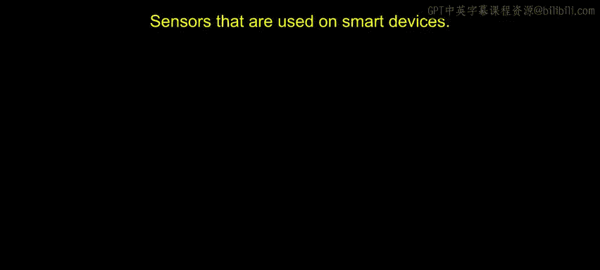
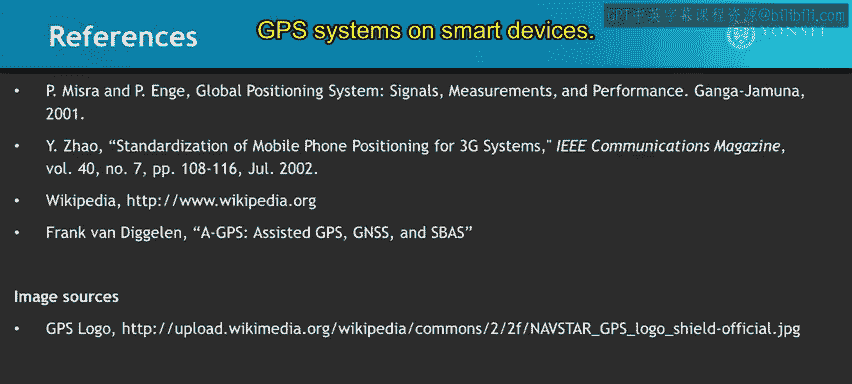

# 延世大学《新兴技术从智能手机到物联网再到大数据Emerging Technologies From Smartphone to IoT to Big Data》 - P43：7_2.4 传感器.zh_en - GPT中英字幕课程资源 - BV18hpFewEcG

Sensors that are used on smart devices。First， we'll start with accelerometerter。

This measures acceleration， the rate of change in velocity。

And it is based on a meMS micro electrolectromechanical system sensor。This has both electronics。

 microelectronics， and micromechanical modules inside。

These use gyroscope sensor information as well to make more precision information and data。

Applications include smartphones and smartwatches， which is definitely why we're studying this right now。

 in addition flight and driving stabilization， for example， for drones， airplanes， missiles， cars。

 buses， trains，You will see accelerometer being used。

Sensing measurements include acceleration due to the Earth's gravity。Inertial navigation systems。

Vibration， machinery rotation。As well as upright and tilted positions。And there's many， many more。

Then the gyro。In smart devices， they use gyros gyro is short for gyroco sensor。

This measures change in orientation and angular velocity。Some sensor types include。

Microchip packaged mems gyroscopes。 And this is the commonly used one that is in smartphones and smartwatches。

In addition， some other types of gyrosensors include solid state ring laser gyroscopes。

 fiber optic gyroscopes， and quantum gyroscopes， which can be extremely accurate。

Now I'm listing B3 down here because in the future。Not only microchip packaged MEM gyroscopes。

 but also these other types will find their way into various smart devices in the future。

 and therefore keep an eye on them and we'll see when they actually join into the microchip structure。

 assisting Me's gyroscope's technology。Heart rate sensor。

This is an optical infrared light sensor technology。And the operation mechanism looks like this。

 where infrared light is absorbed by blood and that is measured， how much is it being absorbed？

Then we look at the infrared light that is being absorbed and when it becomes darker。

 that is most likely because the blood flow amount has increased。

And that is when a heart pulse is done。 So when you have a heart pulse。

 you have more blood flowing and then the overall。Overall。

 absorption of the infrared signal becomes larger， and therefore the infrared light detection will seem somewhat of a darkening。

If you were to detect when the infrared light darkens and find out its period。

 that could be the estimated heart rate， and that is what the heart rate sensor technology is actually doing。

One thing you have to take a note into is that because you may want to share the same infrared light bulb。

 the same infrared LED light emitting diode that the camera uses to take pictures and video in dark places。

To use it for the heart rate sensor， then。For this reason， when you design a smartphone。

 you will see that。The camera， as well as the infrared light bulb。

 as well as the heart rate sensor will be all located nearby each other。

 and that is what commonly is done on smartphones where the main camera is。

 you will see an infrared light LED or a light bulb。

 and then you will see also the heart rate sensor closely located。Borrow meter。

Is used to measure atmospheric pressure。It is used in meteorology as well as atmospheric sensing。

The atmospheric pressure is used in altitude estimations。We have bar meters and pressure alt meters。

 and these two are slightly different， but their core technology is actually the same。

 so let's take a look at what these are。Overall， these two measure pressure of the atmosphere。

 a barmeter is normally considered to be a stationary sensor device that is located at a fixed location to measure very subtleal pressure changes that are occurring in the weather。

On the other hand， an Ltmeterter is more like a transportable barmeterter device。

 which is used for onite atmospheric pressure measurements。So in more precise terminology。

 when we say that we have a barmeterter on our mobile device， on our smartphone。

 it would be more likely to say that it's an altimemeterter。

A mes based altimemeter to measure the overall pressure changes。

 because altimeters are the transportable barmeter types。However， in a lot of the spec sheets。

 specification sheets， you'll see that it has a barmeter sensor。

 and the terminology is based on these definitions。

