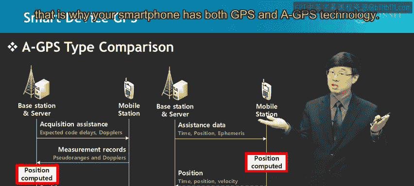
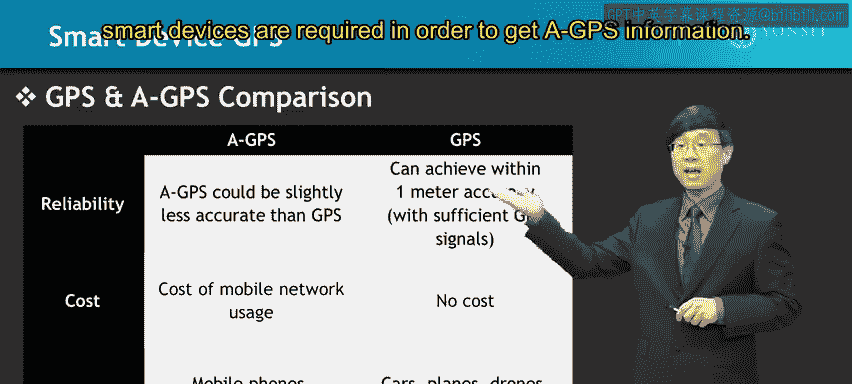
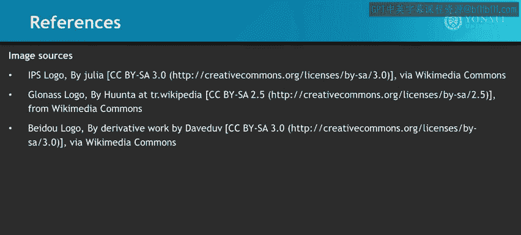

# 延世大学《新兴技术从智能手机到物联网再到大数据Emerging Technologies From Smartphone to IoT to Big Data》 - P44：8_2.5 GPS.zh_en - GPT中英字幕课程资源 - BV18hpFewEcG

嗯。🎼Yeah。GPS systems on smart devices。This is very important because locationbased services LBS are growing and in order to do accurate pinpoint location as well as positioning。

 you need to know overall your location as in terms of longitude and latitude where the sensors in the former lecture will show you how you're going to do acceleration as well as your altitude predictions can be done from those type of sensors Now let's take a look into GPS so that we have an overall view of how we can find out the position as well as the location with accuracy。

Global positioning system was created by the United States Army in 1978。

A GPS device communicates with four or more satellites。In order to determine its exact location。

The location， in terms of longitude and latitude。Remember that there is no altitude value inside here and that's why the barmeter is one of the sensors that are used in smart devices one thing that you need to notice here is that four or more satellites are needed in order to determine your position。

When you go into indoor cases， you may not be able to get single reception from four or more GPS satellites。

 then you have a problem， and also no value may be computed。

 no value in terms of your location coordinates。In addition， even though you may be outside。

In a very common scenario in urban areas where you're in a big city and there's tall buildings surrounding you then when you're in a location where you do not get view of four or more satellite signals that are supporting GPS information。

 then your GPS information may not be accurate or you may not get any value So in a lot of cases。

 when you're using GPS position and location identification。

 you may not be able to get your location information。

 it may take a couple of seconds to a couple of minutes and it may require you even to go into a different location where there is significant signals that you can detect that are being sent from the satellites。

So therefore， there is also the need for。Assisted GPS in where you do not have sufficient GPS signals。

 four or more for a sufficient amount of time to get your precision location then AGPS is needed。

 and that is why smartphones have AGPS technology on board。

This uses information from GPS satellites with help from position information from the mobile network assistant servers。

This works the same way as GPS。It provides longitude and latitude coordinates。

 and this is our final objective。And accurate time information from the mobile communication network is added。

 and this is very useful。There are two types of AGPS technology， MSA and MSA B。

 we'll first look at MSA since it starts with an A here， mobile St assisted。

This is a position calculation technology that is done by the server in the mobile communication network。

 where information is received from the base station delivered to your smartphone。

 your mobile station。The mobile station captures a snapshot of the GPS signals that it can。

 whatever it can， and this may not be for a lot of cases it may just one or two at most and receives help from the AGPS server in the mobile communication network。

The AGPS server has good GPS satellite signal reception and plentiful computation power。

 as well as a very accurate reference time clock。So what we're talking about is that the base stationation of the mobile communication network has a GPS detector。

It knows its location accurately and also it is going to help the mobile device within its cellular region to find its location because that mobile device。

 that smartphone does not have full reception signals from GPS satellites enough to calculate its position。

 This is when we have MSA A GPSPS technology come into activation。The way that MSA operates is first。

 the mobile station receives acquisition assistance。

Then the mobile service provider continuously logs GPS information from GPS satellites with help from the AGPS server。

Then the AGPS server calculates the position and delivers it to the mobile station to your smartphone。

Looking at it in a structure diagram here， first， the base station is connected to the server through the mobile communication network and acquisition assistance information is sent to the mobile station。

Then the mobile station， whatever GPS signals that it can receive。

 it will send that measurement record over there to the base station。

 which will deliver it to this server。Then the position is computed at the server。

 and that position is delivered back to your smartphone， the mobile station。

 This is the MSA technique。Then we have MSB is another AGPS type。 This is mobile station based。

And it works like this。 information is used to acquire satellite positioning signals more quickly。

 where supplies， orbital data and Almanac for the GPS satellites to the mobile stations。

It enables the mobile station to lock onto the satellites more rapidly in some cases。

And the mobile network can provide precise time information。

Let's look how MSB works in further details。Where the mobile station receives assisting data from the AGPS server。

 and the mobile station receives signalss from the visible GPS satellites。

 and it uses the information from the servers as well as the GPS satellite signalss that it received。

 and it combines it to calculate its position。Looking at here in a timeflow diagram。

 the server that is connected to the mobile communication network。

 which is connected to the base stationation， will send assisting data to the mobile station。

 your smartphone， then your smartphone will use GPS signals that it had been able to receive and combine it with the assisting data that it received from the base station to find its position to calculate its location。

Then it will report its position to the base station， which will deliver it to the server。

 This is MSB。Comparing the two types， you can see something like this where in MSA overall。

 the acquisition assistance information is sent from the base station to the mobile station and measurement records of what the mobile station was able to receive of GPS signals is delivered to the base station which is delivered to the server and the server is where the location is calculated and that signal is delivered to your smartphone in MSA type in MSB type of a GPS it is different as the server will send information through the base station to your smartphone。

 mobile station and your smartphone， your mobile station will use whatever GPS signals it can receive and calculate the position。

And then the final position will be delivered to the base station。

 which will deliver it to the server The key point here is that in MSA the location is computed at the server in MSB。

 the location is computed at your mobile station on your smartphone。

And that is the major difference between MSA and MSB in A GPSPS technology。

 because we have so many location based service applications that require precision locationing MSA and MSB。

 A GPSPS technology is very important。 That is why your smartphone has both GPS and A GPSPS technology。

So now let's look at these two GPS and AGPS and compare。

Starting off at the top single information GPS uses GPS satellite signals。

 AGPS uses satellite signals and assisting servers where their information is delivered through the base stations。

Speed wise， well， GPS may take several minutes to determine the location， but once it starts。

 it will be able to easily update， but in some cases if it had poor reception and also it's not able to find the location。

 then once it gets four or more GPS satellite signals。

 it may take a couple of seconds or even up to a couple of minutes to give you your location information。

However， for AGPS， normally it is faster because it gets immediate information from the base station that is connected to the assisting server。

And the base station and the assisting server are consistently updating their information。

 so therefore they can deliver it quicker。In addition， when it comes to reliability。

GPS can achieve within a 1 m accuracy if it has sufficient GPS signals and also。

 the reception is good on a clear day。 A GPS has a slightly less accurate。😊，Information。

 then compared to GPS。When you see GPS， one true advantage is that there's no cost， but for AGPS。

 you have to pay the mobile communication service provider if it's charging for AGPS services。

In addition， GPS is used in everything， from cars to planes to drones， to robots， to ships and boats。

Where AGPS， you need to have mobile communication service provided。

 it has to be where mobile communication services is provided and AGPS support is provided。

 so therefore typical places where you get mobile communication coverage is the range where A GPSPS will work。

 In addition， you need a smartphone。 you need a mobile phone。

 smart devices are required in order to get AGPS information。

Then Gs， Gs is global navigation satellite system， it is operated by the Russian aerospace Defense Force。

It is a satellite navigation system for vehicles and aviation navigation。Then there's BD S。

 which is the Beidou navigation satellite system。 This is China's second generation satellite navigation system。

And these are the references that I use， and I recommend them to you。 Thank you。

