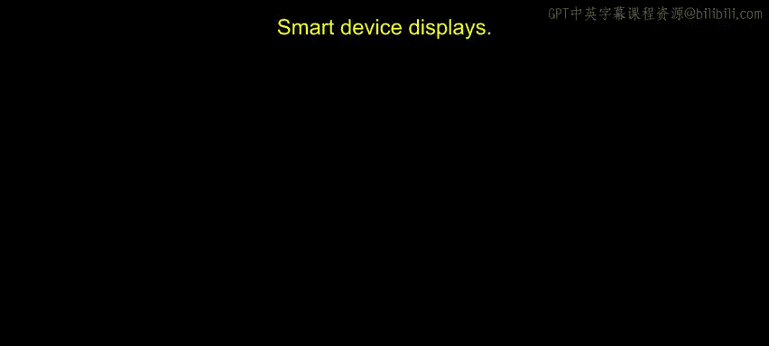
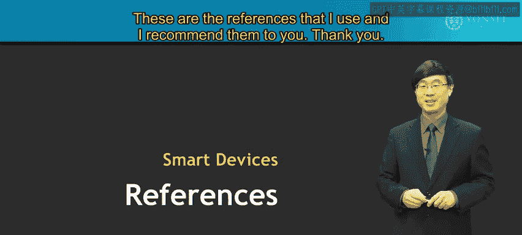

# 延世大学《新兴技术从智能手机到物联网再到大数据Emerging Technologies From Smartphone to IoT to Big Data》 - P45：9_2.6 显示器.zh_en - GPT中英字幕课程资源 - BV18hpFewEcG

嗯。Smart device displays。Starting off with shatter proof glass。It has a seamless interface。

 such that the surface becomes seamless in its overall shape。In addition， it provides a very smooth。

 luxurious field。 This is why it is perfect for smartphones。😊。

And that is why shaterproof glass is commonly used。

Gorilla glasss is a specialized toughened shatterproof glass that is scratch resistant。

It is there to prevent deep scratches。This is the reason is。For glass， even though it may be very。

 very hard and very difficult to crack， if it has a deep scratch that will be its weak point and if power is added to that weak point。

 then that may be the place where the overall glass will crack so therefore you need protection to prevent deep scratches to make it scratch resistant is very important and that will overall give you the feature of becoming shaproof。

This was introduced at the Consumer Electronic Show in 2013 by Cororney。A Laopphobic coat。

 This is used on iPhones。The physical property of a molecule that is repelled from oil。

 this means alaopphobic means fear of oil。This is used on smartphone surfaces for fingerprint resistant and anti smudging。

Overall， what happens is that。We have oil on our fingers。 In addition， we have oil on our face。

 as well as cosmetics have oils in it as well。 So when we use our smartphone。

 it will easily get oily on the surface。😊，To prevent this oil。

 a leopphobic coating is a mechanism where it will repel oil， so oil on your hand。

 oil on your finger， oil on your face will stay on your face and on your hand and not on the phone。

 so your phone will be shiny and clean。Although this is what is invested into creating the surface of your smartphone。

 a lot of cases people use protection， film and protection tape on the surface of their smartphone。

Defeating the purpose of this expensive high techch allopphobic coating。

 however that's what people want to use and that's what's done。 However， on your original surface。

 this allopphobic coating has a special purpose and a special feature that you may enjoy more。😊。

AE technology， this amE is active matrix organic light emitting di technologych。

 and amE and superamylE technology are some of the great products that Samsung Electronics is very strong at。

😊，Looking into the details， amE display technology is used in TVs and smartphones。

OL is organic light emitting diode。 This is a thin film display technology that uses organic compounds from the electrolummicent material。

And enhancements are shown in SuperamuleE， where this is with a integrated digitizer added on the AE display technology。

What does this mean originallyigin in smartphones， you had your amuleE display and on top you had a touch detection layer that was there。

 but this had some reflection characteristics In addition。

 this made we had the amE display an additional layer added on which made the overall display thicker。

 making your smartphone thicker。Therefore， instead of having this overlaid， an integrated digitizer。

 which is the touch sensing detection layer， is inside the amylE layer。

 that is what superamylE technology is all about what does this result Well the characteristics of having a thinner display making the smartphone thinner as well as lower power consumption。

In addition， improved sunlight reflection characteristics are achieved through superamle technology。

 and this improves the screen's outdoor viewing， making it brighter and easier to view outdoors。

Then there's superamE plus where the traditional RGB strip is used instead of the pentile RGBG matrix。

It provides a brighter and more energy efficient performance than superamulet。

And it's used in Samsung Galaxy S2 smartphones。Then comes HD superamE technology。

 where the HD resolution， which is above 1280 by 720 superamE display is supported。

The pentile RGBG matrix is used。And this is used in Samsung Galaxy S3 and Note1。

The full H superamylE is the next step in evolution of superamylE technology。

 and this is based on a 1080p H resolution superamylE display。

 where when we talk about H resolution at 1080p， this means that we have a 1980 by 1080 display number of pixels。

The pentile RGBG matrix with a new subpixel arrangement called Diad Pel is used in this full HD superamulet display。

This is used in Samsung Galaxy S4， S5 and Note 3。Then we have WQ HDD superamulet。

This is the WQHD resolution， which is above。25，60 by 1440 superamlet displays。

The pentile RGBG matrix is used and this is used in the Samsung Galaxy as 6 S7， S8， Note4。

 Note 5 and Note 8 The Note 8 is what we were looking into in its overall specifications so this is the state of Y and if you have a note 8。

 this is what you have on your smartphone。Looking at other display technologies that are used and these technologies that are now going to be explained in parts。

 of course， are already included in the superamule led display techniques in plane switching IPS。

 this is an LCD screen technology used for liquid crystal layer molecule orientation。

So it's arranging and switching between the glass substrates。

The characteristics are accurate color and consistent image from wide viewing angles。In addition。

 when the screen is touched， there's no tailing or lightning effect on the screen what do you mean by that well in older technologies。

 when you are touching a screen and you were moving your finger。

 you would see a tail of the light follow you around。That is what we call tailing。

 and these effects are eliminated using IPS technology。In addition。

 clear images and stable response times are achieved。LED backlit， LCD display。

The LED back lighting flat panel display technology is what is used。

And this is an improvement compared to the former CCFL， the cold cathode fluorescent backlit LCDs。

 these were the former version of LCD display technology。What you get， well。

 improved images with greater dynamic contrast and wider dimming ranges。In addition。

 it results in a slimmer screen， which results in a reduced weight。

More improvements include the RGB LED backlighting。 This results in a wider color gamut。

 What is a color gamut， This is the range of colors identifiable by the human eye。

 So this means you have more colors。We have the effects of reduced heat emission。

 which reduces power consumption。This results in more reliable and longer product lifespans。

These are the references that I use and I recommend them to you， Thank you。

