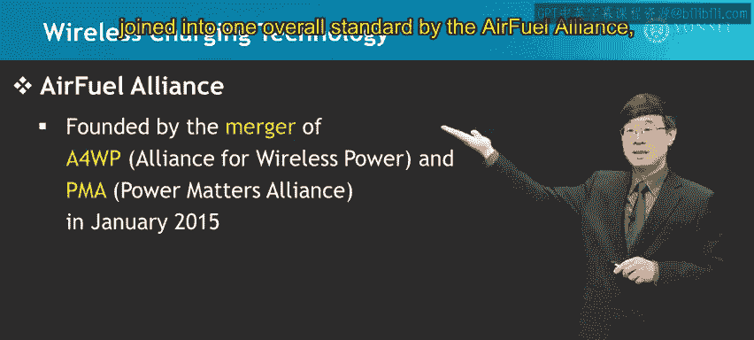
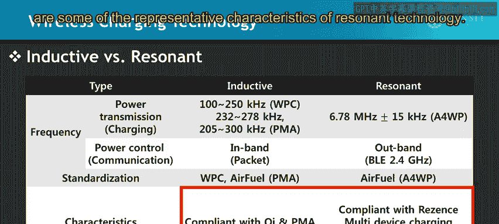

# 延世大学《新兴技术从智能手机到物联网再到大数据Emerging Technologies From Smartphone to IoT to Big Data》 - P46：10_2.7 无线充电技术.zh_en - GPT中英字幕课程资源 - BV18hpFewEcG

Wireless charging technology used in smart devices。We will start with WPC， Wire Power Consortium。

This was established in December of 2008。And it has the objectives of。

To create a universal wireless power charging standard。

That can enable various mobile electronic devices to be placed on top of a single power transfer pad。

And the technology was magnetic induction charging。

This uses the query standard and the key standard is。The Q， which comes from the Chinese letter。

 that means natural energy。The WPC standard for inductive electrical power transfer over distances up to  four centimeters。

The keyy has。A power transmission pad， as well as the power receiver， which is your smartphone。

The key has a low power standard， which is the baseline power profile that can transfer up to five wts。

Then it has the medium power standard， which is the extended power profile that can transfer up to 15 watts。

The PMA Power Matters Alliance。This is a global nonprofit industry organization。

That was founded by Proter and Gamble and Power Mac Technologies in 2012。

The characteristics include inductive coupling。Digital trans receiverceive communication。

And cloud based power management。Alliance for Wire Power， A4 WP was founded in 2012。

It developed the resent standard， which has this logo right here。

This is a interface standard for wireless electrical power transfer that is based on magnetic resonance。

 and you can see that resonances somewhat is similar to the word resonance。

Power transfer up to 50 wts， a significant power level， with a distance up to five centimeters。

The air fuel Alliance was founded by the merger of the A4WP and the PMA in 2015。

 both characteristics of the A4WP and PMA were joined into one overall standard by the air fuel alliance which uses this logo。

This developed air fuel Resonant and air fuel RF for wireless charging technologies。

The basic that you will see is that because of the two standards that merged。

 you have inductive versus resonant technology all combined into one。Air fuel standard。

 so therefore there are two modes that you need to consider the inductive and the resonant。

 which we will talk about now in this table。Inductive and resonant。 first。

 looking at the standardization for inductive， there's the WPC and the PM A。 But the PM A was。

A part of the merger that is now the air fuel Alliance。Then the resident is the A4WP。

 which was also included in the merger of the Airfield Alliance。Now。

 looking into the power transmission characteristics that are used in charging。For inductive。

 this ranges from 100 kilohertz to about 300 kilohertz based upon the standards of the WPC or PMA。

For Reant， you can see that it is at a higher frequency at 6。78 megahertz。

And that is based on the A4 WP standards。 This is for charging。

But when you go into power control that requires communication， then for inductive。

 this uses in band packet communication， which means that within this frequency range。

 we are going to exchange packets， however for resonant。

 this uses Bluetooth low energy BLE standard that communicates control packets at the 2。

4 gigertz range， because the power transmission frequency is not used for the power control communication mode。

 we call this outbe。Then the characteristics of inductive are compliant with Q and PMA。

 and for resonant， this is compliant with res。You can see that the characteristics of multiple device charging and free positioning are some of the representative characteristics of resonant technology。

These are the references that I use and I recommend them to you， thank you。

