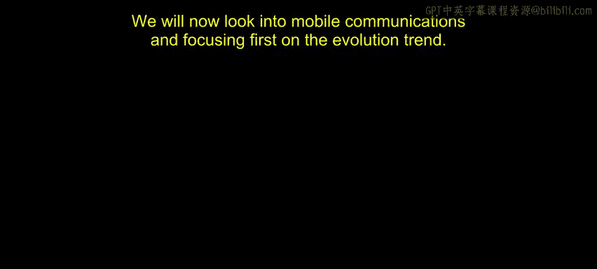
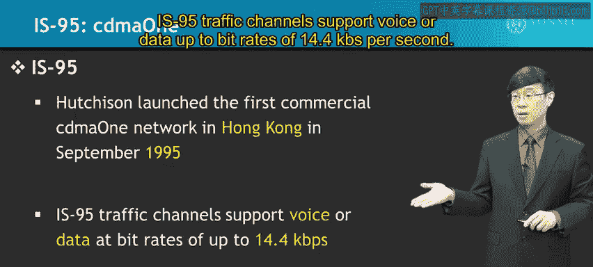
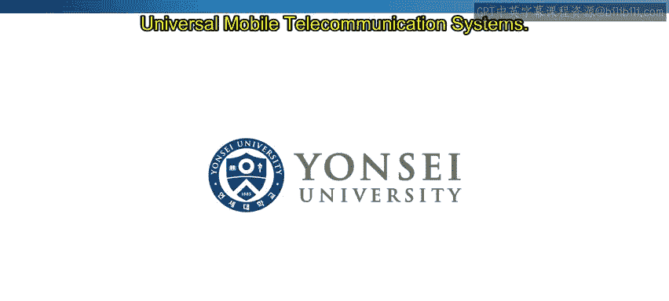

# 延世大学《新兴技术从智能手机到物联网再到大数据Emerging Technologies From Smartphone to IoT to Big Data》 - P47：11_3.1 移动通信演进（第1部分）.zh_en - GPT中英字幕课程资源 - BV18hpFewEcG

Yeah。🎼Yeah。We will now look into global communications and focusing first on the evolution trend。

We start off with A MP S， advanced mobile phone system。

It is a first generationeration mobile seller phone。 This is where the seller phone。

 the mobile phone all began。 These technologies are based on FDADMA。

 frequency division multiple access and analog， which means that the overall channels were divided into sub channelss of frequency based on frequency division multiple access and within a channel。

 the signal was sent in an analog way。 What do you mean by analog。

 typically the options that we have are frequency modulation。

 phase modulation and of course combining in some cases， amplitude modulation。

These were developed by Bell Labs and introduced in North America in 1983。Then we go into GSM。

 Global System for mobile communicationations。This is the second generation of mobile cellular phones。

 and this is based on digital technology。It was introduced in Finland in 1991， and。

It became a dominant global standard because once you go into digital。

 then you have a couple of additional features that you can do。 First。

 a digital system in wireless communication can provide air detection if there are errors in the communication you can find where they are and using that the reliability of the exchange information goes up number two。

 you can do compression。Number three， you can do time division multiple access。

 which gives us a great advantage and we will soon see that this is because once you do TDMA time division multiple access from the overall channels divided into subfrequ channels within one channel now you can have multiple users sharing that one sub channelnel based on time。

😊，It dominated the market over 90% and operated in over 219 countries and territories throughout the world。

GSM uses FDMA and TDMA combined。 FDMA is frequency division multiple access。 So therefore。

 the overall frequency channel that is assigned is divided in two blocks。 and these are sub channels。

Now， before in first generation， mobile cellular communication APS。

 one of these sub channelss had to be assigned to one user。So therefore it was very inefficient。

 but when we go into TDMA time division multiple access。

 then each one of these channels are divided into multiple time slots。

 so therefore for one subchannel it can be divided into multiple time slots which can be shared by multiple users so the communication efficiency of multiple users sharing a subchannel and the overall frequency domain became much higher and much more efficient and that is one of the revolutions that were enabled through FDMA and TDMA technology combined when GSM。

So evidently， you can see why it became so popular worldwide。

GSM services include voice communication， but it also includes data transfer。At 9。6 kilos per second。

 this is possible because we're using digital technology and digital technology is us ofable because we're using TDMA on FDMA architectures。

😊，You can also send short message services SMS becomes possible from here。

 these are the two data transfer and SMS。Become the two major features that are enabled on mobile cell phones based on second generation GSM technology。

In addition， they started to use SIim cards。What is a Sim card。

 A SIim card is a subscriber identity module。 It looks something like this。

Or when you buy a Sim card， typically， it may look like the big card。

 but then you can pop it out and have this small or that small thing pop out。

 which you can insert into your mobile seller phone。This is a detachable smart card。

It contains user subscription information， and addition， it contains phone books。

 so it's so convenient。What are the advantages？Well。

 SIM enables a user to maintain user information even after switching cell phones。

 what does that mean Well by changing one SIim card on a mobile phone。

 if you have two SIim cards and you exchange it， then you exchange your phone book as well as you exchange your identification to the mobile communication service provider。

 meaning that you can change your mobile cell phone operator while using the same mobile phone。

What does that mean Well， it based on what country you're in， let's say for in the United States。

 I have a cellular your phone and I have a SIim card。

 and typically what you can do is that I can change the Sim card which is connected to one operator。

 let's say Verizon Wi and I put in my T mobile。Sim card into it。

 Then I can start using T mobile operator communication services。 That is one option。

 What else does this mean。 Well， on the other thing is something like this。 I have multiple phones。

 and this is red。 This is blue。 This is white。 And based on my fashion for the day。

 which I'm black today。 Well， then I may want a black phone。 Then I get a black phone。

 and I put my Sim card inside， and then I have my fashion coordinated with my phone。

 You can do something like that。 So the Sim card enables you to have this option as well as changing the phone option。

 because it is like what Sim card you put into your phone activates that mode on your phone that is connected to the seller phone operator。

😊，Pretty cool， isn't it， And this is a major。Feature of GSM technology。

Then we go into a more advanced system， which is I 95。This is Interim standard 95。

 the first CDMA base 2G cellular standard。And we're talking about CDMA， what CDMA， Well。

 CDMA is co division multiple access。Meaning that instead of using FDMA and TDMA。

 we're going to use code to divide our sharing of the user frequency channel。

So this works well against narrowband interference and multipath single fading。

 So the quality of communication， the number of bit errors because we're using digital now in secondgen mobile phones。

 the number of bit errors can be reduced significantly interference is single interference from other devices because there are other devices that are using the same frequency in neighboring cells their signals can enter our cell。

 neighboring cell and interfere with my communication that my device。

 my device is having with the base station。😊，Then this type of interference can be eliminated。

 most of it can be reduced by using CDMA technology。Another advantage is multipath signal fading。

 When I send a signal from my mobile phone to the base station。

 then that signal will bounce off of walls and other objects around buildings。

 and it will arrive at the base station through multiple times。 making the signal smeared。

 In addition， the same thing is going to happen in the opposite way as well。

 The signal sent from the base station will reach my mobile phone through multipath fading。

 it will bounce off the floor， it will bounce off the wall and other places because of this。

 the signal。 When I send one signal。 It's like I get an echo of multiple signals coming in interfering with the signal that is going to with a bit that is going to be sent afterwards。

😊，So having a long tail， having an echo isn't good。

 and this eliminates that significantly the multipath signal fading。

 the signal will fade due to the multipath signal profile。

And that is eliminated a lot through CDMA technology， which makes the phones much high performance。

CDMA1 is a brand name for I 95 phones that were developed by Qualcomm。

Hutchson launched the first commercial CDMA1 network in Hong Kong in 1995。

IS 95 traffic channels support voice or data up to B rates of 14。4 kiloBs per second。

