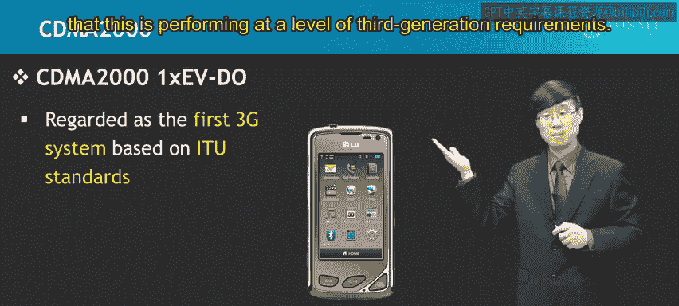
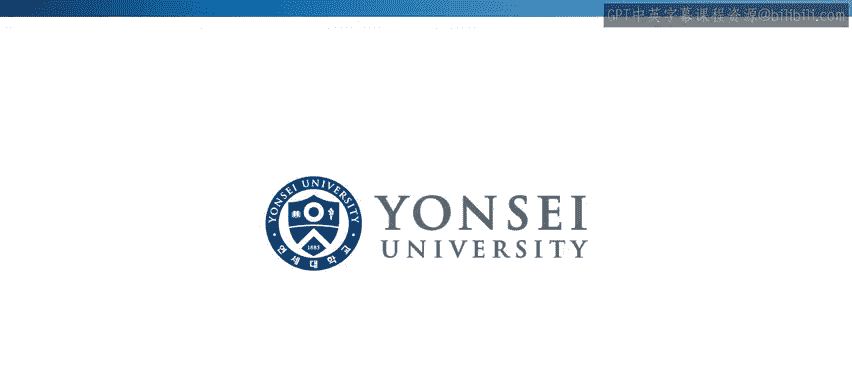

# 延世大学《新兴技术从智能手机到物联网再到大数据Emerging Technologies From Smartphone to IoT to Big Data》 - P48：12_3.1 移动通信演进（第2部分）.zh_en - GPT中英字幕课程资源 - BV18hpFewEcG

Yeah。🎼Yeah。Then we go into UMTS， Uni mobile telecommunication systems。

This is now entering third generation。And the evolution of GSM technology was used in UMTS。

This is good， having an evolution is good because if your technology is an evolution of the former technology。

 then。When you go into a mobile area， a cellular communication area that can support UMTS that's great。

 but what if UMTS was not installed in the overall area of the cellular region。

 what if it was only installed in the high density。

 highly populated areas and the other areas that are less populated， had the former 2G technology？

Either I 95 or GSM， then having a protocol， an evolution of former technology means that when you don't have UMTS。

 then if your device can find a GSM connectivity， it will use GSM。

 but when it goes into an area that UMTS is available， then it will use UMTS instead of GSM。

That is the option you have， and that's really good。 And you get this from having your protocol。

 you get it from having your standard， an evolution of a former standard。

We call this back compatibility。 It's wonderful。 And of course。

 in your phone that you're using right now， there are these back compatibility options as well。😊。

Uuttra is a supporting technology of UMTS， where it is UMTS terrestrial radio access。

 which supports several different terrestrial air interfaces。

Multius access in UtRA can be supported by Uttra， FDD， and TDD。

FDD stands for frequency Division duplex， and TDD stands for time division2plex。

 This is a more advanced technology than。😊，FDMA and TDMA。

 meaning that FDMA advancements are shown in FDD， and TDMA advancements are shown in TDD。

Then we have Y band co divisionion multiple access， WCDMA。

 This is a third generation mobile cellular system that uses Utra FDD mode。

It is based on the 3GPP released 99 standard， and it can send up to two megabits per second data rates。

As you can see， now that we entered the third generation standard before we were at tens of kilobits per second of the data rate that we could do。

 but now that we entered 3G， third generation mobile cellular communication。

 we are now seeing data rates at megabits per second levels。 This is great。

 So we are now in a new dimension of data connectivity。

 the first commercial WCDmaA opened in Japan in 2001。😊。

Semless mobility for voice and packet data applications were supported。

Quality of service differentiation for high efficiency of service delivery was enabled。

And simultaneous voice and data support was possible。These two components are very important。

 meaning that quality of service differentiation means that if you have a user that needs to have a higher data rate or a better quality of service。

 then it will be able to support it。This new technology enables you to control。

 to give a priority or give better services to a specific user using a certain application。

In addition， it supports voice and data together at the same time。

 meaning that you can send data and voice together。Meaning that during a phone call。

 you can receive text messages and things like that。 and that's really good。

It interworks with existing GSM networks， this back compatibility， of course。

Comes from that WCDMA is a evolution of GSM technology。 In addition， it is backwards compatible。

 which is really needed。CDMA 2000 is a third generation mobile cellular system。

 It was standard by 3GPP2。 we've seen 3GP on the former former page。

 which is the third generation partnershipship project。

 This is the group that standardized third generation mobile cellular communication。

 and there is a version two of this standard here。CDMA 2000 is an evolution of I 95 CDMA1。

It uses CMA and TDMA。 CMA is code division， multiple access。

The Y band CDMA on the former slides was Y band because the bandwidth given for CDMA technology was wider than 5 megahertz here if it's narrower than 5 megahertz。

 we just call it CDMA and this is what this technology uses。Initially。

 it was used in North America and South Korea。We have then1x EVDO added on CDMA 2000。

This is EBDO stands for Evolution data Opimized， meaning that we are trying to add on an optimized data communication technology as an evolution of CDMA 2000。

And it enables 2。4 megabits per second of a data rate across the mobile cellular network。

Here it was launched in South Korea in January of 2002。Looking into further details。

 this is regarded as the first 3G system based on IT standards。In other words。

In order to become and be acknowledged as a formal 2G， 3G or 4G or 5G technology。

 then you need to be certified and in that certification。

 there are certain levels of performance in data rate and other features that you need to satisfy。

And based on that， when it comes to third generation mobile cell phone technology。

 CDMA 2001x EVDO was the first device technology that was officially certified by the ITU that this is performing at a level of third generation requirements。

The ITU stands for International Telecommunication Union。

 This is the specialized agency for Information and communicationmunication Technology of the United Nations。

😊，Now， among the ITU agency， there is a dash T， a sector for telecommunication standardization。

 that is why when you see third generation， fourth generation or fifth generation technology。

 you will see it ITUT standardized or ITU T approved certified will be the terminology that you'll see and therefore it will be ITU with a dash T。

