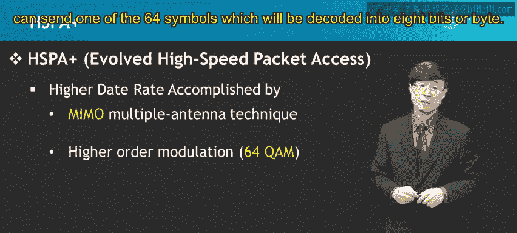

# 延世大学《新兴技术从智能手机到物联网再到大数据Emerging Technologies From Smartphone to IoT to Big Data》 - P49：13_3.1 移动通信演进（第3部分）.zh_en - GPT中英字幕课程资源 - BV18hpFewEcG

Yeah。🎼Yeah。Then we have HSDPA， which is high speed downlink packet access。

This is an enhanced 3G mobile communication protocol。

It is an evolution of UMTS for higher data speeds and capacity。

It belongs to the HSPA family of protocols。 HSPA is high speed packet access。

 so in high speed packet access， you can have high speed downlink packet access。

 and also there is a HSUPA， which is high speed uplink packet access。

Now downlink is from a base station， the signal comes down to your mobile cellular device that's called downlink and typically because base stations are located on big towers or on top of buildings so their location is higher and they're connected to the backbone network so therefore they are a higher entity both in location and connectivity to the network so we call from base station coming down to the mobile device。

 this is downlink and the signal that your mobile cellular phone device sends to the base station that's called oblink。

Of course， in some cases， the base station is located at a lower position than the mobile device user that could happen。

 of course。High speed downlink packet access had its commercial network available in 2005。

 The peak data rate is at 14 megabits per second。 That's based on release 5。 As you can see now。

 the data rates are going into the tens of megabits per second based on this new technology in 3G advancements in 3G。

We have ED deal revision A， where the peak data rate for downlink is 3。1 mebit per second。

 and the uplink is 1。8 megabit per second。 Both downlink and oblink are in the megabit per second range。

This was launched in the United States in October of 2006。

 and this is an example of some representative mobile seller phones。

And one major feature is voiceover IP， supported based on low latency and low bit rate communications。

Now， voice over IP is having your voice sent over the traditional network。

But you have the option of voiceOver IP means that your voice signals can be put on IP packets and transferred as well。

 so you have the traditional network of TDMA based voice communication on your backbone network or you can use the IP based internet type connectivity in the mobile cellular network。

This means that。Based on this technology being implemented。

 starting from thirdgen mobile communication cellular networks。

 they had both the traditional based TDma for voice support。

 but also they have the IP based network connectivity supported as well these network technologies are called Gran for the traditional one and Uran for the IP based technology and third generation mobile networks have these two networks overlaid in areas to support both non- IP based technology。

 but also IP based technology， and also we have IP based data。

 but now we have IP based also for voice， that's the voiceover IP you see right there。

Going into further details， enhancedh Access channel Mac。That's medium access control。

Where decreased connection establishment time is enabled。

 multi user packet technology enables the ability for more than one user to share the same time slot。

Now， we did talk about having frequency channels divided by FDMA。 And then in one sub channelnel。

 we had time slots for TDMA， where a user was assigned an occasional。

 a periodic time slot to use for uplink and downlink。

 Now we're talking about even for one of those time slots。

 there are a way such that that could be shared for multiple users。

So automatically the efficiency that we have of using the same channel goes up because we now have sharing of resources。

 which is great。And the quality of service flags included for quality service control。

 meaning that there were flags that were used inside such that you can control assignments of quality of service。

Now， I do need to mention that channel Mac， medium access control。

 This is used such that you can share the same time slots。 Medi access control is a technology where。

You look at a certain resource of time， space or frequency or code。

 and you make a decision how to use that intelligently such that you do not mess up other users。

 you do not interfere with them such that you can accomplish communication while theyre accomplishing their communication needs。

 that is the technology of medium access control which means Mac。

 and using that we have time sharing of time slots available。

Looking into HSPA plus having that small plus at the end automatically should mean that it's better。

 Well， evolved high speed packet access， it has that word evolved based on that plus that we have there。

HSPA+ all IP network first launched in Hong Kong in 2009。

 meaning that now we have this mobile cellular network is all IP based。

So we can interface that IP based network very conveniently with the internet in that area。

HSPA+ uses YB CDMA， which is UMTS based 3G technology and its enhancements。

HSPA+ is a HSPA evolution automatically you know that just from the name。

The peak data rate goes to 168 megabit per second for the downlink from the base station to your mobile cellular phone and the oblink is 22 megabit per second。

 Now the evolution is evident here。 The peak data rate。

 you see the data rates right here are now going into hundreds of megabits per second supported for the downlink from the base station to the mobile cellular device and the uplink is now in the1 a comfortable in the range of the tens of megabit per second as well。

 that is from the mobile device up to the base station。You may be thinking。

 why is a downling always larger than the obli？And that is because the downlink is a signal that is sent from the base station to your mobile cellular device。

 The base station has a lot more power。 It is placed on a higher location commonly means that it has a better channel in front of it to send down to the mobile cellular device So therefore higher data rates can be accomplished due to these advantages where the uplink is a signal from the mobile cellular device up to the base station the mobile cellular device has a small battery。

 it cannot send signals that strong because it's nearby its human user which you need to be aware of radiation issues。

So therefore and also its position is lower， it may be between or inside a building as well。

 So the single reception back towards the base station is not as good。

 That's why the uplink number of data rate， the size of the data rate is always lesser than the downlink。

What enables this higher performance， it is Mimo technology， or they say Mimo technology。

 This is multiple input， multiple output。 What are the multiples。

 These are the number of antennas that are applied to the communication link。

 as in terms that we have multiple antennas used at the receiver as well as the transmitter to coordinate communication。

😊，Why Mimo？Mmo uses uncorrelated multiple antennas。

 both at the transmitter receiver to increase the data rate while using the same single bandwidth as a single antenna system。

From this statement， you can tell that before on your mobile cellular phone。

 it used only one antenna and at the base station， the base station may have multiple antennas。

 but only one of those were used to send a signal and receive a signal with you。

So therefore we had one antenna and one antenna communicating with each other to support the needs that we had for all of the former communication techniques。

 but starting from this， it uses the MImo or Mimo technology。

 which enables a higher performance through multiple antennas。

 meaning that now I have multiple users sharing multiple antenna sets at my mobile device as well as the base station。

 this is well coordinated in here to accomplish much higher data rates。Now。

 please note that this data rate is the peak data rate。

 meaning that this is the maximum data rate that can be sent for users。So therefore。

 the peak data rate may not be exactly what you get supported for your mobile device。

 this technology may share this peak data rate among multiple users flexibly。

The higher data rate is accomplished by Mimo technology， which uses multiple antenna techniques。

It uses also high order modulation 64 quam now 64 quam is a technology where each symbol that I send has multiple bits。

 64 symbols recorded inside where I select one of those 64 to represent a bunch of bits that are sent together in one transmission symbol。

 typically when you say 64 quom。😡，Two to the power of8 is 64。

 That means that I have8 bits R1 byte is actually mapped into one modulation symbol and each time I can send one of the 64 symbols。

Which will be decoded into 8 bits， a byte。

Dual cell HSDPA is used to combine multiple cells into one。

