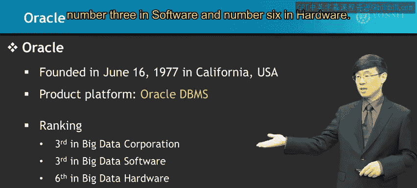
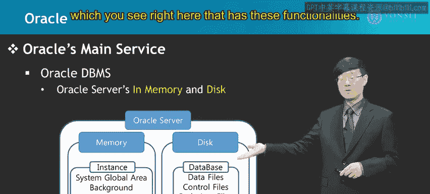
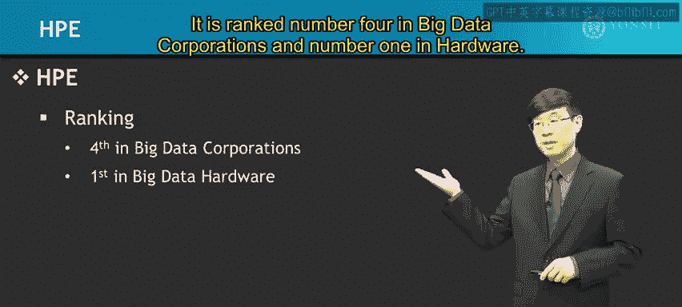
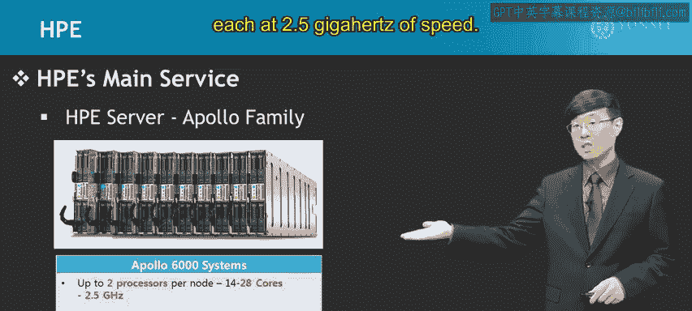
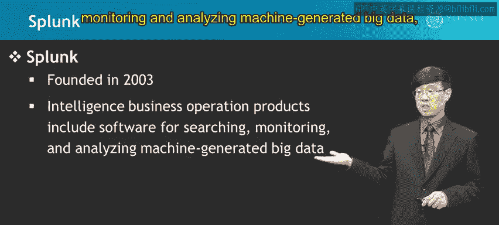
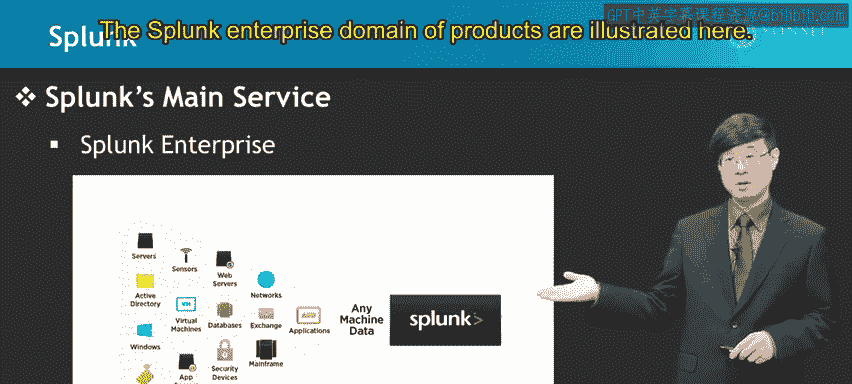
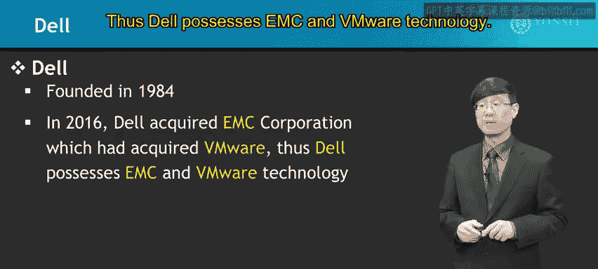
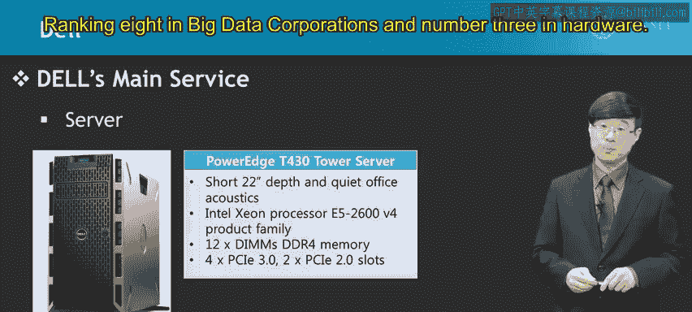
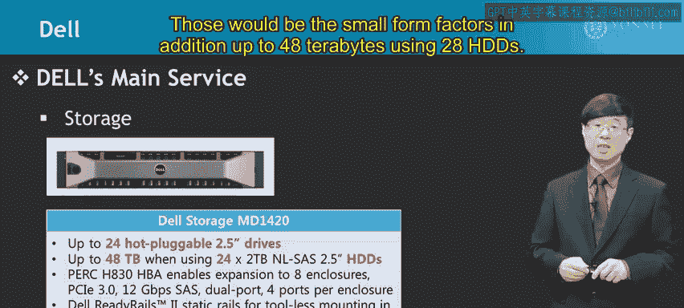

# 延世大学《新兴技术从智能手机到物联网再到大数据Emerging Technologies From Smartphone to IoT to Big Data》 - P4：3_1.4 Oracle 1.5 Splunk 1.6 Accenture 1.7 Dell 1.8 Teradata.zh_en - GPT中英字幕课程资源 - BV18hpFewEcG

Yeah。Oracle was founded in 1977， and it has a product platform， the Oracle DDMS。

It's ranked number three in big data corporations， number three in software and number six in hardware。

Orracle DBMS is Oracle Server in memorymory and disk system。

 which you see right here that has these functionalities。

HPE stands for Hewlett Packard Enterprise。It is a part of the Hewler Packard Company that was founded in 1939。

In 2015， HP divided computer manufacturing and sales to HP Incorporated and cloud services to HPE。

It is ranked number four in big data corporations and number one in hardware。

For HPE servers， there's the Apollo family。 we have the 2000 systems， 4000 systems and 6000 systems。

Where you can see some of the specifications over here， this have different amount of。

HDD and SSDs that can be included。 The processing capabilities are different。

 and also some may have hot plug drives where you can select what you're going to use。

Looking into further details。For the Apollo 2000 systems， the details are listed here。

 which it has up to four hot pluggable server nodes， and the memory is 1。5 terabytes。

And you have up to 24 small form factor。Components where you can select among HD or SSD。

In the Apollo 4，000 systems， you can see in the specifications 28。

 large form factors and 54 small form factors where H plug drives can be used。On the 6，000 systems。

 you can see two processors per node， up to 28 cores， each at 2。5 gigahertz of speed。

For four small form factors， either HD or SSD， you have that option。

 as well as a memory option is written down below。In the store E 1550 storage systems。

 you can see the number of users that can be supported。In addition。

 the network controller and the storage capacity， these options are provided。In the memory module。

You have HPE8 gig device and the capacity as well as the memory size is recorded here。Slunk。

Slunk was founded in 2003。Intelligent business operation products include software for searching。

 monitoring， and analyzing machine generated big data。

Provides web style user interfaces。And its ranks six in big data corporations。

 and number two in software。The Splunk enterprise domain of products are illustrated here。

For collect and index data， all data types are acceptable and can be indexed regardless of format。

 location， metrics， logs， click streams， sensors， web servers， applications。

 and others for search and investigate， Splunk search processing language enables powerful searching of data and information。

Crelate and analyze， relationships between events and activates are revealed and analyzed。

Visualize and report， trends and characteristics are easily visualized in custom dashboards。

 business and operational and security reports are fully supported。For monitor and alert。

 real time alerts and automatically trigger notifications through email or RSS are easily set up In addition。

 access from anywhere is provided secure access for administrators and users can be done anywhere。

Acenture。Was founded in 1989， it provides management strategy， consulting， and big data solutions。

Solutions provider in strategy， consulting， digital technology and operations。

Its is ranking number seven in big data corporations and number two in professional services。Dell。

Was founded in 1984， Dell acquired EMC。And EMC had acquired VMware。

 which is a cloud computing technology company。Thus， Dell possesses EMC and VMware technology。

Manufacturers， sales， repairs and services， PCs， servers， storage and cloud software。

Ranking eight in big data corporations and number three in hardware。

The power edge， power server。The specs are written out here。Then for the Dell storage system。

 you can see 24 hot pluggable 2。5 inch drives， those would be the small form factors， in addition。

 up to 48 terabytes using 28 HDDs。

Teraraada。Was founded in 1979， it provides management， strategy and consulting。

The product platform is the Terraadata in Telecloud。

It ranks number nine in big data corporations and number four in。Professional services。

The IntelCud provides advanced secure managed cloud technology。

Intellicloud service deployment options include the Intelflex and the Intelli basease。

These provide big data software support for Terraadata database， Astra Analytics， Hadop Systems。

 as well as Amazon Web Services and Microsoft Azure platformsform。

These are the references that I used and I recommend them to you， Thank you。

