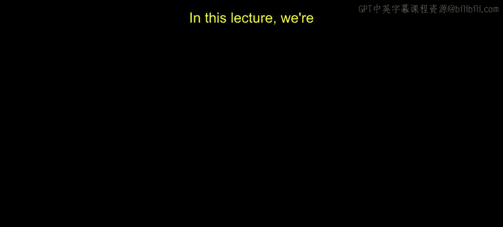
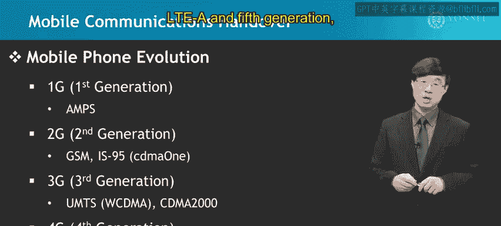
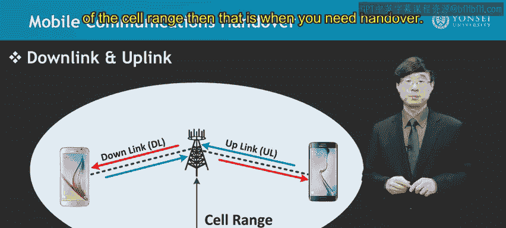
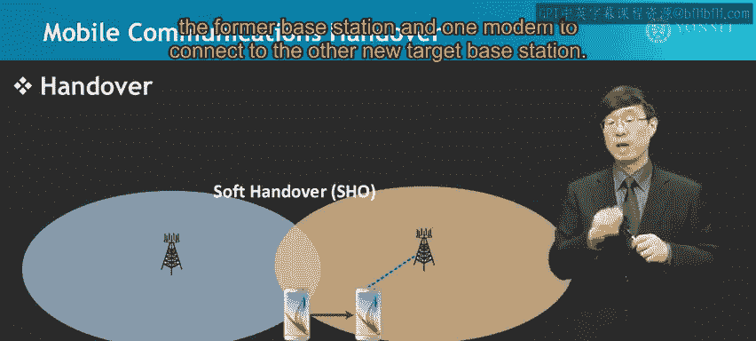
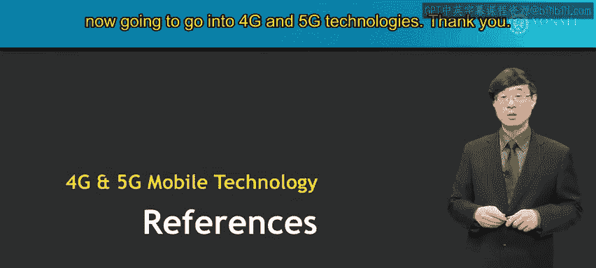

# 延世大学《新兴技术从智能手机到物联网再到大数据Emerging Technologies From Smartphone to IoT to Big Data》 - P51：15_4.1 移动通信切换.zh_en - GPT中英字幕课程资源 - BV18hpFewEcG

嗯。In this lecture， we're going to focus on fourth generation and fifth generation mobile technology。

 but before we go into the details， we're going to first cover the details about handover techniques。

Mobile phone evolution， we already covered this。 however， going over it briefly again。

 first generation was AMPS technology。 Second generation was GSM and I 95 based technologies。

 which included CDMA1。Third generationration Tech， UMTS， which included WCMA technology and CDM 2000。

 were included。Moving over to fourth generation， it included LTE technology， however， LTE。

 the specifications as in terms of data rate and delay components were not sufficient to be fully acknowledged as a fourth generation。

 however， when carrier aggregation and other techniques were added。

 LTEA does qualify as a fourth generation technology we'll go over the details in this course。

 focusing on LTE， LTA and fifth generation 5G technology in detail。

Looking into downlink and oblilink first。Downlink is the signal from the base station to the mobile device。

Normally a base station is located on top of a building， the station itself is very tall。

 or it's located on a roof or some other position that can give good reception over a wide area。

 naturally that would be someplace high because of that the base station is normally at a higher position than the users。

 not always but normally it is。So therefore， you can think of it this way where downlink is from the base station to the mobile user。

And Uplink is from the mobile user's mobile phone or from a laptop。

 tablet or other device up to the base St。And we will be using downlink and Oblink in reference to this model right here。

In addition， there is a cell range， and this is the range of a signal that you can establish a sufficient ob LinkedIn downlink connection from a mobile device to the base station based upon signal strength。

So therefore， the cell range is also a very critical component that determines handover when handover is needed。

 this is because when you reach the edge near the end point of the cell range。

Then that is when you need handover。

First of all， near the cell edge from the blue cell to the orange cell right here。

 the first case is hard handover， hard handover is when you go to the cell edge there of the blue cell。

 and that's when the single gets weaker。Then you find connection to another cell and instantaneously switch over from the former cell to this new cell base station。

The time that you disconnect and connect is done instantaneously。

 but you make a clear decision when you're going to switch over。

 and this is why we call it hard hand over。And when you move into the new cell。

 then automatically you're just connected to the new base station and use connectivity to receive voice and data communication for various applications。

In soft handover， the case is a little bit different。

When you approach the cell edge of the blue cell and you enter the range of the orange cell。

 then at this situation， you establish a new link before you disconnect to the former link。

And we also call this make before break due to this reason。Therefore。

 at one moment near the cell edge， you're connected to both base stations。 and then。

As you move into the territory of the new base station。

 then you just use the link connection that was established。

And disconnect the former one with the former base station。 This is called soft handover。

 It uses make before break， and it maintains connectivity to both base stations at one instant。

Because you're going to maintain connectivity to both base stations at the time that you're conducting handover。

 most likely these devices would require dual modems。

 one modem to connect to the RF link of the former base station and one modem to connect to the other new target base station。

These are the references that I use and using this information。

 we're now going to go into 4G and 5G technologies。 Thank you。

