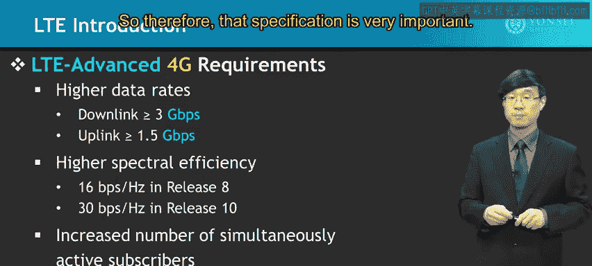
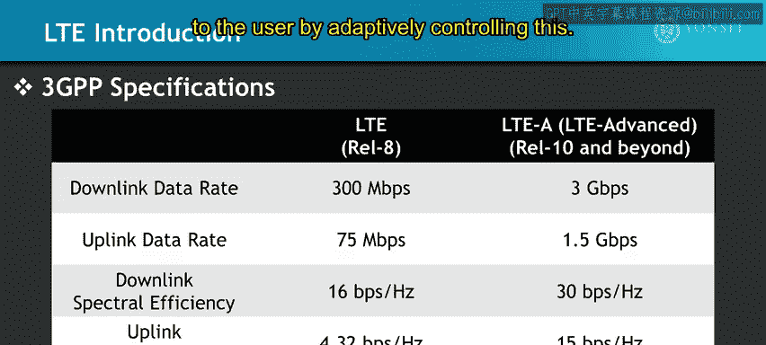
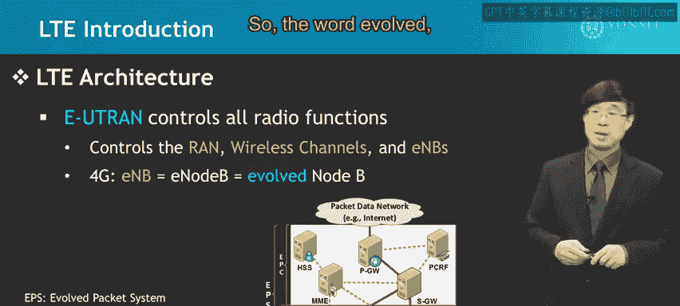
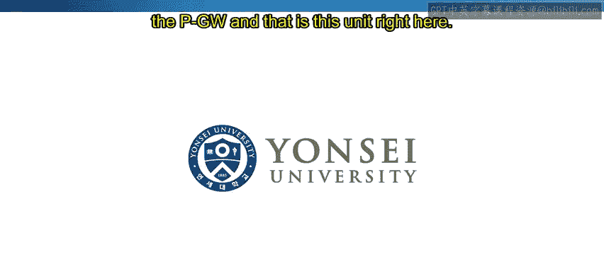

# 延世大学《新兴技术从智能手机到物联网再到大数据Emerging Technologies From Smartphone to IoT to Big Data》 - P52：16_4.2 LTE简介（第1部分）.zh_en - GPT中英字幕课程资源 - BV18hpFewEcG

嗯。We will now look into LTE Induction， where LTE stands for long term Evol。First， the requirements。

 which are based on the data rates。The downlink data rate target is 100 megabits per second。

 and the oblink data rate target is 50 megabits per second。It has to have low latency。

 less than5 milliseconds。And high spectral efficiency， in addition， spectrum flexibility。

 meaning that given the bandwidth that is given to you， based on the users that need more。

 some users need less， you can dynamically and adaptively adjust how much you support to the individual users。

Comparing this to the fourth generation technology， LTE Advanced， or for short LTEA。

The target data rate becomes 3 gigab per second for downlink and 1。5 gigabs per second for uplink。

As you can see here for the downlink and uplink target data rates are in the gigabbits per second range where for LTE we were in the tens to hundreds of megabits per second a dimension of a difference there so therefore as you can see these data rates qualify as fourth generation technology。

 that is why LTA is considered true 4G technology。In addition， based on release8。

 the spectral efficiency was at 16 ps per second per hertz where the new released 10 standards。

Enabled it to go up to 30 piss per second per hertz。

 and this is released 10 standards are the core standards for LTA。In addition。

 an increased number of simultaneous active subscribers can be supported。

This is possible because the target data rates are downlink at 3 gigabits per second， uplink at 1。

5 gigabits per second due to the broader bandwidth that was provided in data rate。

 this could be shared by more users and therefore an increased number of simultaneous support is possible。

In addition， improved performance at cell edges， at least 2。4 bits per second per Htz per cell。

 So this shows another specification that is a very important improvement。

 This is because at the cell edge is where the signal is the weakest。

 That's where handover is required。 That is the so-called weak point。 The bottleneck。

 the aculus heel of any mobile communication technology。

 because that's where the signal is the weakest and the performance is the poorest。😊。

So what is the minimum level of quality that I can support at my weakest point determines my overall quality as in terms that that weakest point would be my lower bound。

 so my performance would be my lower bound and above。

 so therefore that specification is very important。

Looking into 3GPP specifications first， let's compare them a little bit side by side in this table。

 First of all， LTE based on releasease 8 and LTEA based on release 10 and beyond。Where。

The downlink data rate is for LTE 300 megabits per second， for LTA3 gigabbits per second。

 a significant improvement。For the uplink， it is 75 megabits per second for LTA， it's 1。

5 gigabbits per second。For the downlink spectral efficiency。

 it is at the range of 16 pis per second per hertz。

 where for LTEA it is at 30 pis per second per hertz。For uubbling spectral efficiency。

 LTE is in the range of 4。32 bits per second per hertz。

 where LTA ranges into the 15 bits per second per hertz， significant improvement。Bandth wise。

 LTEA can use 1。4 megahertz， 3，5， 10， 15， 20 megahertz bands。Where for LTA。

 you have much more flexibility in a continuous way。

 so you can provide the right amount of bandwidth to the user by adaptably controlling this。

Now we will look into the LTE architecture， the LT architecture is also what LTEA uses as well with some enhancements。

 and we will talk about that of course， in the following lectures when I focus more on LTA but first the common shared technology is in here LT architecture。

 which is based on a network that looks like this， you see these blocks and they are。

Divided into big chunks， which has the EPS and the EPC and EU trend written there those acronyms stand for EPS stands for the evolvedd packet system。

 EPC， which is this top part stands for Ed packet corere， and the EU trend is a lower part。

 which stands for E Univerterrestrial RAN Rad access network。Now， as you can see from this structure。

First of all， the user equipment UE is what we get to use， so therefore it is very important。

 it is the most important to us， so we look into it it will be our smartphone， smartwach。

 smart car like an untonomous vehicle。Tablet or pad。It could be like a laptop or PC。

 as well as a IoT device or a drone。Then for ITS intelligent transportation systems。

 as well as CPS cyber physicalical systems， in ITS intelligent transportation systems。

 there's the onboard unit and the roadside unit devices。

 and these are the devices that definitely would qualify as user equipment of the LT network。

Then there's the units of the EPS， which include two units of the EPC and EU trend。

 as explained before， going into some of the details you can see that these are the two units that are included inside。

Where the EPS therefore is like the entire system that is connected to the internet。

 it includes the unit of the EPC， which is the unit that controls network services and connectivity of the UI。

 your device that connects to the internet right here and the network connections are supported by the EPC they are the main units and you can see these unique blocks that have names。

Which you can see P， G，W， H S，S， M， M，E， S， G，W， and also PCRF。

 We will definitely go into the details of these units。

Semless connectivity during handover is supported by the EPC。In addition。

 the EPC is focused to minimize the packet delay and packet loss。

Going a little bit lower is the unit， which is called the EU trendren。

 which stands for the evolved Universalterrestrial Raio access network。This terminology comes from。

 it is controlling the radio access network， in addition the wireless channel and the En Bs。

The En Bs in fourth generation mobile communication terminology， this is we write it as an E and B。

 which stands for En B， which is short for evolved node B。So the word evolved。

It's an evolved node B。 Well， that means that there must have been a node B before。 And， yes。

 there is。 In third generation mobile communication。

 we call the base stations that you see right here。 We call them node B。

And for short N B is what we use。Before that in like second generation mobile communication。

 like in GSM， well， they use BTS base trans receiverceive station。

 the trans receiver is a combined word of transmitter and receiver into one word。

Then in first generation communication at the beginning， like in APS。

 the base stations were called just the base stations。

You may be thinking why do we have these different names for the same unit that is used to support the cell Well it was intentionally named something different the reason is because every time you write a standard you do not want to have to write first generation base station second generation base station third generation base station instead of doing that we just give them unique names and that's what the standardization committees do when they get together they give it a name that is unique so when they say that name evolved node B or node B just by listening to the name you know exactly what standard it belongs to 4G3G2G1G in addition you know the basic set of functionality data rate and other requirements that are included。

So that's why the names are unique。 They were done that way intentionally。

