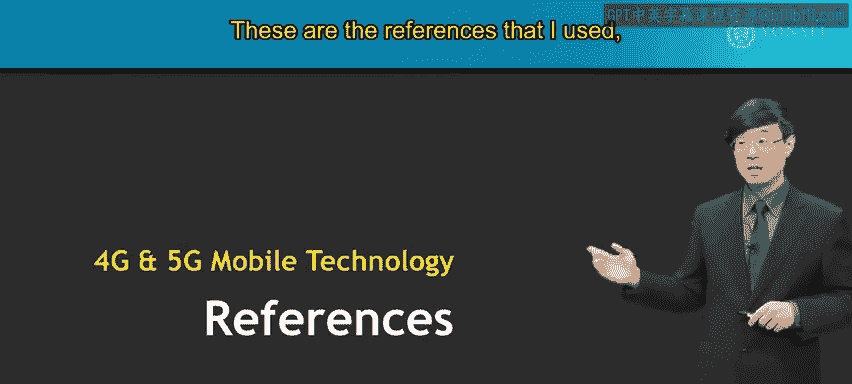
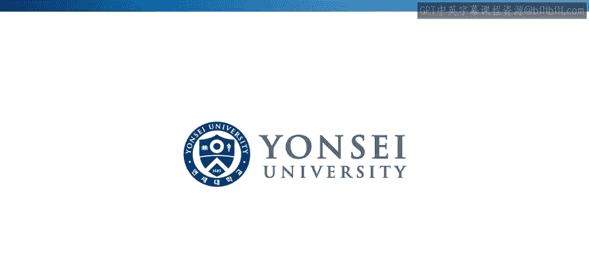

# 延世大学《新兴技术从智能手机到物联网再到大数据Emerging Technologies From Smartphone to IoT to Big Data》 - P53：17_4.2 LTE简介（第2部分）.zh_en - GPT中英字幕课程资源 - BV18hpFewEcG

Yeah。Yeah。We go into the packet data network gateway， the PGW。 And that is this unit right here。

 It is the unit that connects the overall Eps to the Internet。So it is a critical unit component。

IP address allocation for the UE is given from the P gateateway。In addition。

 it is the mobility anchor for non-3GP handover now what do you mean by non3GP handover the basics that you're looking right here are based on a 3GP standard and this 3GP standard I will explain a little bit later where this is the standardization organization that focused on standardizing third generation mobile communication technology and it continued on to standardize both fourth and fifth generation mobile communication technology as well。

But since it started as a third generation partnership project， which is the acronym 3GPP。

 where it came from。It has the name of 3GPP。So when we say non3GP handover。

 we're talking about to Bluetooth， to Wifi， as well as other techniques that were not a part of the 3GP standard for 3G or 4G or 5G。

So therefore， if you're communicating using WiF and you want to connect and now you need to do handover too。

LTE， or you were using LTE and you were doing like voiceover IP。

 and then you switched over to use Wifi for your connection to continue on with your voiceover IP session or video chat。

 then that would have to be done by support of the P gateway。

Then policy enforcement and quality of service enforcement are conducted by the P Gateway。

In addition， packet filtering is also supported。I do need to mention that for P Gway。

 in some places you'll see PDN Gway with a hyphen or PDN gateway without a hyphen。

Now the PDN stands for this right here， packet Data Network and Gateway is the GW。

 so that's why in some papers， documents， white papers， specifications， you'll see PGW with a hyphen。

 PDN GW with a hyphen or PDN GW without a hyphen， but I want you to know that they're talking about this guy right here。

Going into the second unit block， which is critical， the serving Gateway， the SGW。

The serving gateway is in control of packet routing and foring。

It is the mobility anchor for InterEode B handover what this means is that for this example。

 in this serving gateway， you see two Eode bes connected。Then if the UE is doing handover。

 it is right there at the edge of the two cells。If it's conducting handover。

 either soft or hard handover， then this serving gateway will support the anchoring of the switchover because these two EOBs are connected to this serving gateway。

 it is appropriate to do the anchoring that will do the handover support。In addition。

 it collects information for charging。 That is， of course， important。

 Mo communication service providers do it to make a profit。 So therefore。

 charging is the most critical thing for them。Then comes the mobility management entity， the MME。

 which is this unit right here。 You can see that it's connected to the serving gateway。

 as well as on the backside， it has the HSS that is connected to。

User authentication is done by this unit。It confirms the user that it is a valid user and we should allow it on our network。

😡，Then the roaming services are done Natural roaming is mobility support you're roaming to other locations。

 you want to find that even though this user is in a different country or a different territory that he or she normally does not go to you want to be able to quickly identify that user and make and support connectivity that is what we mean by roaming and of course roaming is a critical component of mobility management。

It controls and processes the signaling between the UE and the EPC。 The UE is your user equipment。

 The EPC is this unit， the block above here。You need to note that when we say signaling。

 signaling is the control messages that are sent back and forth。

 they include various control information that supports switching。

 handover and quality of service support for the mobile device。

The next unit is the home subscriber server。It contains a database that supports user subscription information。

One way to understand the HSS operations and what it actually does is to compare to 3G processing blocks of the 3G network。

 and one is the HLR， which is the Home location register and the AUC。

 which is the authentication center that were both major blocks that supported the third generation mobile communication networks。

Looking into the details of these two will give you an idea of what the fourth generation LTE network HSS actually does。

First of all， the HLR in 3G networks， this stores all user subscription information as in terms of user ID。

 mobile phone number， address， and other things。Then there's the 3G system， AUC。

 which is the authentication center， this controls the security information based on user identity keys。

 in other words like your user identity， based private keys。

 public keys are used for security for control signals and data communication when needed。

Mutual network and terminal authentication is conducted using these identity keys。

What this means is that it's mutual。Such that when a network is going to allow a user UE to connect to it first。

 the network will authenticate that that user is a valid user number two。

 when the user connects to a network it checks the network if this is a valid network if this is the right network that I should use because once again。

 in many areas we have more than one mobile service provider So therefore you want to connect to the right network and that is what we mean by mutual where the network checks the Uv。

 the user equipment and the UE checks the network should I connect。

 should I approve this connection when both approve each other that's when mutual authentication is processed and the user and the network are connected together。

Radiopath ciphering and integrity protection are conducted by the AUC。

These two units of the HLR and the AUC is what the HSS does together in LT networks and this way you can understand both what was going on in 3G and what is going on in 4GLT networks。

There is the other unit， which is this one right here， that is the PCRF。

 the policy control and charging rules function。Qualality of service and charging policy control is conducted by this unit once again。

 mobile service operators are there to make a profit， there to make money。

 and you have service plans that the user will preregister for and have a monthly charge at maybe a discounted rate based on a guaranteed user length of how many months。

That is what we talk about user based service plan and based on your service plan。

 it will determine what type of quality of service and how much you've been using it will be tracked so。

If you need to pay more where you use above your service plan limits。

 then the pricing and all the other rates will be appropriately charged based on the PCRF tracking functions。

😡，These are the references that I use， and I recommend them to you。 Thank you。

