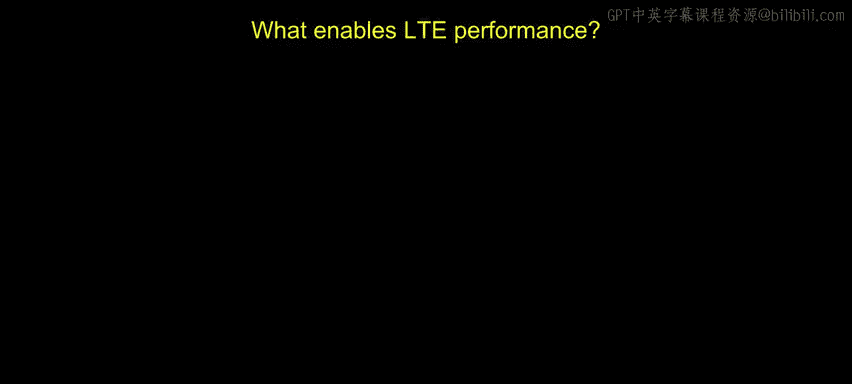
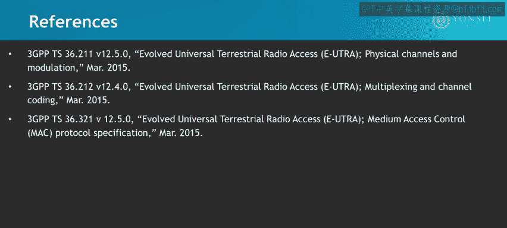

# 延世大学《新兴技术从智能手机到物联网再到大数据Emerging Technologies From Smartphone to IoT to Big Data》 - P54：18_4.3 LTE组件.zh_en - GPT中英字幕课程资源 - BV18hpFewEcG

Yeah。What enables LT performance， it's these LT components。The first one is OFTM。

 orthogonal frequency division multiplexing。Where you carry data using closely spaced orthogonal subcarrier signals。

These signals are placed in orthogonal form like this， where you can see that they are overlapping。

 which should create some interference among them， however。

 the beauty of this technology is that at the peak of the low where you see its peak points right here。

You see that all the other lobes will have zero crossings perfectly matched。

 thereby creating a orthogonal relationship where one is at its peak and the other side lobes that are overlapping have their zero crossings at the peak point of others。

So therefore， if you were to look at the interaction， the correlation among these。

 the orthogonality will provide you with a level of uncorreativeness。

 independence so that you can extract information from these overlapping very dense subcarrior frequencies。

OFDM is resilient against severe channel conditions。

Such as narrowband interference and frequency selective fading。

This is extremely important because narrow band interference and frequency selective fading are phenomenas that can significantly degrade your communication。

And when this happens， you basically have almost no way to recover your current link。

 therefore you may need to do handover， switching and various other techniques。

OFDM is naturally strong， resilient against this， and this is how LTE provides such high data rates。

It provides high spectral efficiency because you're using orthogonal overlapping subcarriers densely located。

 so you're really using your frequency band at a very high efficiency because of the orthogonality placement of the subcarriers。

And simple channel equalization is possible because of this。

OFDMA is orthogonal frequency division multiple access。

 It's a step up to OFDM where it provides further flexibility。

You assign subset of carriers to multiple users where you have a block， you can see that user 1，2。

3 have different color coordinated blocks。Where the vertical axis here is frequency and it's subdivided into subfrequ channels。

 and then time wise it's divided into time slots， as you see right here。For user one。

 user one uses the blue ones that were assigned to him。

 user2 uses the orange ones that were assigned to her and user3 does the same thing。

 and you can see that they are scattered overall throughout the frequency range。

 they are dynamically assigned。This is good because if a user needs more。

 then you can just assign more as long as you have available space to assign more。😡，So therefore。

 assign subsets of subcarriers to multiple users once again。

 these are both based on frequency subcarriers and time slot units。

OFDMA enables adaptive carrier allocation， as you can see。

 the frequencies are changing for the blue blocks。High spectral efficiency and because of this。

 you can see that if there is an empty slot which is a slot based on time and frequency。

 then you can assign it to someone to use， which is very good。 In addition。

 these block units do not always have to be continuously located into a region where they are located side by side by side。

 you can see right here that they are placed where there is availability。Therefore。

 high spectral efficiency is achieved and little interference between subcarriers are possible because of the OFDM and OFDMA based technology。

Another technique that LT uses to achieve higher data rates is Mimo technology and precoding。

Mimo technology or Mimo technology as some may pronounce it that way。

 is multiple input multiple output multiple input is talking about the transmitter side。

 which sends multiple input signals into the wireless channel using uncorrelated antennas that are separated by a sufficient distance at the transmitter side at the receiving side is where it is the output of the channel。

 the receiver side。And that's why we call it multiple output。

 which also needs multiple antennas that are sufficiently spaced。As you can see here。

 the channel is used in a specific way where given the same time and the same frequency band。

 you send different information out of these antennas using precoding techniques。

 that is what Mimo does。Basically， you are using the channel multiple times where you take advantage of the uncorrelated。

Characteristics of these multiple antennas over the channel。

Memo technology enables reliable operation， large spectral efficiency because you're reusing the channel to send different data at the same time and increased data rates。

 of course this is accomplished。By utilizing multipath single propagation based on multiple antennas at the transmitter and receiver。

Pre codingd is used to map the modulation symbols to different antennas such that you use them to send them efficiently over the MImo channel。

Hand over and pack it forward0。Here you can see that。The source Eode B， which is the one on the top。

 decides handover by sending a handover command right here。Message based on handover conditions。

Where the condition could be， the source E node B signal is below a threshold。

 it became weaker and weaker， and therefore it passed a threshold to go underneath it。

 That would be about the orange dotted line。Or the target Eode Bs， ones right here。

 which is the red dotted line， this signal became stronger up to a certain level。

 or you can use both of these one and two together， and there's other criterions， for example。

 it could be such that the source Eode B has went down a certain amount where the target Eode B went above a certain amount。

 and based on a certain difference gap which we will call an offset or a hysteresis。

 then you can make a decision on what to do。When to trigger a handover。In this example。

 this is where handover and packet forwarding come in and become very powerful。

 as in terms that during handover， data loss is prevented by packet forwarding。

This process buffers and transfers undelivered data package to the U V。 For example， step one。

 where if handover is decided， then。We focus on forwarding packets to the target Enote B。

So as this connection over here becomes weaker at some point the source EOB will say stop。

 I'm going to save these packets， I'm going to send them down to the target EOB。

 so this target EOB can deliver it to the UE this is because if I try to send it。

 my channel is becoming weak and weaker such that I cannot reliably send these data packets that is what is determined and then this is what is activated。

😡，Then step two， after it's passed down， it's passed over to the UE in step two。

And the packets are delivered。One thing I do need to mention is this。No packet loss will occur yes。

 all packets that were not delivered by the source EnnoB before handover will be delivered securely。

 reliably through the receiving target EnOB to the UB。So no packet loss will occur， however。

 that does not mean that everything is usable。Why do you say that Let me give you one example。

 which is based on delay bound violation， There are packets that have delayed bound violations。

 which means that some packets have to be received within a given window amount of time and if they do not if they are not received within that window amount of time。

 then they are useless， even though they may be errorless and packet forwarding delivered it through the target enno B to the UE and nothing is in error still the UE or the target enno B may have to just discard that packet because it is passed its it is exceeded。

 its delayed bound violation and therefore the packet is useless。What do you mean， Well。

 let's take a look at another technology that would use this frequently in LTE。 That is the。MBMS。

 which is multimedia broadcast， multicast service。In some places。

 they will put an and in the middle and call this multimedia broadcast and multicast services。

MBMS utilizes the efficient point to multipoint distribution feature of LT to broadcast that means that in an LT networks。

 you can set up a point to multipoint broadcasting structure where from one point it is going to send to multiple receivers through the network。

If you're going to send unlimited to everybody。In a certain range。

 we call that broadcasting if you send it to a selected group of users that qualify based on subscription or certain other quality or a certain other requirement then we call that which is limited broadcasting or restricted broadcasting。

 we call that multicasting。In this example， many MBMS services are influenced by packet delay bound violations。

One example could be video broadcasting。This is for one case where。

Let's focus on a low quality video， which only has 20 frames per second。

 I'm saying that it's a low quality video stream because you can use like 30 frames per second。

40 frames per second going into more dense frames to have higher quality。 That is also possible。😊。

Let's look into this where we have 20 frames per second of a video stream。

This means that each frame is 50 milliseconds of a duration that is given to reconstruct it using multiple packets。

So if you cannot reconstruct your frame of an image within 50 milliseconds。

Then the packets would be useless because the next 50 milliseconds。

 I will need other different packets， the following packets to hurry up and reconstruct it。

That is the way I have to do to construct 20 frames per second。 each frame needs to be constructed。

 reconstructed from the packet sequences。That are gathered within that 50 millisecond window。

If a packet is delayed beyond 50 milliseconds， then those packets in this case will be discarded。

 even though they may be air less， still you will need to discard them。

 that is what I mean by delay bound violation for this example。

 the delay bound violation would be in the range of 50 milliseconds or less because you need to collect them。

 decode them and then show it on the monitor within 50 milliseconds。

 so the actual delay bound violation to transfer the packets would be less than 50 milliseconds in this case。

These are the references that I use， and I recommend them to you。 Thank you。

