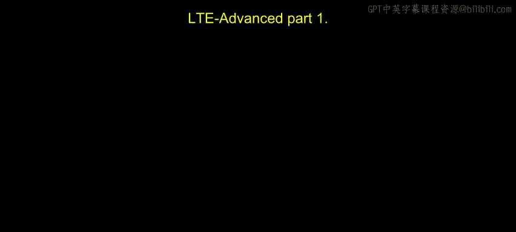
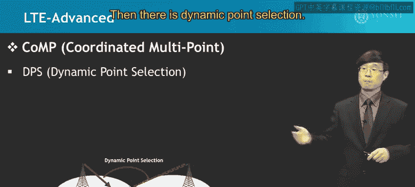
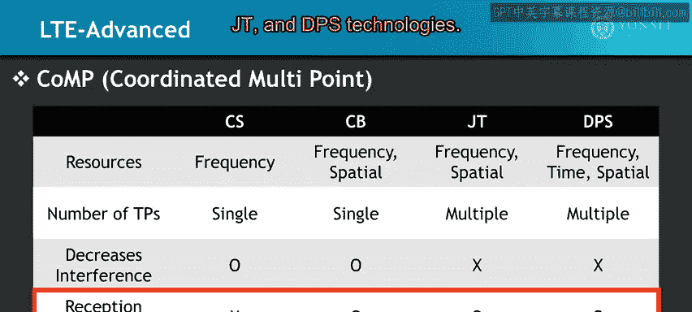
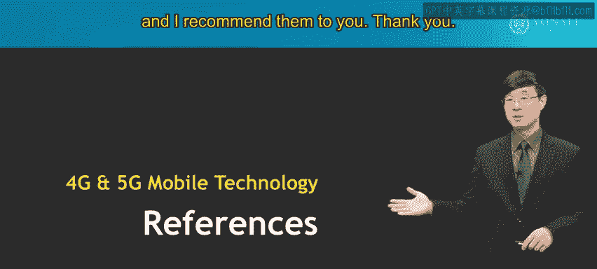

# 延世大学《新兴技术从智能手机到物联网再到大数据Emerging Technologies From Smartphone to IoT to Big Data》 - P55：19_4.4 LTE-Advanced（第1部分）.zh_en - GPT中英字幕课程资源 - BV18hpFewEcG

嗯。🎼Yeah。LT Adv Part one。Here we will first start off with ICIC and FFR ICIC stands for Intercell Interfer Coordination and FFR stands for fractional frequency Reuse。

I씨 아이시。Alleveviates data rate degradation at cell Es Q2 Interce interference by FFR。

And that's a long sentence。 may be difficult to understand。 So let's make it a little bit easier。

Using an illustration。You can look right here where。When you go to the cell edge。

The cell edge is where the performance is the weakest in the middle of your cell。

 which looks like honeycomb structures right there。

 the middle of the cell is where they have the green colored region。

 and as you can see here in these figures， the green region， the green level is lower than the blue。

 red or orange levels。Meaning that it's using a lower power。

 it's using a lower power near the center of each cell because that's close to the base station where the reception is good。

 the signal to noise ratio is good so therefore you can get away with a high quality data service using very weak powers that's why the green levels are all low but when you want to support high quality data communication at the cell edges。

You see that the power level of the blue， the red and the orange are higher than the green levels。

So they're using stronger power at the cell edge and once again。

Mobile communication is so difficult at the cell edge。

 So that is why when I do research with my engineers in my laboratory， handover。

 which is one of the most difficult。Performance measures to conduct。

 to provide high quality services， that's what we focus on a lot because if you can provide high quality services during handover。

 you can provide it anytime anywhere， because those are the weak points， the bottlenecks。

 the Aculus heels。Let's look into this part， where follow this arrow。

That arrow leads to a point where three cells are meeting at a corner。

If you look at the end of the arrow， you can see an orange region， a blue region。

 and a red region there。 that means that they're using different frequencies。

This is where FFR kicks in。FFR fractional frequency reuse separates the frequency bands and allocates the band efficiently to prevent single interference from adjacent En Bs。

Looking at the position where at the edge of a corner， you see a blue， orange。

 and red region nearby each other。You look at this figure right here。

 you can see that the blue region， the red region and the orange region have stronger power。

 but they are at different frequency bands。Look at where they are located on their individual frequency axises。

 which is the horizontal axis。 They're located in different positions。

 meaning that you're using strong signals。Because the blue， red。

 and orange are all stronger than the green level。But in addition。

 they are located at different frequencies， so they do not interfere with each other。

 That is what we mean by FFR。And putting this together is intercell interference coordination。

DSA dynamicna subcarrier assignment。This is an improved resource allocation scheme upon static allocation that dynamically allocate subcarriers considering channel state conditions。

So you're going to look at what's going on， where are。

The locations that some channels are weak and cannot receive。

 where are the null points in the spectrum， and you take advantage of that to support other users in those areas。

Such that。The interfering level with that device， since it's in a null anyway and it can't listen to anything。

 you can go ahead and focus your signal on that area for another user and get a large gain out of your communication link。

For example， look at this。Here， user one is in the blue line。😡。

And user1 has a spectrum null over there。User 2 is in the red dotted line。

 the red dotted line has a spectrum null right over here。So what we're going to do is this。

 since we know the spectrum and where the nulls are for user 1 and user 2。

 what I'm going to do is this。I'm going to allocate user one to focus its communication where its neighboring device user 2 has a null。

 spectral null that way， even though a strong signal is sent to user one， user two。

 it's in a null anyway， it cannot receive anything that's where the spectrum is weak so it cannot read the signal so it will automatically not see the signal of the other user。

 it will not show up as a strong interference， taking advantage of this。😡，Is what we're doing in DSA。

 Once again， you can do this because。LTE Advance technology is adaptable in the way that it can allocate the frequency bands to certain locations。

 That's why it can achieve such high data rates。Due to frequency selective fading。

 subcarriers have different effects on users， which you see different null points。

In the spectrum for different users。Thus， DSA can improve the user quality of service in various ways。

By tracking the overall spectrum null points per user and then using the adaptive control assignment mechanism that is assigned within DSA technology。

 Pre cool， isn't it？Com coordinated multipoint technology。

This improves the coverage of high data rate， cell edge throughput。

 which is where we have our weak point and system throughput。

You may see multipoint with a hyphen or without a hyphen， and you will see both in various documents。

 so consider them。The same when you see comp。It is like this where you have multiple cells supporting a base station together。

 You have multiplepoint means multiple base stations are pointing at the same device coordinating。

 That's where the word coordinated comes in。In a way such that。

 multiple enOBs communicate with a UE at the same time to increase throughput by reducing intrace interference。

There are a couple of ways to do this。Coordinated scheduling is one CS coordinated beamforming CD is another way。

Joint transmission is another way。 JT and dynamic point selection D P。

 These are the four major ways to do it。Let's look at one by one。

Coordinated scheduling CS is like this where it allocates different subcarriers to use at the cell edge。

 once again at the cell edge， this is where we have to enhance our performance to avoid intercell interference。

You can see right here for that device that is at the cell edge， we are using different frequencies。

 frequency one and frequency two are both used to support that device in the middle。

What this means is that that device that is at the cell edge in the range of handover is。

In need to receive both signalss in order to get comp support。

This may require that device to have multiple modems。Such that one modem can be set to frequency 1。

 the other modem on its can be set to frequency 2， and these modems must be able to be turned on and processed at the same time to take advantage of comp technology in LTEA 4G。

Then we have CB coordinated beam forming once again， we are using multiple antennas。

 array of antennas， and when you have multiple antennas， you can do beam forming。

 you can make it a directional signal where instead of omnidirectional spreading of the signal。

 you can use multiple antennas to focus it into a beam。

 a wireless radio frequency beam and that is what we mean by beam forming。

 but it's coordinated to serve a purpose like this where you allocate different beam patterns to uses at the cell edge to avoid interference and also improve the reception performance where you see right here。

 there is anulling effect。For the beam pattern1 and beam pattern two。

 you're supporting different devices at the cell edge based upon different beam patterns。

This is what we use in coordinated beam forming， very effective and possible because we have multiple antennas。

 an array of antennas that we are capable of steering。Beam for me。

Then there's joint transmission where from this base station and the other base station。

 they are coordinating their signals together such that the UE， the user equipment device。

 your smartphone， for example， is receiving both and。Supporting communication at high data rates。

 This improves the reception performance by having the UE receive data concurrently。😊。

From multiple E Bs。

Then there is dynamic point selection。This selects the transmission point with better channel quality to improve the reception performance。

Here we will say transmission point or TX point， you will see either TP or TX point based on different documents that you may see。

 basically they' are talking about the transmission point and this is used very frequently in DPS technology for comp in LTA 4G。

Let's compare them a little bit side by side since there's four of them， and here we go， there're CS。

 CB， JT， and DPS。Resource wise。It's frequency for CS， frequency and spatial diversity for CB。

The same for JT， where GPSPS will use spatial time and frequency all coordinated together。

The number of TPs。In CSCB， it is all single， but for JT and DPS， its multiple Ts are used。

Decreases interference。In CS and CBB， this is where the interference decrease effects are obtained。

 but for JT and DPS， not that much。On the other hand， reception performance wise。

 CS is a little bit lower compared to CB， JT and DPS technologies。

These are the references that I use， and I recommend them to you。 Thank you。

