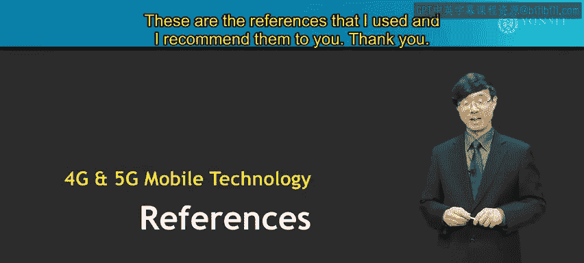
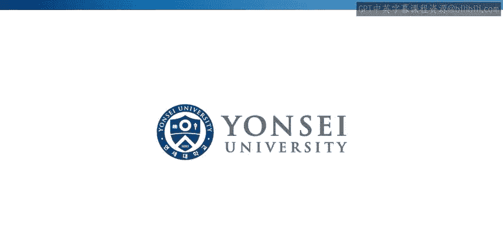

# 延世大学《新兴技术从智能手机到物联网再到大数据Emerging Technologies From Smartphone to IoT to Big Data》 - P56：20_4.5 LTE-Advanced（第2部分）.zh_en - GPT中英字幕课程资源 - BV18hpFewEcG

Yeah。Yeah。LT events， Part two。We will start off with carrier aggregation。

 which is such an important technology that enables L T A。😊，How does it work？

Carrier aggregation combines individual component carriers to increase data rate and capacity of the networks。

 This is used to achieve the 4G requirements in data rate。

Three modes of carrier aggregation are used in LTA。One is inband contagious。

Number two is intra and non contagious。And number three is in band。

 The ones on the top are intra band， and the third one is in band。

Intra band means that it's within the same bandwidth。

In turbban means that it is among different ones。For example。

Introband contagious means that you have two sub frequency blocks that are side by side。

 They're contagious in the。Frequency band A， which is a common band that is used for。

Blocks that are within a group。 So you are assigned two blocks side by side within the same frequency band。

 That is intra and contagious。 They are connected。 So that's why they're contagious。

On the other hand， non contagious， they're still in the same frequency band A。

 but these two blocks are not continuously located side by side， so they are non contagious。

On the other hand， Inter band uses a component， a subblock that is located within a totally different frequency band。

 let's say band B， which you see right here。Among these three， these two。

 which are inter band and non contagious and in turbban。

 these two require the UE to use separate trans receivers for each frequency carrier。

This is because they are not located side by side What this means is that in order to support this。

 the UE， the user equipment device would need to have two trans receiverces。

 which could be like two RF units， which are connected to antennas and two modems。

This is what you need to support something like that。

Hetnet and small cell technology is another very important technology HetNe is short for heterogeneous network。

 which means that just from its name， you can see that we're talking about some different things that are not the same are mixed up together where the word of heterogeneous comes from。

Looking in closer， it is a solution to increasing traffic demands。

Where cell coverage is extended using small cells within a range where an overall big cell。

 a macro cell is located。This will be used to increase capacity and provide coverage extension。

Here it expands network capacity due to coverage extension and small cell technology is very effectively used to enable heterogeneous networks What this means is that the small cell is in the macrocell。

 the bigger cell so they are overlapping where one is big。Others are small。

 and they are in the same cell range， which is why we call it heterogeneous。

 They're not all the same。Small cell technology can use a small cellular Eode B。

 which you see right over there， which can be installed inside a building for cell range extension and capacity improvement this is currently what they will do a lot。

 for example， if you are in the basement and you have to use mobile communication but your cell phone does not get good reception。

 if you call your mobile provider， they might install a femto cell receiver base station Eodeode B a small one within the basement area and connect that to the main network within your building to the mainframe mobile communication network。

 which is the EPC to connect it to the EPS which is the overall system。If they do that。

 then of course， the basement area where you have your needs to communicate。

 of course will be well supported This is what we're talking about hitnet technology。

But in this case， if you're using it in the basement where the overall main macrocell base station signal does not get received well。

 then interference is low between the regional small cell and the overall larger main base station signal。

 the E node B signal from the macrocell。Looking into the details， the macro cell。

 which is a big cell， the big enode B signals that are received。

 this provides a few miles of wide area coverage and small cells can be categorized based on their coverage in terms of microce。

 pico cell， femto cell， so you have the macroce which is a big one supported by the big enode B。

 and then you have smaller cells， which are microce， pico cell and femosce。The femosil， of course。

 is the smallest。Because they are in the same range， supporting areas that are not well covered。

 the weak points of the macro cell， well， that's why we call it heterogeneous networks because we have different cells overlapping。

Then various techniques to manage heterogeneous networks with different sizes cells are needed because in some cases you may get reception from another pico cell interfering with a nearby femto cell or your femto cell may be interfering with a macroce signal。

Therefore， you will need ICIC， carrier aggregation， comp， sun， and other techniques。

SN is self organizing network， which we will talk about soon。In here。

Which is a technique to manage complex and diverse cellular technology， like small cells and hits。

Automated network setup and maintenance is provided。

This is why we call it self organizing because it has this automated capability。

This aims to configure and optimize the network automatically by providing support for。😡。

Expanded number of Enode B base stations。Diverse network parameter optimization。

And new evolving wireless technologies。The functionality is based on self-configuration where newly deployed base stations are automatically installed and configured。

 they look at the network， they figure out the heterogeneous networknet current status based on their position and they try to avoid interference by controlling themselves that is self-configuration or self-healing。

 network entities automatically detect some system failure and apply solutions to it so that even though there was interference at once。

 it will readjust and alleviate， it will avoid。Interference by self healing features。

These are the references that I use， and I recommend them to you。 Thank you。

