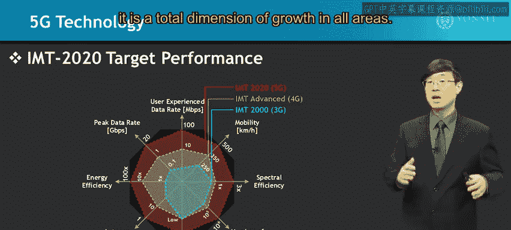
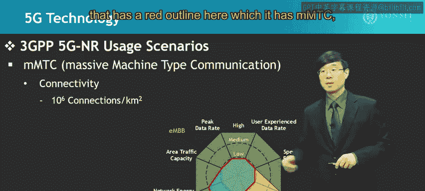

# 延世大学《新兴技术从智能手机到物联网再到大数据Emerging Technologies From Smartphone to IoT to Big Data》 - P57：21_4.6 5G技术.zh_en - GPT中英字幕课程资源 - BV18hpFewEcG

嗯。5G technology， we go into the future。5G technology is based upon the overall service objectives of everything on cloud。

Telepresence。Immersive experiences and massive connectivity。 These are the driving sources。

 or they are what the applications need。 And in order to allow that。

 relating these into core technologies such as cloud service， high speed internet， wireless。

 high definition CCTV techniques。😊，Personal broadcast。

 location based technology or location based services， LBS， as well as wireless backhaul。

 instead of using a wired backhaul network， a backbone network。

 you have a wireless backhaul technology。 These things。 What would enable this to be impossible。

 These are the target that 5G technology is building upon to enable。

5G technology looking at the standards， well there's the ITU R。Which has the IMT 2020。And in 3GP。

 theres the 5GNR new radio。High quality multimedia， self driving and smart cars。Auggamented reality。

Massive IoT networks， Internet of Things， connectivity， cloud based services。😊，These are the targets。

 and in order to do that， we need a higher performance compared to LTE。

 and that's where these standards， the IMT 2020 and 5GNR， that's where they're needed。

To achieve and be supported by a higher data rate， compared to LTE。

 something like 20 times higher data rate。Low latency， like a latency cut in one10th。

Higher device density We'll see that we're going to soon have a demand from these standards where there are a million devices in a square kilometer area that needs to be supported。

 That's what we're talking about millions in units。

In order to understand who is making these standards， let's look at these organizations。 the ITU R。

 This is the ITU radio communication sector。Which is one of the three sectors of the ITU。

 the International Telecommunication Union。It is responsible for radio communication standards and regulations。

Then there's the third Generation Partnership project， which I talked about before。

 this is the team that got together， which is a global entity of multiple industry components of industry representative companies investing together to create a common standard that will work worldwide and their focus came together when they were doing the third generation 3G mobile communication technology。

When they did that， they continued on to create 4G as well as continued on to create 5G。

 which is the 5G you see right here。And provide mobile communication standards for Radios network。

 the services and systems， the core network components and the terminals such as the UB。

 if you look at this。That's everything。 And yes， that's everything。 So in their standards。

 they will include specifications for everything to enable standards at 5G technology levels。

 And these levels are specified in the IT UR documents。😊，IMT 2020 target Per。

 let's see what's in the specification requirements。For data rate。

 you want to have a peak data rate of 20 gigab per second。

 This will be like the data rate that is provided such that it is shared among multiple users within the cell。

 and each user should be able to experience something like 100 Mgabits per second。😊。

Then there's connection density， a million devices per square kilometer area。Mobility and latency。

 up to 500 kilometers per hour of speeds in mobility truly fast。

 this will satisfy some of the new coming high speed railways， as well as flying drones。

Less than5 milliseconds end to end of delay and less than one millisecond over the air。

When we say less than 5 milliseconds n to end， that would have a part within it that is the air interface and that component within the five should be less than1 millisecond。

 so it's like the lowest 1 millisecond over the air is a part within the5 milliseconds of N to end。

Looking at its structure， here 3G is IMT 2000。4G is IMT Adv， which is like the LTEA LTE advanced。

 and then 5G is IMT 2020， which you see right here。

Looking at the blue inside is what 3G was able to accomplish， and that's the sky blue area inside。

Compared to that， you can directly see what the IMT events。

 the LTEA was able to accomplish in 4G mobile communication techniques。

You can see the range right there where for mobility， user experience， peak data rate。

 energy efficiency， latency， there are significant advances compared to 3G techniques。

5G kicks it up a notch way， as you can see there is the red region， which is IMT 2020。

 that region is just way out of the range of 3G or 4G。So you can see both in all aspects of mobility。

 spectral efficiency， number of devices， reliability， latency， energy efficiency， peak data rate。

 and user experience data rate。It is a total dimension of growth in all areas。

Looking into some 5GNR usage scenarios based on 3GPP standards， well， there is the EMBB。

 which is the enhanced mobile broadband， which you can see right here and look at this green area。

 which is the green EB EMBB over there， and it has a red outline。

You can see that this green area that has a red outline。

Is what provides high user density and high data rate with a peak of 20 gigabits per second。

 which is the largest data rate， and edge at the cell edge 100 megabits per second。Think of this。

 so with 5GNR new radio techniques based on 3GP standards， even at the cell edge。

You should be able to get 100 MBgaBs per second。 overall data support， truly tremendous。

 even at its weakest area。Looking at this overall， you can see some applications of what EMBB would be designed for。

 mobile cloud computing。Smart devices like your smartphone is smartwatch and UHD streaming。

 ultral high definition video streaming。Then another mode is U LLC， which is ultra reliable。

 low latency communication。This is the area which you see right here。

 the orange area or the yellow area that has this red outline。

 and it has U LLC written connected to it。This is focused on a latency below or focused on one millisecond or lower。

With a reliability of10 to the power9 in its error rate。

Normally you would go down to this rate only when you are very close to the base station under near optimal conditions。

 however， they're talking about this service that satisfies it under this red outlined area based domain。

So this is like one in a billion permitted of errors， truly tremendous。

What applications would need such low delay and such high reliability？

If you are driving an autonomous car， a smart car with it， you would want no errors to exist。

 such that you're driving it with precision accurate。

Levels of driving control conditions under any situation。

 and there is almost a zero probability that you are disconnected to the network。

 such that the network is consistently monitoring and controlling the smart device， the smart car。

That's when low latency and extreme high reliability would be needed。 In addition。

 industrial automation。Think of a automated factory like a smart factory unit based upon CP cyber physicalsical system control。

 then you're using big machinery or big chemical devices and things that are going on where a small miscontrol could result in a big catastrophe that's why you would need ultra high reliability and zero delay so you are always directly there in control。

That's what this provides in U LLC。Then the other mode is massive machine type communication， MTC。

 MMTC， which are based on IoT devices that need lower data rate。

 but the number of them are truly tremendous in the range of millions。😊，In a square kilometer area。

What is the focus for that， Well， that is this region that is the sky blue area that has the red outline here。

 which has MMMTC。

Which focuses on millions of connections per square kilometer， battery lifetime，10 years。

And this could be used for smart home， smart city， and U health， as well as wearable devices。

In this situation， you're looking at lower data rates because you can see right here that on the axis of the data rates。

 or when you look into mobility， this has less in those domains。

 but the life expansion of it is truly significant and also it provides massive connectivity。

Which means like this， for the overall capacity， it is divided into very small units。

 so each individual device can have frequent connectivity at low data rates。

Sharing this overall wide band high capacity spectrum。

But each individual device has a very intelligent way。

 a low power way of communicating such that their battery is extended significantly over a duration of like 10 years。

Let's look at them and compare these three modes。In 5G performance requirements based on 3GP。

Standards，5GNR has three modes， EMBB。There is the MMMTC， and you are LLC。Data rate comparison。 Evily。

 EMBB has the significantly highest data rates in the ranges of tens of gigab per second where you go to the other side and you look at MMTC。

 This is talking about 1，2，100 kilobits per second， very low data rate。😊。

But then when you're talking about URLLLC， the data rates are in the range of 50 kilobits per second to 10 megabits per second。

 sufficiently large， but later on you'll see that the latency and errors are of course very low in URLLLC。

 meaning that it's more focused on very high， ultra high， reliable and very low delay。

Spectral efficiency。Of course， EMBB needs the highest level where for MMTC and URLLLC。

 not really specified。User experience data rate for EMBB。

 you need to specify this for the uplink and downlink it goes like about 50 megabits per second。

 downlink 100 megabits per second for users， so each individual user is getting this type of a service truly significant。

For MMTC and U LLC， it's not exactly defined。The area traffic capacity。

In the range of 10 megabits per second per square meter， wherefore MMTC and URLLLC notified。

Network energy efficiency， it is defined， but not really in detail for EMBB。 however， for MMTC。

 we're talking about up to like 15 years of a battery life with extreme low power design that is what is provided in MMTC。

In U LLC， not really defined。In mobility interruption time， you can see that EM MBB，0 milliseconds。

 U are LLC 0 milliseconds。 These are the targets。 We don't want interruption。

 We want it in all mobility conditions where handover is executed。 We do not want interrupt。

 We do not want interruption。 We want a seamless， continuous stream of data to be supported。Latency。

 here is where you can see a difference。As in terms of EMBB。

 it is down to four milliseconds for you are LLC， like it says， LLC， low latency。

Into a range of half of a millisecond， really significant。Connection density Well。

 definitely this is where MMTC is going to be the best 1 million devices in a square kilometer area where EMBB and URLLLC。

 they have some definitions but not truly rigidly required。As in terms of these。

Please consider the references for further details and now we are going to go into 5G network architecture in the following lecture。

 thank you。😊。