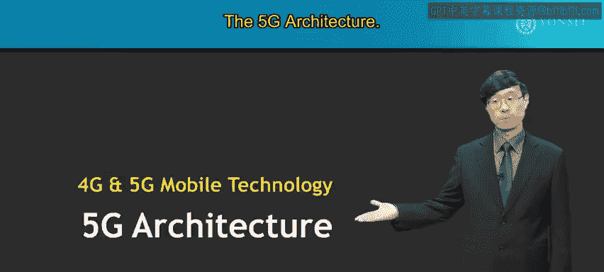
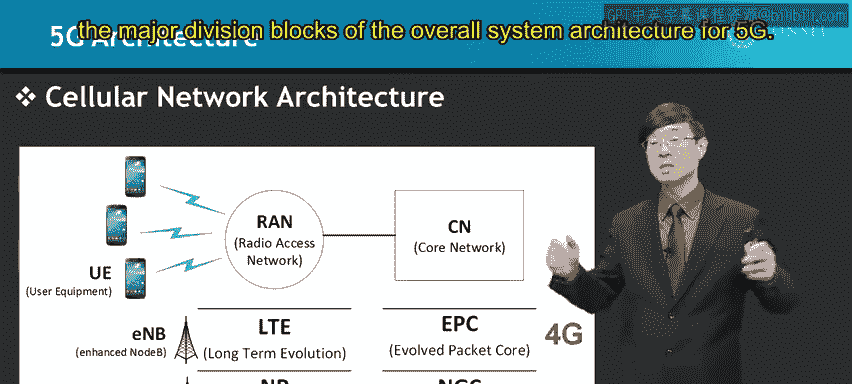
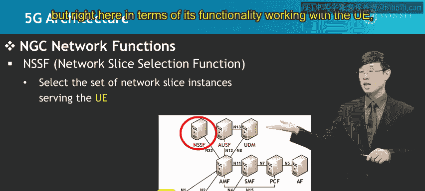
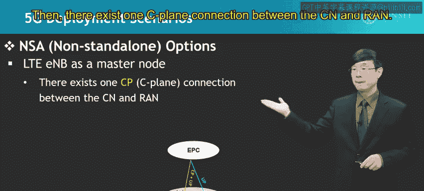
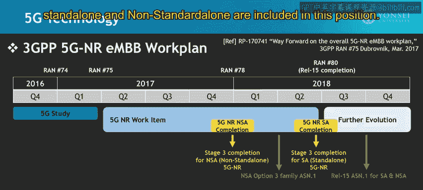

# 延世大学《新兴技术从智能手机到物联网再到大数据Emerging Technologies From Smartphone to IoT to Big Data》 - P58：22_4.7 5G架构.zh_en - GPT中英字幕课程资源 - BV18hpFewEcG

嗯。The 5G architecture。

First， looking at cellular network architecture， there is the UE， which is a user equipment。

 then there's the RAN， the radio access network and core network。

 we can divide the network overall into these three units。

Let's map that into 4G well in 4G we have an En B， and then in the Ra access network it is like the LTE component and then over here we have the EPC。

Of course， the LTE component over there is where the EU trend in 4G networks existed。

 and then the EU trend and the EPC together is what it was called the EPS Evol packet system for 4G technology。

Comparing 5G， we have， it is now called a next generation node B， so it's used the G and B。

Then for the radioio access network area， we call this the new radio。

This is where you will see in 3GPP standards， 5GNR。5G hyphen NR。

 that's where the NR stands for new radio technology。In addition。

 over here in the core network corresponding to 5G， this is where we call the next generation core。

 the NGC。And that is what is the major division blocks of the overall system architecture 45G。

In further details， we'll look at what's going on。For the NGC network functionality。

 one block to first look at is the AMF， the access and mobility function。

 registration and connection management， as well as mobility management are supported。

Access authentication， as well as access authorization are supported by this unit。Then theres the SF。

 which is the session management function。😊，This is about session management， session management。

 as in terms of data session， a stream of packets。IP address。

 allocation and management is also supported by the SMF。

And you select and control UF user plane functions for data transfer。Then the unit down there。

 the UPF user plane function， which is in charge of packet routing and forwarding。

The UPF is the anchor point for intra rat， radio access technology， and intraRA mobility。

Which means that it's going to be the center where you anchor to supportover handover based upon radioactive technologies。

PCF policy control function， which is this block right here。

It provides policy rules to control plane functions， such as the。AMF and SMMF right here。

Then there's the AF unit right here， which is the application function。

It interacts with the core network to provide various services。

Then we have the UDM user data management。This unit stores and manages subscription data of the E。

 the user equipment。Access authorization based on subscription data is supported by the UDM。

Then the AUSF authentication server function， this unit right here。

This unit works with the UE and it stores authentication data of the UE。Then there's the NS SSSF。

 which is the network slice selection function。We will soon talk about further details of network slicing。

 but right here， in terms of its functionality working with the UB。

 it selects the set of network slice instances。

The NSI serving the UB， and we'll talk about more about the network slice instances。

Nonstandalone option is one of the representative 5G deployment scenarios。

 and this will be considered to be the one that is originally first deployed 45G。

 The reason why is because it is a nonstandalone， which means that it's going to work together with the 4G network。

If you have a 4G network and you're going to evolve into connecting it to 5G。

 then the NSA option is of course， a middle step that will provide you with additional control and functionality using your 4G LTA network that you already have。

As in terms that， the NR GNB serves as a master node。Where the NGND connected to the NGC。

 the next generation core is the first。That you see right there。

The second option is data transport through NR， Gnb， and or the E B connected to the NGC。

 which is right here。You can see the UP and you can see the C and add it to the UP。

 then you can see the connection right here， which shows that the LTE enol B is connected to the NRGNB through a C plus C supported connection。

This is why it's called nonstandalone。네。Then data transport through NR GNBs through the NGC。

 which is this example right here。And as you can see， the connection is provided an example。

 there is UP， that are provided in the links， and then also for this case you can see that we have the connection supported where the one over there had LTE with an Enode B and here is NR GNB is connected together。

Let's look a little bit into the details。When the NR GNB as a master node， for case 2 and3。

 there exists one C plane connection between the CN and RAN。

 the core network and the radio access network。Here。

 the core network and Radio access network are the units that are supporting the connectivity for these two cases。

When we say core network and RAN， we are using this terminology because this is a non standalone option that will coexist with the LTEA 4G network。

So when I say CNN RA， this could be used both for the 5G and 4G CNN and 4G and 5G Ra access network correspondingly。

 which was the first page that we did in this lecture。Then there is the NRGNV as a master node。

 where the Uplan data is routed to the RA directly through the CN。Alternatively。

 the U data that flows in the same barrier is split at the RAN。

And that is what you're seeing right here in this example now。Further。

 there is the LTE E node be as a master node， which is another option。

And that is what you see right here， so therefore that becomes the master node of the network connectivity。

 where the LTE Enode B is the master node and the data flow aggregation across the Enno B and NR G and B through the EPC is what is actually done and the EPC is right here。

 the EPC is what the core network of the 4G network。Here。

 data transfer through the LT E node B and or the NRGNB through the EPC is what is actually being supported。

 so the EPC plays a significant role because the LTE E B is the master node。

Then there exists 1 C plane connection between the CNN and RA。

In addition， the U data is routed to the RA directly through the core network on a bearer basis。

 a bearer means that it's a carrier on a carrier basis。Alternatively。

 the Uplan data that flows in the same barrier and the same carrier within the connection is split at the radio access network in this case。

Looking into some performance requirements here， remember the EMBB case。

We will look into further details of this in the following pages。

 but I do want you to remember that there is a data rate requirement at very high rate。

 in addition look at the specifications as in terms of the user experience data rate。

 50 megabits per second for uplink， 100 megabits per second for downlink。In addition。

 you can look at the overall latency requirements is set as four milliseconds。

Further details of this。As in terms of how the 5GNR EMBB work plan is set out。

In a range of the dates from 2016， leading all the way into 2018。

Where the RAN standards for different documents are listed here， where you can see that。

The releasease 15 completion is targeted for 2018， and the reference document is listed above。

Then you can see this is where the study for 5G mobile communication was conducted。

Then the NR worked items were individually set and designed based on cooperation of multiple institutes that participate in 3GPP。

And then further evolution was to be conducted in quarter3 and quarter 4 of 2018。

In terms of major reference points， 5G new radio， NSA non standalone completion was based on stage3。

Right here。Where're NSA option three， family ASN。1。Had a reference point there， then for standalone。

5GNR has a point there。And then there is the releasease 15 ASN4 SA and NSA standalone and non standalone are included in this position。

Therefore， by March 2018， NSA 5GNR EMMBB completion is targeted， September 2018。

 the standalone 5GNR EMMBB completion is targeted。

