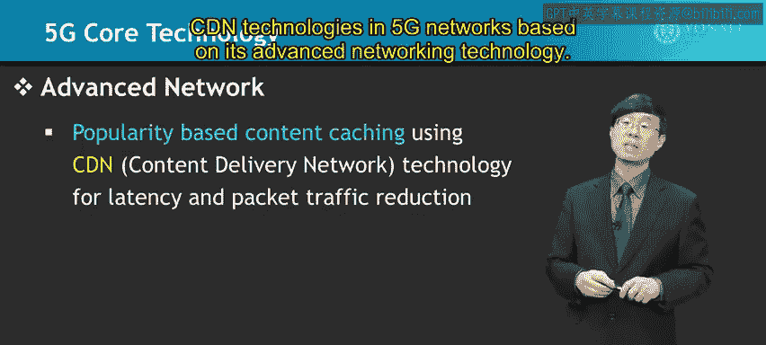

# 延世大学《新兴技术从智能手机到物联网再到大数据Emerging Technologies From Smartphone to IoT to Big Data》 - P59：23_4.8 5G核心技术（第1部分）.zh_en - GPT中英字幕课程资源 - BV18hpFewEcG

嗯。5G core technology。The key enabling technologies are based on what you see right here。

 which we will talk about in this lecture。First， advanced network。As you can see。

 this is one example where the EPC cloud is there。And it's connected to an NFV enabled node。

 which you see some functionalities are included inside。

Flat and distributed network architecture is one of the advanced network characteristics。

 What do you mean Well， before when we were talking about 4G LTA and LT networks。

 there were these blocks of units that have very specific functionalities， as in terms of。HSS。M咪。

S GW， the serving gateateway， the P gateateway， the PCRF。

 these units had very specifically designed functionalities that were in their specifications。

 and these had to be devices， units that were in the network in order for the overall network to function。

So therefore， the overall network had specific units conducting specific operations。

Flat and distributed network is about having these functions。

 but they are distributed out in the network based on a software virtual functionality format such that you do not have specific blocks。

 but all the units in the network will have some of these functionalities inside of them that you can use in a way。

 such that there is no single unit that has a single functionality that you have to depend on。

Meaning that the functionality of the individual devices are somewhat like averaged out。

And therefore， they're distributed。Therefore， we use the terminology flat and distributed。

In advanced network of the 5G core。Integrated and distributed network functionalities。

 So based on some devices， their functionalities are integrated in there with virtual functions。

 and we'll talk about more on this。As we go into flexible network architectures。

 in which programmable network functions are based on SDN， software， defined network technology。

 and NFV network function virtualization。NF is where you see this example listed out。

 where virtualize。Network functions could be like， deep packet inspection。Optimizer， web gateway。

 firewall， net， and various other IP functionalities。

 in addition to the mobile communication network functionalities as well。

 they need to be provided and supported。But instead of having like an MME， a serving gateway。

 a PDN gateway that has this unique functionality in a single block。

We're going to use network function virtualization。

 where you virtualize complex hardware based network node functions into software building blocks。

That can be combined and chained so in other words。

 if I need this function then this function then this function then this function。

 then I combine them together in a way that creates a service chain。

And these individuals are based upon。What we call virtualized functions。

So instead of having a unique block， conducting a unique thing where in order to get that service。

 you need to go to that block and get service， and then that device will lead you to the next thing to do here we collect what we need and then we put it into the functionality of a specific flow。

NFV technology eliminates dependency on complex hardware based network nodes by using flexible software blocks that are called V and Fs。

 which are virtualized network functions。You can improve flexibility and functionality and efficiency by this technique of using NFE。

How once again， you， what you need can be collected with software functionalities。

 and then you create a chain of what you need to support your data flow within the network。

 and then you execute it。So therefore the network is flat and it's distributed。

 so you go collect what you need and you put it together and execute it。

 so therefore you do not need to make a certain turn point to go somewhere and then go somewhere and then go somewhere to get your functionalityities。

 you collect it， chain it and then you use it so therefore you get these features of flexibility functionality and efficiency。

SDN， software defined network， SDN decouples， meaning that it divides the network control and data forwarding paths and functions。

Before inform formerer networks that did not use SDN。

 your control forwarding path and your data path were the same。So you do not have much flexibility。

But using SDN technology in 5G networks， this divides the control and the data。

So therefore you can control this much more flexibly。

That is why distributed management by using the shortest data path without traversing the core network is possible now using SDN technology。

The network control can be directly programmable， and the underlying infrastructure is abstracted for applications and network services。

This is where you get much flexibility， having the control flow and the data flow controlled and accessed independently。

So you have so many more options to optimize the overall way you control your network and then how you send data。

Avanced network。Is once again， the flat and distributed network architecture。

Wwhichch takes advantage of distributed management providing the shortest path without traversing the core network。

 once again， how is this provided through NFE and SDN technology？Contextware resource allocation。

 considering realtime traffic， service type and device characteristics are provided。

 contextware resource allocation， where is this context coming from。

 and where do I need to rebalance the overall resource allocation scheme to make my network overall optimally efficient and highly utilize。

Going into other characteristics of taking advantage of CDN technology， content delivery networks。

Content delivery networks are networks that predict what will be needed based on an algorithm。

 and then that traffic is brought near to the users in advance such that when users need it。

 it can be delivered very quickly and also the overall network utilization is brought down because you move it closer and then it shared over a local domain。

This is what is used in various broadcasting and multimedia services。

 CDN technology is therefore very popular。And we're going to bring this prediction and CDN technology to support faster services and reduce the overall utilization of the network。

 making the network functions much more highly efficient。

Through CDN Tech in 5G networks based on its advanced networking technology。

Of course， one example is like here where to support the UE much quicker then the packet data network will look at what is needed and especially for the low latency requirements like the URLLLC ones。

The contents are brought closer to the actual user。In order to do this。

 there needs to be a prediction algorithm of what needs to be brought up closer。

To the user and things like popularity based content caching could be that reference。

How will you execute this popularity based algorithm， There are several schemes。

 and those are based on CDN technology。