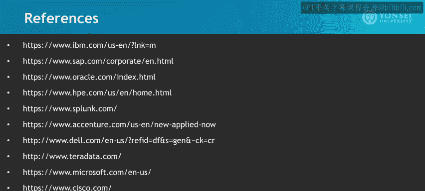

# 延世大学《新兴技术从智能手机到物联网再到大数据Emerging Technologies From Smartphone to IoT to Big Data》 - P5：4_1.9 Microsoft 1.10 Cisco 1.11 AWS.zh_en - GPT中英字幕课程资源 - BV18hpFewEcG

Microsoft。Microsoft was founded in 1975， and their big data platform is Microsoft Azure。

It is interoperable with SAP， Hannah and Splunk。It ranks number 10 in big data corporations and number five in software。

Microsoft Azure provides computation， networking， storage， web， mobile， database， data analysis。

 and other features。It is a consistent hybrid cloud technology that supports data driven intelligent apps。

Avd security， privacy， transparency and has the widest compliance with computers and network coverage。

 Evily Microsoft operating systems are most well spread out。

 so this characteristic is very important。😊，Cisco。Was founded in 1984。

 it's the world's largest networking company。Develops and manufactures。

 networking and telecommunication systems and services。It is ranked number four in big data hardware。

Some of its products include servers， look at the overall total bandwidth and memory options that are provided here。

For the data center， there is data center networking。

 which supports agile network operations with architectural flexibility and for the compute storage。

 unified compute storage and networking capabilities are supported。

Automation and hybrid cloud supports automated IP tasks， accelerated apps， and optimize processing。

In the analytics and security domain， real time app analysis， in addition。

 advanced network and data protection。AWS。Amazon Web Services launched in 2006 as a subsidiary of Amazon。

com。Provides over 90 service types， including computing， storage， networking， database， analytics。

 application services， IoT tools， and much more。It ranks number seven in big data hardware。

The AWSS3 simple storage service is very popular Object storage enables storing and retrieving any amount of data from anywhere。

 supports websites， mobile apps， corporate applications， IoT data and much more。

Then data durability and reliability。Designed to deliver 99。9999，99，999% durability。

 That is after the decimal  point99。Here also， security and access management。

 control and monitor all database access。These are the references that I use。

 and I recommend them to you。 Thank you。

