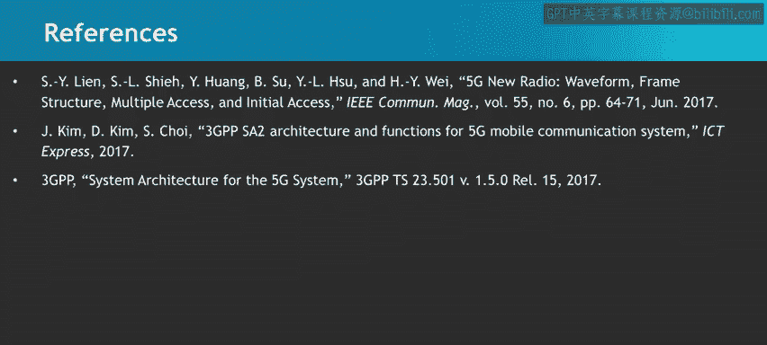
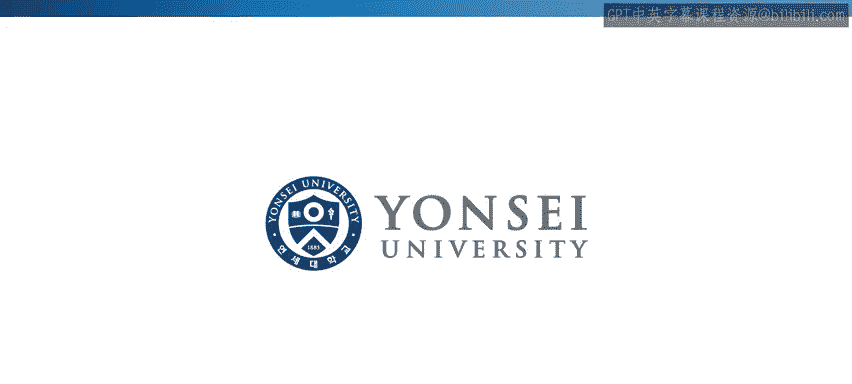

# 延世大学《新兴技术从智能手机到物联网再到大数据Emerging Technologies From Smartphone to IoT to Big Data》 - P60：24_4.8 5G核心技术（第2部分）.zh_en - GPT中英字幕课程资源 - BV18hpFewEcG

嗯。Network slicing。Very important， this divides the 5G physical network into multiple virtualized and twin networks。

Logically isolated network technology， influencing the mobile device， access。

 transport and core network。So you are going to really be using one network。

 but logically you're going to be like dividing the network into separate sublay such that for this application。

 I'm going to use this for this application I'm going to have a specific set of functionalities and this going to be supporting what I need where I need it。

How do I achieve that， that is with network slicing overall。It is one big 5G network， however。

 you feel like it's multiple smaller divided networks all combined together that is where the word of virtualized comes in。

 meaning that it's really one， but based on logical control and very precise scheduling and resource allocation and dividing you get it such that it feels like you have multiple independent networks that are there。

 but in reality you're sharing one big network。How do you do that， Let's get into the details。

So dedicated for different types of services that have different characteristics。

 quality of services。Further details， one would be ultraltra high definition video broadcast and multicast Services S。

In here， take a look at this network where you see multiple devices based on how they're sliced。

Overall， it's like it is really one big network and really it is。

 but you divide it based on how you want to use it looking over there， there is this slice。

 this slice， this slice， some could be supporting smartphones， some could be supporting IoT devices。

 some could be supporting intelligent transportation systems or smart cars on autonomous vehicles。

 self-driving vehicles。And much more。So you divide the network into individual slices and you select what functionalities you need to get it。

Of course， ultratra high definition video broadcast once again。

 these services have strict time regulations of how and when they need to be provided， once again。

 because they may have delay bound violations based on how many frames per second in the example we did in the earlier lecture。

In this case。We need to look at some of the major functionalities like the user plane， control plane。

 digital unit， and mobile video optimization。Where all virtualized DU and the 5G cord。

 which is the UP and cache servers are in the Edge cloud。And in the core Cloud， virtualize 5G core。

 the CP， and the MVO servers are located there。We divide them up and we provide functionality。

Phone slicing。Well， for the 5G core UP and CPP with full mobility features and IMSS servers are all virtualized in the corere cloud。

For smartphones， their individual service slicing could be where this phone slicing is supported。

 Once again， we say phone slicing， but overall this could be like the majority of the service because for a 5G network。

 your smartphone is used as a tool for so many different applications so phone slicing could be like the majority component slice of your 5G network。

Massive IoT slice， force sensored networks。A simpler light duty 5G core without mobility management。

Is in the core cloud。And for IoT devices， we're looking more at these devices where they are not going to move around that much。

 in addition， they do not need that much of a high data rate。

 but there are still a big challenge because there' are so many of them。

 once again in the 5G standards， one of the targets for M machine type communication MMTC was having a million supported in a square kilometer area。

Mission critical I O T slice mission critical， as in terms like supporting vehicle to。

Vhicle communication， vehicle to infrastructure communication to support un autonomous vehicles。

Intelligent transportation systems。Smart car functionalities。Let's take a look。

 the 5G core UP and associated servers that are connected through the V2x that is vehicle to anything。

 the x can be anything， the vehicle2 vehicle， V2 v， vehicle2 infrastructure， V2 I， vehicle2 person。

 V2 P could be all in the X， so the x could be a V。

 an I or a P based on being a vehicle infrastructure or person。

These are all in the edge cloud for minimize transmission delay once again。

 if it's in the core cloud， it's a little bit further away from you， but if it's in the Edge cloud。

 then it's closer to the user because the edge is what is near to the individual users。

 but then again， if you want to place something in the edgedge cloud。

 you need to predict it and bring it there so it can directly be used。In addition。

 the core cloud has much more capacity to keep something there。However。

 the edgedge clouds have limited amount of memory and space。

 and then they're supporting a lot of users， so therefore you will need to refresh and eliminate some of the old stuff that may not be used and bring in and new predicted information。

 new predicted functionalities， new predicted content that would be needed to highly utilize your Edge Cloud。

 so there needs to be an engine to support this type of updating functionality。

 especially for the Edge cloud that are limited in memory and functionality and processing capabilities。

😊，Now， further details of a B2X。Slicing。Where I want you to look at this network。

 there are a terminal one， a terminal2 in these automobiles at the lower components。

Then there's the V2 X CSP。Which is the communication service provider。In addition。

 you will see the drive function， the map function， and like the multimedia entertainment system。

 which could be like the video system。They are connected in the V2X CSP。Now， over there。

 I have a red circle in the middle that has on the top which you see NSI。

 which is the network slice instant for the drive functionality。Then for the map functionality。

 then for the video or other multimedia functionality that are connected to the terminal one。

 which is a onboard unit or an onboard system or an onboard equipment。

 could be like the smart controller on your smart car， which is down there。

So the connectivity is there being provided。For B2X service using network slicing。Of course。

 the features of entertainment and driving assistant would be important where for entertainment requirements on data throughput may be the major one。

 such that your multimedia video services are provided or the user。

 the passenger on your vehicle is using a video game。

 you want to provide good quality of service for that。Driving assistant， well。

 high requirements on latency and reliability are the target。

Suchuch like a driving assistant could be like a navigator。

 or it could be like an ITS intelligent transportation system where the roadside unit is supporting the onboard unit。

 which could be the smart device controller on your smart car or your unautonomous driving vehicle。

Further details of going into actually controlling the automated driving could be for efficiency and comfort for fully automated driving being supported by the U LLC service。

Which provides。Ultra high reliability， and also low latency。You are LLC。

Because this has such strict requirements， of course， you can do high density platooning。

 cooperative intersection control and others。 What do you mean by high density platooning the major concept here is that if you have multiple vehicles or trucks。

That are driving at very close distances， but they are controlled together like a platoon。

They will accelerate together， they will decelerate and break together for their braking systems。

 they will make coordinated left turns and right turns together。

 such that they look like they're a train， but actually they're not and they are closely driving together this will enhance the overall utilization of the roads such that instead of having them with a security distance of hundreds or 200 yards to be separated apart because they're driving close just like a trailer or just like a train。

The overall utilization of the road goes up， and you have high capacity driving functionalities through these devices that are supporting the。

High density platooning transportation systems。This is where B2X services and U LLC can be so efficient and so effective。

In addition， cooperative intersection control， remember， this is where the lane changing， the light。

 the right turn， the left turn， the crossovers and where most of the accidents occur when you're driving。

At the intersection， by having cooperative intersection control。

 the safety level and the efficiency of how you use the intersection areas on the roads will go up tremendously this is what we want to accomplish through network slicing based on V2X services。

These are the references that I used， and I recommend them to you。 Thank you。

