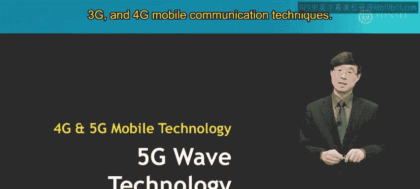
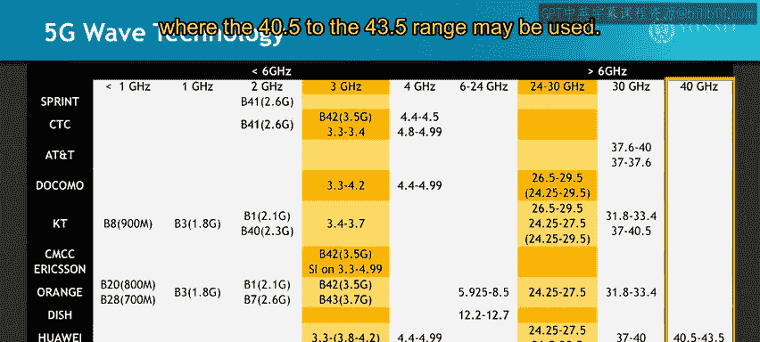
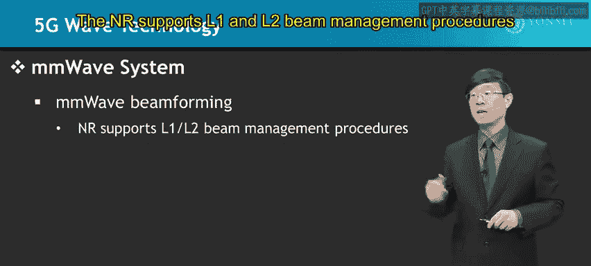
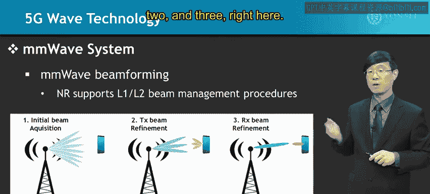
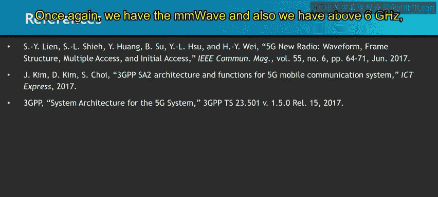
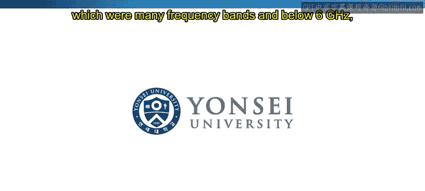

# 延世大学《新兴技术从智能手机到物联网再到大数据Emerging Technologies From Smartphone to IoT to Big Data》 - P61：25_4.9 5G毫米波技术（第1部分）.zh_en - GPT中英字幕课程资源 - BV18hpFewEcG

嗯。5G wave technology is a topic of this lecture， and we're going to focus on this area with further details because when we go into 5G using like the millimeter wave range。

These type of things are significantly different from former 2G。

 3G and 4G mobile communication techniques。

So therefore， we need to look into this in further detail。And we'll start off with this table。

Where below 6 gigahHtz range， which focuses on below 1 gigahHtz， 1 gigahHtz， 2 gigHtz， 3 gigHtz。

 and 4 gigahHtz frequency ranges。Then above 6 gigahHtz， there is a 6 to 24 gigertz range。

 24 to 30 gigertz range， 30 gigertz range and 40 gigahHtz range。Evidently， as you can see。

 in the yellow columns， focus at 3 gigahertz and 24 to 30 gigahertz that will be where the major range of focus is in。

Looking at some of where the companies are focusing in。

For these companies that are participating in the 5GNR technology standardization。

 let's look at where their focus is and their future products and services are targeted。

For the below1 gigahHtz range， you can look at this here where you have like 800 me， 700 meHtz。

 900 megaertz are used。In the 1 gigertz range， you can see at 1。8 gigahertz。

This is where companies are focusing on some future technology and 5G services。At the 2 gigHtz range。

 the 2。1 gigahHtz， 2。3 gigertz and 2。6 gigahHtz are the focus of service implementation。

In the  three gigHtz range， you can see much activity focused around the range of 3。3 to about 3。

7 gigahHtz。Going beyond to  four gigahertz， you can see the ranges that go up to in the range of 4。

4 to about 4。99 gigahHtz are the range of interest。Above 6 gigHtz and below 24 gigHtz。

 you can see that one frequency range of interest is from the 5。9 to the 8。5 gigHtz range。And also。

 there's a 12。2 to 12。7 gigertz range。Going into the 24 to 30 gigahertz range。

 this is where a lot of interest is being invested into。

 and you can see from the 24 gigahHtz going up to like the 29 gigertz range is highly going to be used。

In the 30 gigHtz range， you can see from 31 all the way going up to like 40 gigHtz is the range of interest and various applications and service providers are thinking of using this for their applications。

And at the 40 gigertz range， there is interest where the 40。5 to the 43。5 range may be used。

In 5G wave technology， the millimeter wave systems are of prime interest。Compared to the LTE band。

 above6 gigahHtz in the millimeter wave band is where the major focus is because there is so much bandwidth which we can accomplish extremely high data rates。

So some examples would be 2。2 gigahHtz data rate range can be supported in the 28 gigertz band using multicell 500 meHtz bandwidth transmission technology。

Supporting technologies。To enable this are the 28 gigahertz polarization interleaved array。

 as well as the 60 gigertz 360 coverage， 16 chain CMs RFIC techniques。

One of the key technologies in 5G。Is millimeter wave where millimeter wave signals can be being formed and taking advantage of this is very important。

Multiple beams need to be provided such that sufficient coverage over the overall cell is enabled。

This is because when a single goes beyond 10 gigahertz， it starts to behave like light。

 What light does is that it cannot penetrate a solid object On the other side of a solid object。

 you would have a shadow likewise millimeter waves， which are far beyond 10 gigahertz。

They act the same way。So therefore， shadowing happens very。Frequently。

 such that in order to get full support to avoid shadowing。

 you may need to have multiple base stations sending signals， directional signals to a certain user。

 such that if one signal you lose it due to shadowing。

 the other one will support it to provide continuous data rates。

What this characteristic is called is line of sight L。

 which means that you need to have line of sight connection。

 which means there needs to be a direct path that has nothing hindering。

 nothing creating a shadow in the middle of that path between the base station and your mobile device This is what we call LOS and that is needed and this is not provided in many cases。

 this is why we need multiple devices to support connectivity。

 and multiple beams therefore are needed to provide sufficient coverage over the entire cell area。

Bean management procedures are of course needed， these are used to acquire and maintain best beam for each of the devices。

The NR supports L1 and L2 B management procedures。

And this is how basically the operation could be accomplished。

 where initial beam acquisition is done where the base station radiates different patterns and from different angles。

 then the mobile device in stage two will send a signal in a reply and in stage three。

 the best beam pattern is found to transmit and receive right here。Which is used eventually。

So after you look and scan， you get a reply， then you do the mix and matching to optimize which beam patterns you're going to use and then you use it in stage one。

 two， and three right here。

