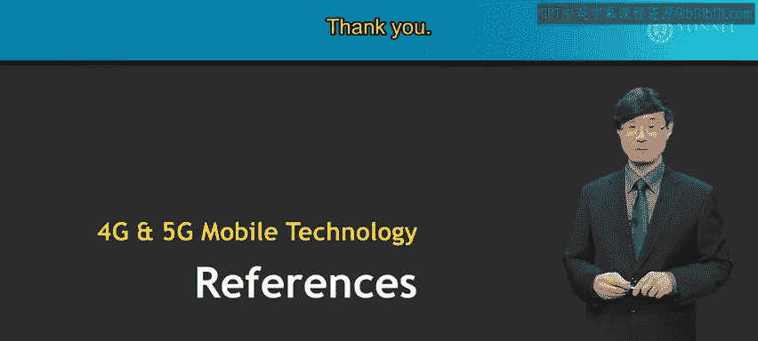

# 延世大学《新兴技术从智能手机到物联网再到大数据Emerging Technologies From Smartphone to IoT to Big Data》 - P62：26_4.9 5G毫米波技术（第2部分）.zh_en - GPT中英字幕课程资源 - BV18hpFewEcG

Another technique is multi rat internet networking。

Rt is radio access technology once again we have the millimeter wave and also we have above6 gigahHtz which were many frequency bands and below6 gigahHtz which were many frequency bands。

 that means that we need to mix and match among multiple radio access technologies and provide interneting services。

So the UE and the network based multira coordination technology is definitely needed。

Throughput and connection reliability enhancement using license and unlicensed spectrum coordination is required。

Unlicensed， what do you mean， well think of it like this for the 2。4 gigahHtz band。

 which is the IMSS band， which is used for Bluetooth， Wifi， ZigB and other devices。

 this unlicensed band as well as a license band， which are dedicated for LTE or 5G communications。

 you need spectrum coordination。Looking into unlicensed and license bands listed together。

 look at the LTE at 800 MHtz， 2。1 gigertz， and then 3。5 gigahertz， these are license bands。

 and then unlicensed bands。At 2。4 gigHtz for Wifi， the ISM band。

 also in that region is where Bluetooth and Zigby and other devices use。

Then over here in the Wifi range， this is also the5 gigahHtz unlicensed ban。But in this range。

 also a licensed technology like the LTELAA， the licensed assisted Access could be using it as well。

Then 5G technology frequency access needs to be added here。

 which will also include below 6 gigahHtz and above 6 gigahHtz。

 which include the millimeter wave technologies as well。So you need multi radio access technology。

 multira internet networking。And that will support the coordination such that you are using different bands in a very intelligent way to provide broadband access in a seamless manner。

Interneting and integrating the 5G system with other radio access technologies， 3G， 4G， Wi Fi。

 Bluetooth is needed。Multtipath transmission technology enables a device to use multiple transmission protocols。

Simultaneously， for cellular， like 2G， 3G， 4G， as well as wireless LA， like Wifi， Bluetooth。

 and other techniques can be used together where Im connecting both the Wifi access point as well as the millimeter wave base station。

This could be done simultaneously using multipath transmission technology based on multire internet networking。

Then we need to consider that multipath transmission enhances connection reliability and data transmission rates at the cost of higher technology coordination。

The MPTCP， like multipath TCP， enables a device to configure several TCP sessions simultaneously by using multiple network connections and addresses。

This is what could be run on a multi REt intra networking technology supported 5G network。

Advanced Mimo technology or Mimo technology， where Mimo is for multiple input， multiple output。

 You're using multiple antennas， and you want to take advantage of diversity mode。

 There's time diversity， frequency diversity and space diversity。Time diversity wise。

 you're using different time slots and channel coding。Frequency diversity wise。

 you're using different channels and modulation techniques。Of course。

 some things like spread spectrum， OFDM， OFDMA， and MImo combined techniques。

Space diversity is about Mimo technology using antennas located at different locations or positions。

 they need to have a certain amount of separation in distance。

 like a couple of wavelengths of a difference， but they can be placed even closer if you have them in certain positions that they may be orthogonal and not influence each other's single patterns。

So uncorrelated radiopaths are simultaneously used with multiple antennas based on space diversity。

Then you need to consider how you're going to use space diversity。

 what are the antenna positions as well as their interdists。

 and you consider that in your design and use that to your advantage to get full capacity of using the memo technology。

We also need to consider multiple access where OMA， orthogonal multiple access。

 and non orthogonal multiple access and OMA。Going into the details， well。

 in OmaA each time or frequency resource block is exclusively assigned to one user like we did in OFDma。

 however in non orthogonal multiple access， this allows multiple users to share the same time and frequency resource。

 So in other words， if you had a certain。Frequency division and also a time slot assigned with intelligent NOMA techniques that could be adaptively shared。

To enhance the system capacity and accommodate massive connectivity。In other words。

 even though a certain time slot was assigned to a certain user。

If you can reuse that locally in a short range communication device that you will not interfere with the overall usage of that time slot and frequency slot that was assigned to another user in a different location。

 then you can maybe intelligently reuse some of the time slots and share it。

This is almost like using colonative radio technique based on mobile communication platform in a multiple access structure based on NOMA technology。

Pretty cool。Advanced device to device communication Now normally devices need to connect to the Access radio access network。

 which is connected to the core network。So you're going to eventually need to use some part of the RAN as well as the core network CN。

But through device to device communication， since we're considering such high data rates。

 in addition， since we're considering such massive ultra connectivity for IoT devices like through the MMMTC where we have like a million of devices in a square kilometer area。

 well， maybe we could use our network a little bit more efficient such that。

 if the device is in range with me， and I do not need to use the EodeB or the radio access network resources。

 if there's a way I can directly connect with devices to get service support and avoid using dedicated resources within the RAN and the core network。

 then maybe I should through D2D technology。So you want to offload data from the mobile network such that the load and cost of processing data and signaling is reduced。

Here， one of the critical things is MCPTT before there was PTT that was pushed to talk。

 think of a walkie talkie walkie talk is use a common band and when you want to say something you push the button and then you talk that is what we call PTT push to talk in a more advanced mode。

 we have mission critical PTT that is what we are talking about in advanced D2 D in 5GNR techniques。

V2X， which is vehicle to anything communication could be another place where advanced D2D technology could be very effective。

The standards where you see IE 80 to the 11P and the IEE 1609。

 these combine to create the wave protocol， wireless access for vehicle environments， wave WAVE。

Adding on cooperative computation support for V2X， communication could be what advanced D2D through 5GNR could be effectively supporting。

Efficient exchange of emergency signals between vehicles and roadside units could be supported through this。

Eventanced small cell technology， like in the Henet technology and So。

 self organizing network supported technologies in 5G mode is also needed。

 large number of small cells in a given area can provide significant throughput enhancements。

5G systems utilize vast bandwidth in millimeter wave bands。

 and these are what need to be included very intelligently and controlled scheduled effectively in 5G wave techniques。

High propagation loss of the millimeter wave makes it suitable for dense small cell deployments。

So distributed and self configured network technology using SDN and NFV would be very effective here。

 and this would make it very easy to deploy small cells。These are the references that I used。

 and I recommend them to you， Thank you。

