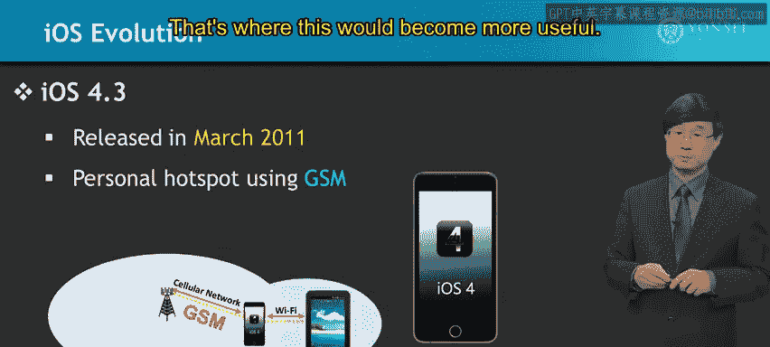
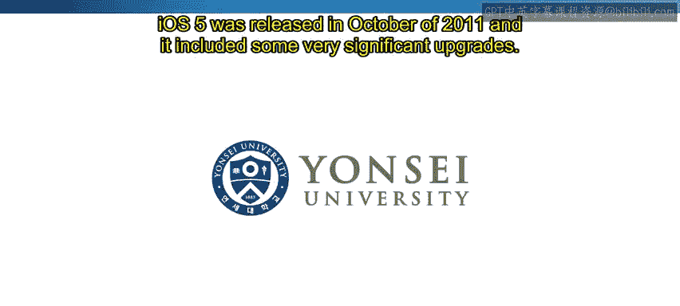

# 延世大学《新兴技术从智能手机到物联网再到大数据Emerging Technologies From Smartphone to IoT to Big Data》 - P63：27_5.1 iOS演进（第1部分）.zh_en - GPT中英字幕课程资源 - BV18hpFewEcG

🎼In this module， we'll study about smartphone operating systems。

 We'll focus on the Android and the iOS。 This is because these two are dominating the smartphone operating systems。

We will look into the evolution and then the architecture of iOS and Android。

 but we will start with iOS first。 The reason is because the first smartphone。

 the iPhone was using iOS。 and this was the first operating system to go into action。

 So iOS evolution。 here we go。Steve Jobs introduced the iPhone on January 9， 2007。

And the iPhone and the iPad started a new era of smart devices， mobile apps and mobile computing。

 This was a revolution in the electronics and IT industry。😊，IOS1 was released in June of 2007。

This was the operating system of the first iPhone。And it included the features of。

The core iOS user interface supporting capacitive touchscreen pinch to zoom where you could zoom in like that and also inertial scrolling where you put your finger and roll up。

 and it will continue based on the movement。Mobile Safari web browser was included。

And visual voicemail was included。And Google Maps was used where the map were used as a reference of your location to support location based services in the future。

 where your GPS module would provide you with information of longitude and latitude such that you could be pinpointed on the Google Ma。

IOS 1。1 was released in September of 2007。The iPod touch compatibility was included。

 and iTune's Wifi music store was connectable。IOS 1。1。3。Was released in January of 2008。

And web clips on home screen were available， and icon arrangement features were also included。

A multi touch keyboard became available to use。And improved location finding capabilities were added。

The approximate position of where you were was collected from information that was provided from the base stations as well as the access points。

 base stations as in terms of your mobile communication base station and access points as in terms of your wfi access points。

 so this information was used combined together to help you find your location。

 in addition to possible GPS information。In iOS2， which was released in July of 2008。

 the app store became available。 This is a true revolution in mobile app distribution。

Improved app browsing and installation became possible。In addition。

 the iOS software development kit was made such that more functional apps could be designed and improved appearance was enabled。

The SDKs enabled developers to develop apps and place them on the app store。

 so all of this going together is indeed a true revolution of how mobile applications were becoming available and could be developed。

IOS 2 also included Con search， as well as Microsoft Exchange support and mobilebi Me。In iOS 2。1。

Which was released in September of 2008， the battery life and speed fixes were made。

In which the battery life was extended and speeds， the operation speed。

 the interactive response time were reduced。The iTunes Gen playlist became available。

And the drop called problemsm were fixed。IOS 2。2。Was released in November of 2008 and Google Street View was included。

In addition， podcast downloads became available。IOS 3。Was released in June of 2009。Where cut， copy。

 and paste， this feature was added， such that new text selection metaphor that works well with touch was added。

In addition， push notifications for third party apps became available。In addition。

 voice control became available and the features of multimedia message service MMMS became available and USB and Bluetoothtethering became available In addition。

 landscape keyboard and Find by iPhone were now available。IOS 3。2 was released in April of 2010。

Support for iPad resolution was included。And U app views for iPad were included as well。

Location based on Apple data and Bluetooth keyboard support was included。In addition to iBooks。

IOS 4 was released on June of 2010。And multitasking became available。Mululttiitasking。

 as in terms of fast app switching and save state were the features that enabled effective multitasking。

This allows an app to save the current state for easy reuse when returning to the app after multitasking。

Now one thing to notice that the apps on a smartphone on an iPhone。

 they were made to be energy efficient In addition。

 a smartphone has a limited amount of processing capability in its chipset and CPU and GPU in addition it has a limited amount of resources in memory。

In addition， it has a limited battery。So therefore。

 a lot of the apps that are on an iPhone typically have a time mechanism in which if you do not use it for a sufficient amount of time。

 then it will actually go off。Because of this， even though you're doing multitasking and the multitasking features are now available on iOS 4。

 sometimes if you don't go back to that app quick enough， it may be terminated。

 and that's not terminating due to the operating system。

 it's the app itself being energy and process efficient。Retina Dis support was also added。

Now for this in the following lecture， we're going to talk about iOS architecture。

 which will go through the operating system layers as well as the kernel and device driver characteristics there in that lecture further details about the iOS and how these features are connected to will be taught。

So until then， we'll go over the major features based on this evolution trend， and we will continue。

IOS4 also includes FaceTime video chat using WiF， which was a very popular application。In addition。

 home screen folders became available where you could drag and drop an app icon on another app icon and then automatically an app folder will be formed。

IOS 4。2。5 was released on February of 2011 and it included personal hotspot using CDMA technology。

 this means that basically you could create a hotspot using your iPhone where you're connected to 3G mobile communication CDMA technology through the mobile communication network as you're connected to the base Station and use Wifi to expand your network and serve as a hotspot itself。

In addition。In iOS 4。3。Which was released on March 2011， the personal hotspot using GSM。

 mobile communicationic technology was added。One of the characteristics you can see is that CDMA technology was a third generation mobile communication technology。

 which had a higher data rate support compared to GSM。Although GSM adding itself is valuable。

 the reason is because although GSM， which is a second generation mobile communication technology。

 supports a lower， much lower data rate， still due to the fact that GSM coverage is almost everywhere。

That even at a lower data rate， some of the data services were very useful。

 whereas your CDMA hotspot in the former page that you saw provided higher data rates， however。

 in some cases there would be limited places where only GSM and not CDMA would be available。

 that's where this would become more useful。

