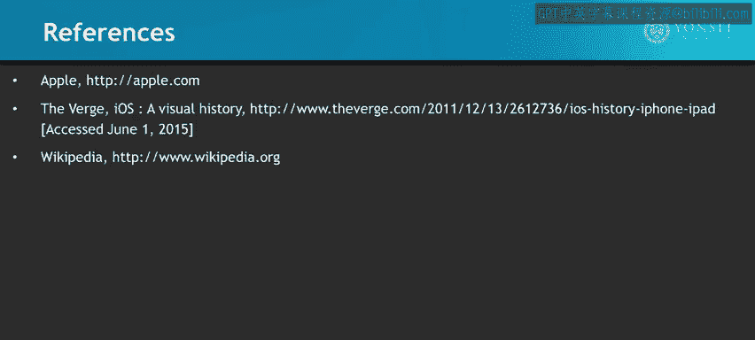

# 延世大学《新兴技术从智能手机到物联网再到大数据Emerging Technologies From Smartphone to IoT to Big Data》 - P64：28_5.1 iOS演进（第2部分）.zh_en - GPT中英字幕课程资源 - BV18hpFewEcG

嗯。IOS5 was released in October of 2011， and it included some very significant upgrades。

In iCloud being the first one where file backup and multi deviceev synchronization became available。

 In other words， your iPhone， as well as your iPad could be synchronized in its overall applications and data through your iCloud。

Then Siri was added， which is a virtual assistant that is based on voice control。

 this replaced the voice control application that was originally on the former versions of the iOS。

Ey messagessage was added and it became very popular because free multimedia message exchanges now became available。

In addition， no more PC activation requirements were linked。

 meaning that an iOS5 device does not need to be physically tethered to a computer through a USB cable when it is activated this means that the device can be activated and standal alone all by itself。

IOS 6 was released in September of 2012， and it included Apple's maps。So therefore。

 a departure from Google Maps was made at this time。In addition。

 FaceTime over mobile cellular networks became possible。

Add an included improved Apple ID integration。IOS6 also included Passbook。

 which is a mobile payment and rewards card mechanism， the mobile payments included tickets， coupons。

 boarding passes that were included in its service range。In addition， Siri enhancements were added。

Where sports scores， schedules， and player data could be called upon。

Restaurant reviews from Yelp were also available now。

And reservations from Open T became available as well。And Siri car control was added， however。

 this was for future development as Siri car control was not actually controlling a product at that time。

 so this was for future usage。Iow 7 was released on September of 2013。And it included touch ID。

Which is a fingerprint biometric sensor to unlock your phone。In addition。

 password less purchases from the app Store became available。In addition， Airdrop was added。

 which enabled ad hoc sharing of images， videos and files。In some social network applications。

 you could share images and videos。However， in some cases。

 they would reduce the resolution of your video or image。

And one of the characteristics of Airdrop is that you could send images and videos at their original resolution。

 and therefore Airdrop became very popular。FaceTime audio。

 where audio only versions of FaceTime between Apple users using Wifi， 3G or LTE became possible。

IOS8 was released in September of 2014， and it included continuity。

Which works with Apple's new Mac OSX 10。10 Yosite for enhanced interactivity between your iPhone。

 your iPad， and Mac computer。And you could send and receive text messages from a Mac in addition you could take a phone call from a Mac。

 making your Mac more like a iPhone inh。In addition。

 third party keyboard support became possible in iOS 8 as well。

And also you had the health kit and home kit。Where the health kit was a hub for third party fitness tracker data。

 and the home kit was for home automation， but this was for future development。In addition。

 the iPhone was going to be serving as a remote controller for the entire home when home automation became available through the Home Kit operating system support。

IOS 9 was released in September of 2015。And 3D touch， which is included in iPhone 6。

 6 S plus 7 and7 plus was included。So when pressing or holding the iPhone screen。

 it will trigger a pressure sensitive capability that will open up menus and actions。In addition。

 news and spotpotlight search was added where this would be able to provide additional information based on user experience。

In addition， Wall and move to iOS where some of the main features in iOS 9。

 where the wallet replaces the Passbook app。And it enhances the features of Apple Pay with support for Discover credit cards and discover debit cards。

 store reward， programs， and other things。This was a win win situation for Discover credit cards and the iOS 9 wallet features。

Moved to iOS made it easier to migrate from an Android device to an iOS device。

 so if you are going to purchase an iPhone or an iPad。

 then move to iOS would be able to pick up the data and your preferences as well as some possible apps and then move it over easily to your new iPhone or iPad。

IOS10。Was released in September of 2016。And it allows hiding home screen icons of built in apps。

Lock screen features were added where at the lock screen state。

 you could swipe left to open your camera， you could swipe right to open your today view。

 and by pressing the home button， you could unlock your device。

Home feature was for new home app to securely manage and control the home kit enabled accessories。

IOS 11 was released on September of 2017。And the files and Doc for iPad were some of its main features。

 where for files， the file manager for iOS devices included cloud storage。For Doc。

 the app controller center to quickly open and switch apps was added。In addition， for iPads。

 we had multitasking where two apps at the same time could you be used。

Slide over and split view mode became available。For a drag and drop， you could move text。

 photos and files from one app to another using drag and drop gestures。In addition。

 the Apple pencil function where instant markup and instant notes。Inline drawing。

And scan and sign became available。In the AR kit， the AR kit stands for Aed reality Kit。

This is a augmented reality platform for iOS devices。

And then there's the Control center customizing feature that was added。

These are the references that I use， and now we're going to go into the iOS architecture to show how all of these features are actually programmed and working on top of a processing kernel。

 and that will be the next lecture。Thank you。😊。

