# 延世大学《新兴技术从智能手机到物联网再到大数据Emerging Technologies From Smartphone to IoT to Big Data》 - P65：29_5.2 iOS架构.zh_en - GPT中英字幕课程资源 - BV18hpFewEcG

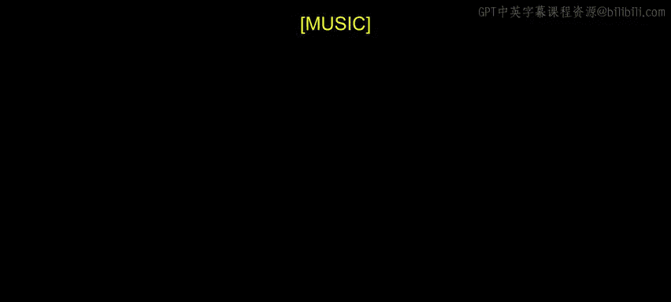

The iOS architecture for the iPhone and iPad。The overall iOS architecture， including the SDK。

 which is softwareft development kit。This consists of four distinctive layers and a kernel。

The Kocoa touch layer on top， the media service layer， then the core services layer。

 and the core OS layer， these four are what the iOS architecture is built upon。

 and at the bottom you have kernel and device drivers。

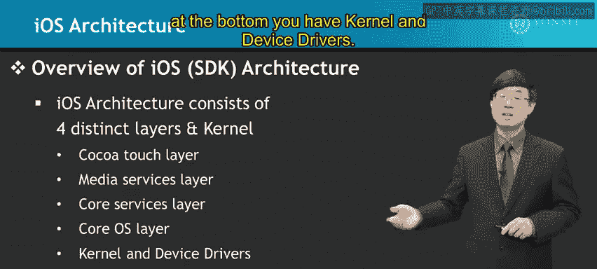

Looking at the architecture， it looks like this。And there are sub components that make the functionality work in each layer。

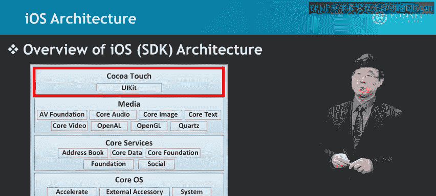

Looking at the top one， the Kocoa To layer， this includes the UI kit。

The top layer of the iOS architecture is the Cocoa touch layer。

 and it includes the framework for the user interface kit， the UI kit。

This defines the basic application infrastructure and provides core functionality such as multitasking and touch based input。

It provides many high level features such as auto layout and gesture recognizer and document support and printing。

This is primarily written in object C。Where some of the contents include the UI kit framework。

 the Ma kit framework， push notification service， message UI framework and。Address book UI framework。

 Game Kit frameworkwork， Even kitt UI framework， Ac F， and social F。

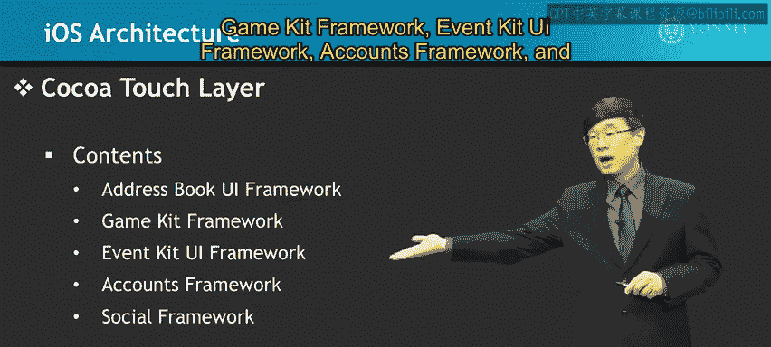

The next layer is the media layer， and here you can see various functions for graphic support。

 audio and video support are included in here。

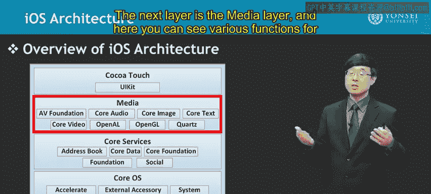

Looking at the media layer， this is what provides iOS with all the functionalities to support audio。

 video， animation， and graphics。The core video frame and the core text F are included in addition the image IF and a sets library F are also included。

The core graphics framework and the core image framework are also included。

Then there's the quartz core framework as well。More on contents include。

The GL kit framework and the open GLES framework， what does that mean Well the GL stands for Graics library。

 it is a library where a lot of the graphics processing functions are all included。

Then the OpenGL ESS stands for embeddedd Systems， so you can look at the embedded systems and their functionalities。

 their processing capabilities， and use that as well。The New Stan kit framework was also included。

And the iOS audio support and audio videoo Foundation framework are also in the media layer。

In addition， we have the core audio frameworks and open audio library， in addition to the media。

 player framework and core media framework as well。This is what is in the media layer。

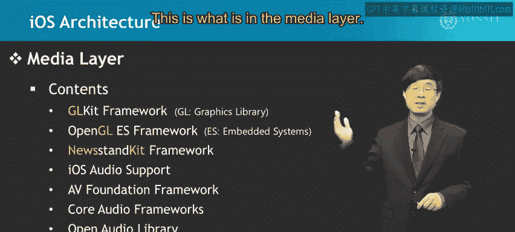

Then going down one layer， we look into the core services。

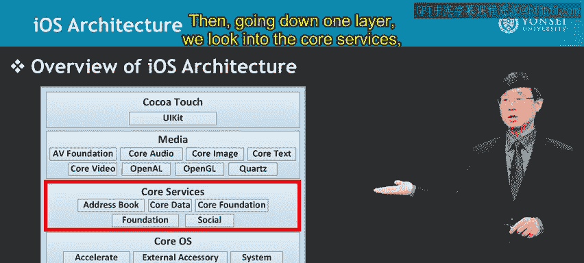

Which include。The functions to manage the fundamental system services for native iOS applications。

 such as providing key features for block objects。Grand Central Dispatch。

 in app purchase and iCcloloud St。The contents include。Foundation F and Addersbook framework。

 as well as corere function F， C F for short， CF network F。As well as core data framework。

 core media framework， and core telephony framework。In addition， there is an event kit framework。

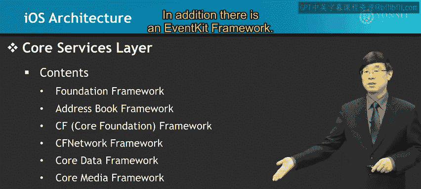

The lowest layer of the iOS architecture is the core OS。

 and that has the following functions in which it provides processing and interfacing and security support for the iOS and its overall applications。

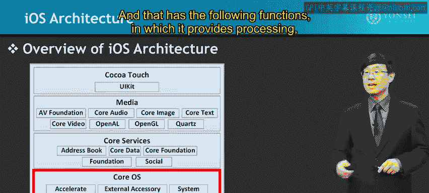

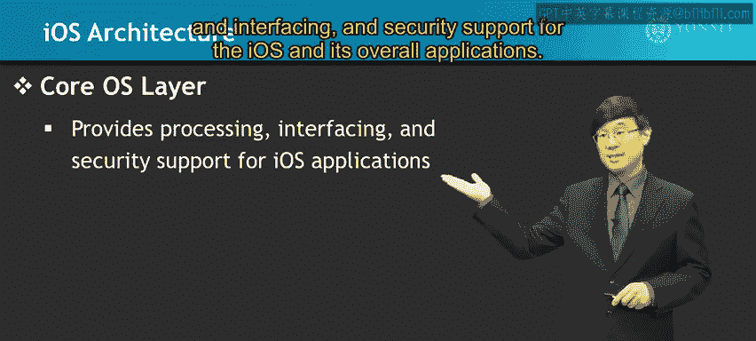

Where it encapsulates the kernel environment and low level Unix interfaces。The contents include Ac F。

External access framework， security framework， and system。Then we have the kernel and device drivers。

 so the iOS is on the kernel and device drivers， the kernel is where it provides processing of the operation threads。

 in addition the device drivers enable interfacing with other input output devices。

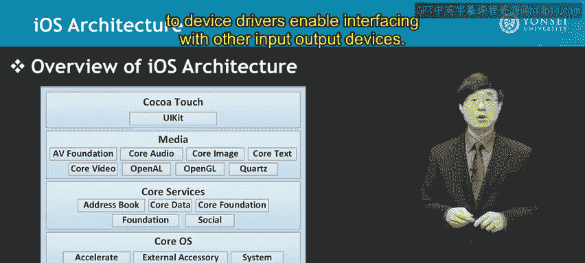

Looking into the details， this is the lowest layer of the iOS architecture and in some places they do not include it in the iOS architecture。

 having the iOS architecture above and this is the kernel and device driver's layer separate so it's based on how you see the iOS architecture。

 sometimes the kernel and device driver's layer is included and sometimes they will not。

It is formed of the kernel and device drivers and the kernel environment is built on top of the Moch 3。

0 This is a micro kernelnel technology what does this mean well the kernel has a full stack of processing firmware that is used and this interfaces with the CPUUs。

 the chipets， the GPUs such that you can get your processing capability。

What we mean by a micro kernelnel technology is that this is reduced to make it compact and fast。

 and that is what this is doing right here。The kernel and device Drives layer provides high performance networking facilities as well。

 and that is because it includes device driver capability。

It supports multiple integrated file systems。And contents wise， it includes the BSD file system。

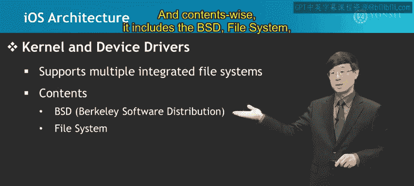

The matchch， microcro kernelnel technology and networking。

And this is what is included in the iOS architecture。

 and each layer has unique functionalities that were added that enable the iOS evolution to evolve into its current form。

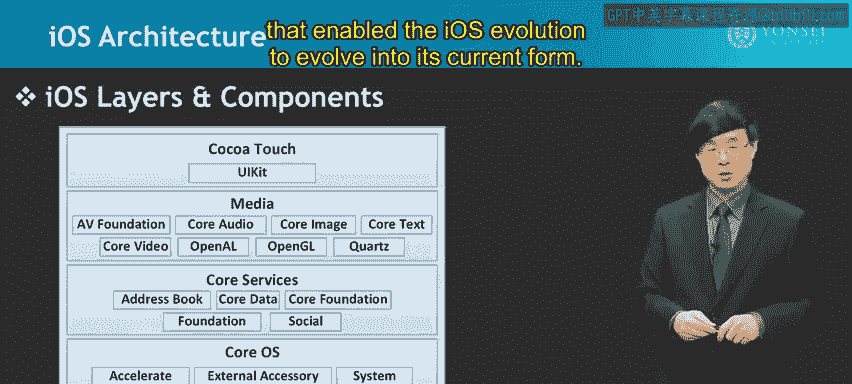

In the next lecture， we'll talk about Android。

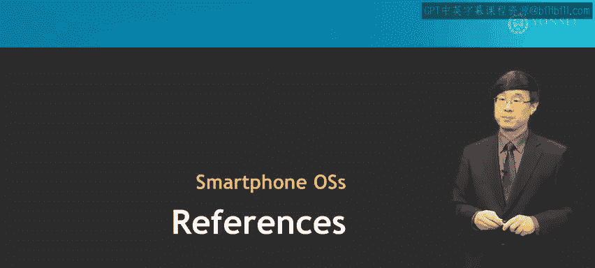

These are the references that I used and I recommend them to you， thank you。

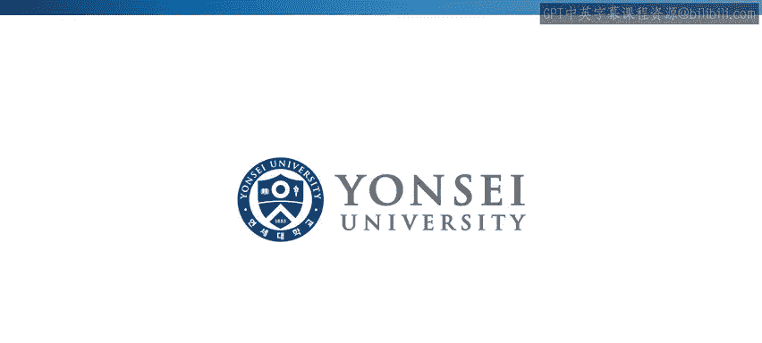