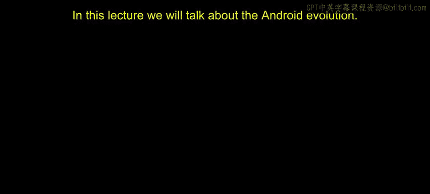
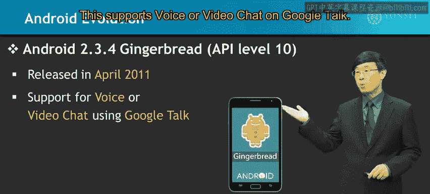
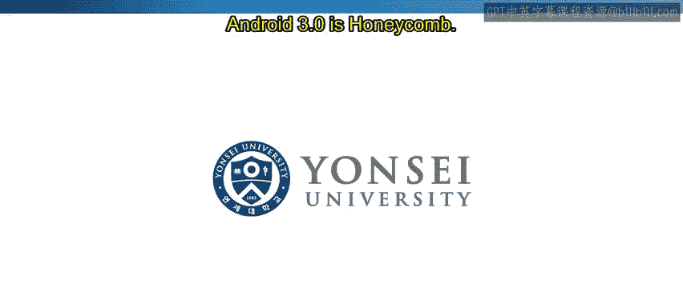

# 延世大学《新兴技术从智能手机到物联网再到大数据Emerging Technologies From Smartphone to IoT to Big Data》 - P66：30_5.3 Android演进（第1部分）.zh_en - GPT中英字幕课程资源 - BV18hpFewEcG

In this lecture we will talk about the Android evolution。

 and this is important because Android is the most widely used。

Operating system in the world for smartphones。Android started with the Android beta test version。

That was released in November of 2007。And it is the beginning of the Android mobile operating system。

Android 1。0 was released in September of 2008， and it was the first commercial Android operating system。

Android versions are linked with API levels。The API level is what we have as an application programming interface。

 and it is a level that is used as a general indicator to show how much the programmer can communicate with functions that are included in the device。

Higher API levels indicate an increased functionality control feature。Starting off with Alpha。

 which is Android 1。0， this is API level1。And grouping of folders into a single folder icon became available。

And access to web email servers were included。WiF and Bluetooth support was included and Google syncync。

And wireless synchronization of Gmail， people and calendar were included as well。

The basic applications and additional applications that were in the alpha version。Where calendar。

 maps， Street View， talk， voice dialer， and wallpaper were included。For additional applications。

 for the phone， the dialer， for the launcher， the home screen， for the gallery， we had pictures。

 the alarm clock and the calculator were included as well。In the beta version。

 which is the Android version 1。1， this reached API level 2。This was released in February of 2009。

 and this is different from the beta test version that we talked about in the former pages。

This was released on the HTC Dream smartphone first。

And attachments in messages can be saved with the new features。Android 1。5 cupcake was at API level3。

This was released in April of 2009 and starting from Android 1。5。

 the Android versions were each given a confectionary code name in alphabetical order because we had the alpha and then we had the beta at C。

 we had cupcake。The Re browser copy and paste was added and also user pictures added for favorites in context。

In addition， screen transition with animation became possible。Android 1。5 cupcake also included。

Auto pairing with stereo support for Bluetooth A2 DP and A V R CP profiles。

Where A2DP stands for Advanced audio distribution Profi。

Which defines how multimedia audio can be streamed from one device to another over Bluetooth。

Where one device would most likely be your iPad or iPhone。

 and the other device would be like a wireless headset。A hearing aid or a car audio system。

The AVRCP is audio videoo Re control Pro。And this enables a single remote controller to control all local audio video equipment。

This can be used with a 2DP。Third party virtual keyboards were now possible to use。

And text prediction and custom Word user dictionary were added in this feature as well。In addition。

 widgets became available， miniature applications that can be inserted into another application。

 this is what widgets are and from this point in on widgets have became very popular。

This receives periodic updates。And it's used in home screen customization。

You could touchuching leads to direct app access， which is very convenient， and in addition。

 some of the representative widget examples for the time included weather widgets。

 clock widgets and sports score trackers。In 1。6 donut。

 this reached API level4 and it was released in September of 2009。Text to speech engine was included。

 multilingual speech synthesis engine was added， and this enabled Android applications that could speak a string of text。

 this became very useful for when you were not able to look at the screen。

 the display and the information could be read out to you。In addition。

 enhanced fully integrated gallery， camera and cam codeder features were added。

 This made the camera access faster。Donut also included multiple photo selection for deletion and CDMA EVDO and 802。

1x support was added。What does this mean， this CDMA and EVDO is an enhanced third generation mobile communication technology that supports high data rates and 802。

1x support it enhances Wifi technologies these were added for support in Donut Android 1。6。

VPN virtual private network support was added as well。

A virtual point to point private dedicated network connection set up in a public network became available。

Where virtual tunneling protocols and packet traffic encryption commonly were used。

What does this mean Well， in a public network， in a network that is shared by multiple users。

 you could create your own virtual private connection between two computers or a computer and a server or your iPhone and a server。

This is very good how do you do it Well in order to make a private connection inside of a public network you need virtual tunneling technology。

 that's where the virtual tunneling protocols were added and used in addition for your tunnel session you want security that's where the packet traffic encryption became needed。

The wide video graphics array， WVGA screen support was added in Donut。

Where wider VGA screens with the same 480 pixel height became available。As in terms of that。

 the aspect ratio of 3 to2 in which you have a 7，20 by 480。

Aspect ratio of 5 to 3 based on a 800 by 480。Approximate aspect ratio of 16 to9。

 which included the modes of 848 by 480。852 by 480， 853 by 480 and854 by 480 were included。Android 2。

0 EClare reached an API level of 5。And this was released in October of 2009。

It included account syncnc， where multiple user accounts on a single device became possible。

Synchronization of email and contacts were supported。And support for Bluetooth 2。1 was included。

EClLaiare also enabled you to search all saved SMS and MMMS messages。

And supported new camera features。Flash support， digital Zoom。

As well as scene mode and white balance。And color effect and macrofocus。We're included。

EClare also includes enhanced Google Maps and enhanced virtual keyboard。

 where improved typing speed using dictionary suggestions became available。

Where it included words used by the user and included user contact names。

EClLaiare also includes motion event class， where multi touch events were trackable。

And live wallpapers were supported where home screen background animation became available。

Microsoft Exchange email support was also included。Android 2。2 to 2。2。3 f yo frozen Yogurt。

This reaches API level 8。It was released in May of 2010 and the Android C2DM Cloud2 device messaging support was added。

This enables push notification for third party developers。It uses email， contacts and calendar。

Adobe Flash support was added。In addition to USBtethering。And Wifi hotspot technology。

 in addition to multiple keyboard languages and dictionary quick switching。We're at it。

In the Android 2。3 to 2。3。2 gingerbread， this reaches API level 9。

This was released in December of 2010 and front and back camera support was added。

 so as of gingerbread， now because you have a front and back camera。

 that means that selfies become possible。This had also improved virtual keyboard technology added。

Which had intuitive text input， improved accuracy and improved suggested text and voice input mode。

In addition， there was a easy to use copy and paste feature where word selection by you press and hold。

 then a copy and paste would become available。SIP based voiceiceOver IP support became available。

 where SIP stands for sessionession initiation protocoltocol。

 this was a protocol that was used to enable VoiceOver IP over IP networks where IP multimedia communication sessions were now available。

Where voiceiceOver IP， video call and instant messaging were all supported。

For sensors that were added on to smartphones， the gyroscope and barmeterter features and others were supported through the gingerbread technology。

In addition， near field communication NFC was added， which was a significant contribution to how。

People could exchange small information segments and support various applications such as payments。

 posters， stickers， and advertisement。In addition， Android 2。3。4 gingerbread reached API levell 10。

 and this was released in April of 2011。This supports voice or video chat on Google Talk。

Google Talkk is an instant messaging service， and it provides text and voice communication。

