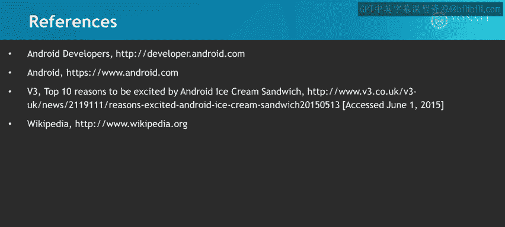

# 延世大学《新兴技术从智能手机到物联网再到大数据Emerging Technologies From Smartphone to IoT to Big Data》 - P67：31_5.3 Android演进（第2部分）.zh_en - GPT中英字幕课程资源 - BV18hpFewEcG

嗯。Android 3。0 is Hocom， and this reaches API level 11。This was released in February of 2011。

And it is supported， simplified multitasking。And it's the first tablet only Android OS。

 it was optimized for small tablets。It included the action bar and system bar where the action bar had top of the screen access。

Contexual options， navigation and widgets， the system bar had bottom of the screen access。

Where notifications， status， and soft navigation buttons were activational。

Honeycomb also included improved tablet keyboard where improvements for faster and more efficient and more accurate typing on larger tablet screens were supported。

 in addition the camera features for quick access， where camera exposure， focus flash， Zoom。

 front facingcing camera， time lapse and other features were supported。

Honeycomb also included multi core process of support。Then external IO device support。

 input output device support was enabled through Android 3。1 Hocom， which had an API level of 12。

This was released on May of 2011， in which keyboards， pointing devices， joysticks。

 and game pads were supported。Ice creamre Sandch is Android 4。0 to 4。0。2。

 and we reach an API level of 14。This was released on October of 2011， where easy to create folders。

 drag and drop creation was possible。An enhanced visual voicemail was supported through controllable。

 speed up or slow down voicemail messages。In addition。

 face unlock was included where facial recognition based smartphone unlocking was added。

 and this opened up the facial recognition era as well as improved camera functionality。

 where zero shutter lag， time lapse setting， panorama mode and Zoom control during recording features were added。

In addition， location and person based gallery layout was a feature that was added。

Built in photo editor was added， Wifi Direct was added as well。Android 4。1 is JeellyB。

 and this reaches API level 16。This was released in July of 2012。

 where bidirectional text and other language support was enabled。

Bluetooth data transfer was also included。Android Beaam was enabled Android Beaam is an instant file sharing application where two NFC enabled phones by touching each other activate this capability。

Key mapps are keyboard maps。Where additional international key maps and special layout keyboard types can be installed。

Multichannel audio was also supported by Jeelly Bean。

This is supported on smartphones with multichan audio output through HDMI。

The key feature is that for non equippedpped devices。

 Android automatically downmes the audio to fit the number of audio channels supported by the smartphone。

 so there was adaptation capability built into this。Android 4。3 is jellybean。

 and this reaches API level 18， the same jellybean， but a higher API level。

Where Bluetooth low energy， BLE is supported。The AVRCP 1。3 is supported。

Where this is Bluetooth audioudio video Re control profile。Android 4。4 is Kitcat。

 and this reaches API level 19。This was released in October of 2013 and it supports wireless printing。

Step detector En。And NFC hostcard Iulation， where smartphones are capable of replacing smart cards。

As well as sensor batching， this collects and delivers sensor events efficiently in batches。

In addition， KtCt included a loudness enhancer where this would increase the loudness of speech in media playback apps。

There was also a built in screen recording。Which primarily was for developers。

 and when they were to use the Android debug bridge， the ADB。

Then they would be able to use the built and screen recording features。The Bluetooth map。

 which is the message access profile， this was enabled in KitCt。

 where apps can exchange messages with a nearby device。Android 4。

4 KiKt had an API level upgrade to level 20。That was released in June of 2014。

Wearable extensions were added， where Android， where platform for smartwatches were added。

 and this is truly significant because now this opened up the era for smartwatches。Android 5。0 to 5。

0。2 lollipop was based on API level 21， and it was released in November of 2014。

This is when 64 bit CPU support were enabled， this was a big migration from the 32 bit CPUs to the 64 bit CPUs and the operating system was able to support it。

Audio input and output through USB devices were possible。

And third party applications can read and modify data on external storages like SD cards。

This made the application and data control much more flexible due to this feature。

Memory of recent used applications were kept where even after restarting the device。

 the memory of recently used apps was maintained。In addition。

 15 new languages were added into the lollipopop OS package， which included these。Android 5。

1 lollipop reaches API level 22。And this was released in March of 2015。

Official support for multiple SIim cards were enabled and device protection was enabled as well。

 if a device is lost or stolen， the device will remain locked until the owner signs into their Google account。

In addition， high definition voice call support were enabled only between 4GLT devices。Android 6。

0 marshmallow reached API level 23。 It was released in October of 2015。

 where Google now on tapap feature was added， so by holding down the home button。

 Google automatically searches for In apps for similar things that are displayed on the screen So what you're looking on the screen if you want to find something related to this。

 then that's where you use now on tapap feature。 it will find information related to what you have on the screen。

The do mode was added， so in order to save battery power。

 do mode reduces the CPU speed when the screen is off。

Marshmallow also includes support for native fingerprint reader。And USB type C。

As well as 4K display mode for apps。And adoptable external storage to behave like internal storage。

 This helps in various ways where we could save files and also read files from external storage。

Android 7。0 to 7。1 is Nuga， and this reaches API level 24 and 25。This was released in August of 2016。

Where native multiin support was added。Displays multiple apps on screen simultaneously in a split screen view。

Daydreing， which is a virtual reality platform developed by Google was added。

 in which it works on phones and headsets with wireless controllers。Android  a。

0 is Oreo reaching API level 26。This was released in August of 2017。

It is two times faster in boot time。 This is based on a measurement on a Google Pixled phone。

And picture in picture mode is enabled。Multi display support。

 as well as notification improvements were added， notification channels， notification dots， badges。

 and notification snoozing。In addition， Google PlayProtect and Android instant App。

 these features were added where。Google Play protecttect is。The security system for Android devices。

And the Android instants App is the new apps for web browser without installation。

The features of how these are made possible in the overall operation will be explained in the following lecture when we talk about Android architecture。

Oreo also includes Project Treble， where this is a new modular architecture for easy and fast Android updates。

Separation of Android operating system framework。And vendor implementations were divided。

These are the references that I used， and I recommend them to you。 Thank you。

