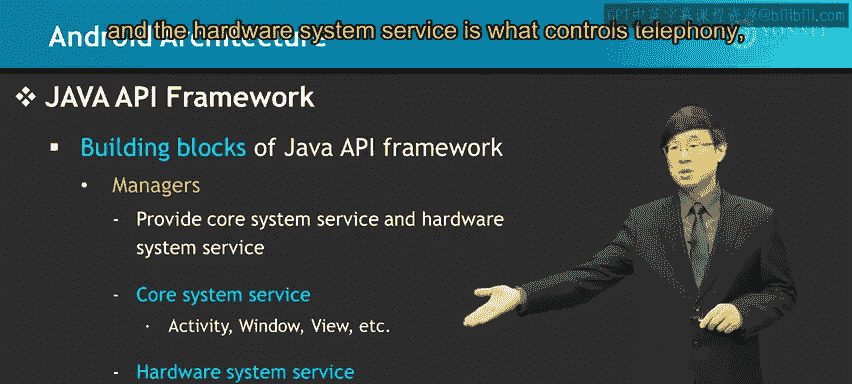
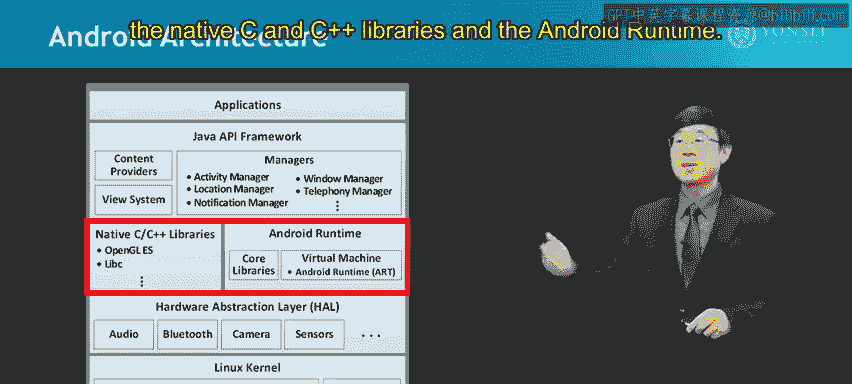
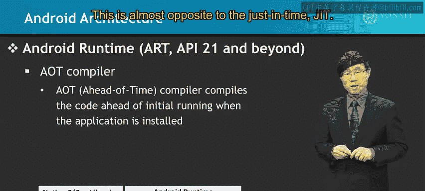
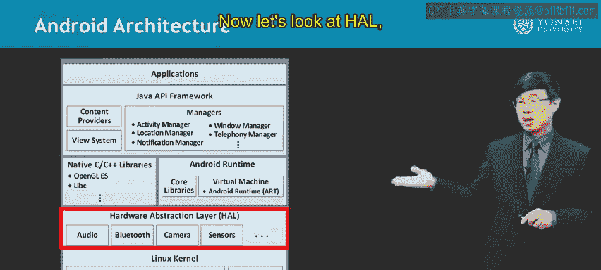
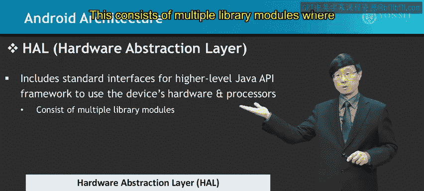
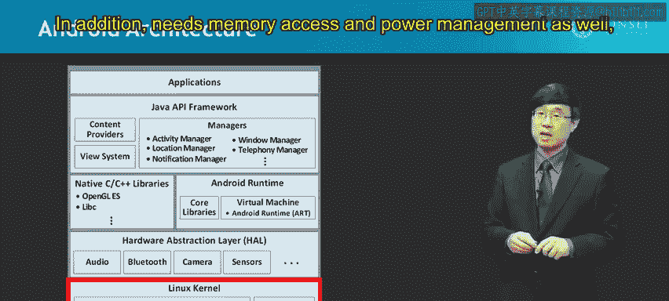
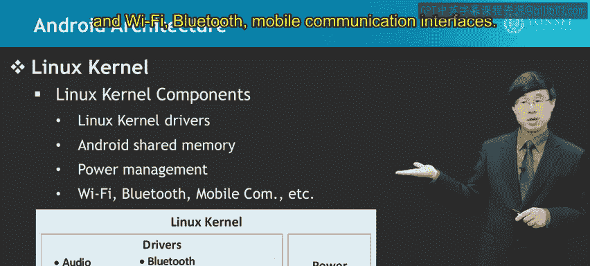
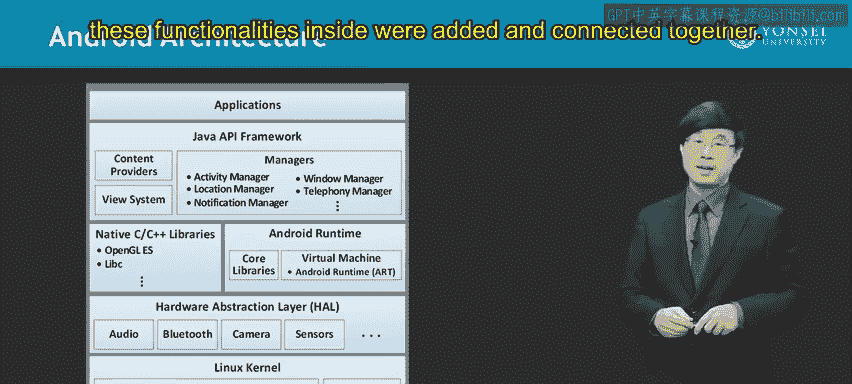

# 延世大学《新兴技术从智能手机到物联网再到大数据Emerging Technologies From Smartphone to IoT to Big Data》 - P68：32_5.4 Android架构.zh_en - GPT中英字幕课程资源 - BV18hpFewEcG

Now let's take a look at the Android architecture， which is the world's most widely used operating system for smartphones。

The Android operating system， Android is the most popular operating system for smartphones。

 and it includes the operating system， middleware and key applications based on this structure where you can see the structure here。

 and it's based upon a Linux kernel the Linux kernel includes drivers and power management tools。

Looking at it from the top， the Java API framework。

 all features of the Android operating system are available through APIs that are written in Java API once again is an application programming interface。

Java APIs are provided for developing and using apps。

Further details of this are built upon building blocks of the Java API framework， where View systems。

 this helps building user interface apps， UI apps， and this includes text box， buttons and lists。

Then there's content provider This enables apps to access data from other apps。

 such as context and gallery。In addition， there's the managers。

 which provides core system service and hardware system service。

The core system service is what activates and controls the activity， the window， the view。

 and other things， and the hardware system service is what controls telephony， location， Wifi。

 USB and other features as well。

The applications directly send their process needs and use the Java API framework to get their support。

 but then the Java API framework will also need to use the native C and C++ libraries and the Android runtime。

The native C and C++ libraries support programs that are written in CNC++ in the Android system。

 these include the ART N HAL， which I will explain very soon。Popular libraries include。Open GL ES。

 GL stands for Graphic Library， and ESS stands for embeddedded Systems。

2D and 3D graphicraph library with OpenGL is supported。Open Max Ale。

 This is a companion API to open SLES for multimedia video and audio supporting native multimedia handling。

In addition， the Lib C， this is the library C， which is a C runtime library。The Android runtime。

 this is a running environment instant for Android applications。

Virtual machines are used for Java apps that will run on different Android devices。

 and we call them JVM， Java Vi machines。There are two where the Java Dalvic virtual machine。

 this was before API 21 lollipop， and from API 21 lollipop and beyond we have the Android runtime。

First， let's have a short review Android 5。0 to 5。0。2 is lollipop， this is the API level 21。

And this was released in November of 2014 what were the significant enhancements Well 64 bit CPU support was enabled from the former 32 bit processing architecture moving on to a 64 bit architecture。

 this was very important In addition， audio input and output through USB devices were enabled memory of recently used applications were enabled in addition。

 15 new languages were added in API level 21 lollipop。Going back to Android Runtime ART。

 which is API level 21 and beyond the Java Dalic virtual machine。

This is based on a JIT just in time compiler that's used。

The JIT compiles the code when the application starts。

And JIT uses partial section of the code in case of a request。

Android Runtime ART is API 21 level and beyond。And let's first look into the Java Dalic virtual machine。

ART includes support for improved debugging environments and improved garbage collection。

 What do you mean by garbage collection well？For example， when garbage collection compacts the heap。

 the display becomes choppy and the user interface responsiveness becomes poor。What do you mean。

 Well， this heap right here is talking about heap memory。On a smartphone。

 you have limited amount of processing capability supported by the chipet， the CPUU， the GPU。

 in addition you have a limited amount of memory in your flash memory， your RA。

 as well as your solid state memory units。On a smartphone， therefore。

 you need to clean up the applications and the supporting data that has already been completed。

In order to do that， that process is what we call garbage collection。Of cleaning out information。

 of former processes that are now done。When that happens， especially in the heat memory。

 the garbage collection will compact the heat memory parts for those components。

 then what will happen is that the display will become choppy and the user interface response time。

 the interactive response time talking about when you touch the screen until the response comes out。

 this will become slower so therefore you need some improvements and that's what the Android runtime does。

 it improves garbage collection features。ART provides improved automatic memory management to prevent these type of problems Pre cool。

 isn't it？The AOT compiler。This is the ahead of time compiler。

 this compiles the code ahead of initial running when the application is installed。

 this is almost opposite to the just in time JIT。

Improvements in app speed and power consumption performance are obtained。But。

You may require a longer app installation time because when you install this。

 you're going to have the compiler compile the code ahead before you actually run it。

 and that is where you get the gain in speed and power consumption。

 but then again it will take more time。

Now let's look at how the hardware abstraction layer。And in here。

 this includes standard interfaces for higher level Java API framework to use the device's hardware and processors This consists of multiple library modules。

Where customized to specific types of hardware components， such as your Bluetooth。

 your camera module and others as well， and looking at down here。

 you can see the modules that we're talking about。Then comes the Linux kernel， the kernel。

 all of the operating system units that you see here need something to process it。 In addition。

 needs memory access and power management as well。 and that is what the kernel does for you。😊。

Here， the Linux kernel， this is the processing foundation of the Android operating system。

It executes all low level functions， such as processing， the threading， the power management。

 and also the input output devices， which you see right here。For Bluetooth。

 Wifi and mobile communication。The kernel components include the Linux kernel drivers。

The Android share memory。Power management， and。Wifi， Bluetooth， mobile communication interfaces。

This is the Android architecture， and as you can see。

 these functional layers and functional blocks inside enable the Android system to work。

 and the various evolutions were added and added as these functionalities inside were added and connected together。

These are the references that I used， and I recommend them to you， thank you。

