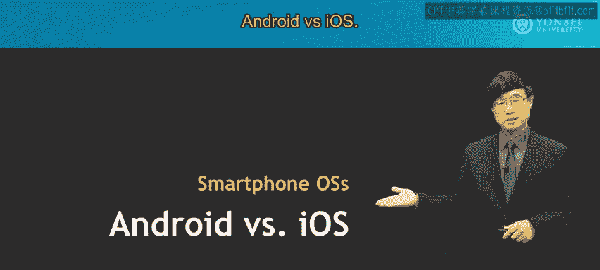
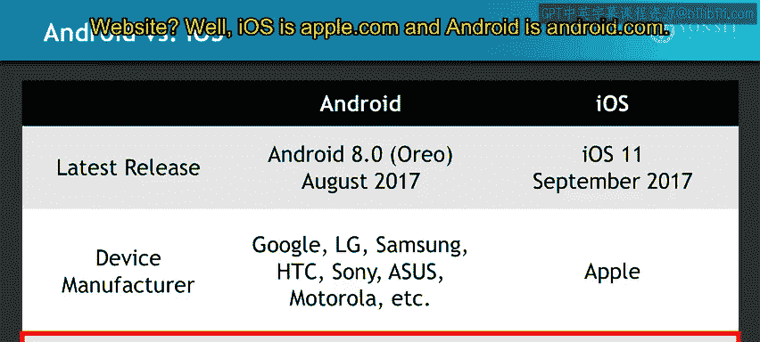
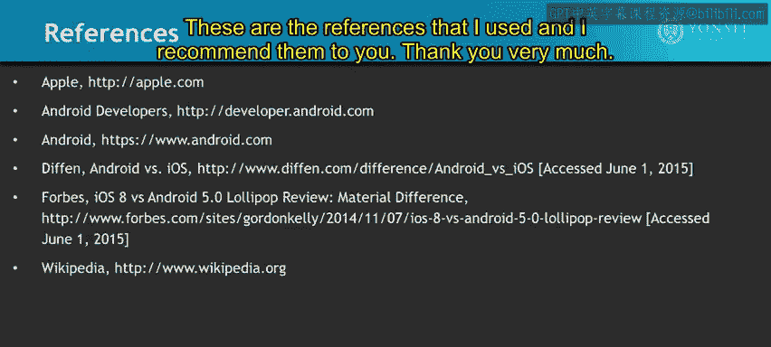

# 延世大学《新兴技术从智能手机到物联网再到大数据Emerging Technologies From Smartphone to IoT to Big Data》 - P69：33_5.5 Android与iOS比较.zh_en - GPT中英字幕课程资源 - BV18hpFewEcG

嗯。🎼Yeah。Android versus iOS， let's compare some of the characteristics and pros and cons。

Looking in here， we start with Android and iOS。Where the developers are here for Android。

 it's Google and for iOS， it's Apple。The operating System family， Android is Linux based。

 and iOS works on OSX and UniX。Customizability wise， Android is high and iOS is lower。

This is because Android is an open source platform。And iOS is a close source platform， however。

 parts of it are opened。So that is why customizability for Android is higher。

Looking at initial release， iOS was released with the iPhone on July 29， 2007。

Android was released a year later in September 23rd of 2008。The programming languages for Android。

 RRC， C++ and Java， for iOS， it is C and C++。And objective C and Swift are used。For source model。

 Android is open source。 Ios is close source， but has open source components。 Once again。

 this is why Android has high customizability where ios does not。😊，Internet browser wise。

 Android is Chrome based and iOS uses Safari。Voice commands。

 Android uses Google now and iOS is using Siri。The app Store wise。

 Android uses Google Play and other app stores， where iOS uses the Apple App Store。

Looking at the recent releases， Android is the Android A。0 Oreo。

 which was released on August 2017 iOS 11 was released on September 2017。Dvice manufacturer wise。

 you can look at it like this。 iOS is on the iPhone and iPad， and these are Apple products。

For everybody else， it is Android almost now， so you can see under Android， there are many。

 many vendors。Website Well iOS is Apple。com and Android isand。com。

Apps available on iOS and Android。Most popular apps are available on both Android and iOS。

Google's App Store is more open and tends to include some apps that are not available on iOS。

IPad has an advantage in tablets as many apps are designed specifically for iPads。

Many Android tablet apps are scaled up versions of apps that were made for Android smartphones。

Developers at smaller companies may first develop their app for an iPhone or iPad and then conduct development in Android why would they do that Well the reason is because iPhones and iPads have very distinctive structures where you know what you're developing it for as in terms of processing capability。

 memory options and especially the display structure。Well， as for Android。

 there are so many vendors creating so many device types。

Where the displays are different and also the memory， CPU， and other features are different as well。

 based on vendor specifications。That is why some developers will develop an application for an iPhone or an iPad first。

 and then after they see how it works well， they will go and develop it for Android。

 fitting and mixing and matching it for a variety of different devices so that it will fit well。

Looking at building and publishing apps， first， Android， Android apps are programmed in C。

 C++ and in Java。A free download of Android source code is available and the Android SDK。

A  one time $25 registration fee is required for app developers that need to publish an app。For iOS。

IOS apps are programmed using objectject C and Swift。

Developers need to annually pay $99 to access the iOS softwareft development kit and publish in Apple's App Store。

IOS SDK is only available for Mac platforms。This $99 that developers need to pay in addition。

 being able to publish something on Apple's app Store。

 you first need to go through a checking process to make sure that your app fits the needs and the requirements of the operating system as well as the product manufacturer requirements and Apple does a good job in making sure that apps that are placed on the Apple App Store fit this requirement。

Android， pros and cons。A variety in hardware selection is available。

Various Android devices are available。And various hardware capabilities。

 screen sizes and features are available as well。Various prices。

 as well as customizable user interface， is one of the features of Android。

A easy to customize home screen， adjustable app icons and widgets are what make that possible。

IOS pros and cons。Massive a ecosystem。Where a very large Apple app app store is available and app quality check is done。

Lockdown interface。No third party apps can be preinstalled by the mobile operator。

 this is bad for mobile operators and could be good and bad for individual users like us。

Limited home screen customization options where you have your apps in rows of app icons。

Softter upgrade。IOS has a very good software upgrade system。

And this has very good upgrade notifications and reminders。

Device capability is considered in the upgrades。And also privacy control iOS provides good control of user private information。

 such as context and location， and this has been showing something that iOS and Apple device users are enjoying。

These are the references that I use， and I recommend them to you。 Thank you very much。

