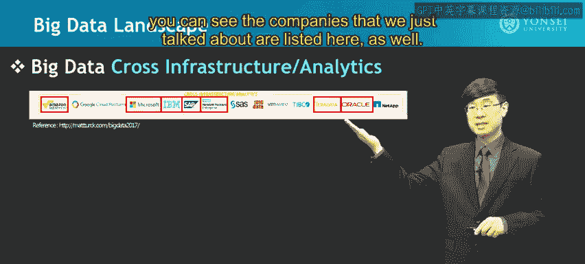
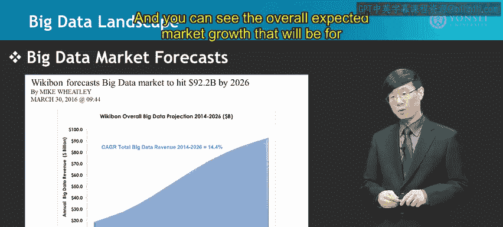
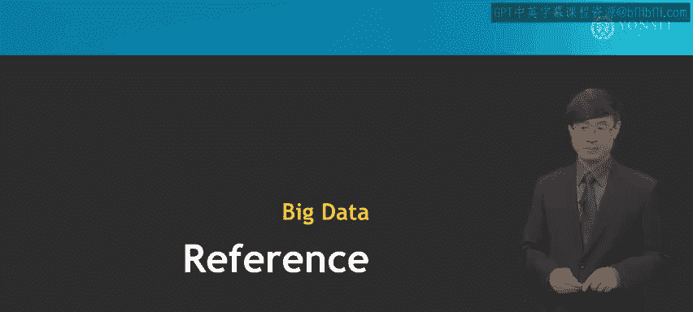
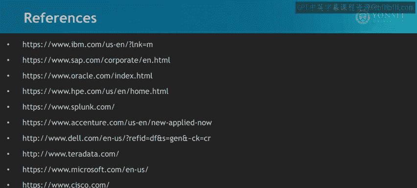

# 延世大学《新兴技术从智能手机到物联网再到大数据Emerging Technologies From Smartphone to IoT to Big Data》 - P6：5_1.12 大数据生态系统.zh_en - GPT中英字幕课程资源 - BV18hpFewEcG

🎼Yeah。The big data landscape。Looks like this in 2012。

 where you can see the companies that were participating。And in 2017， this is how it has changed。

 So many more companies have been joining and the number of products and the product diversity has been growing tremendously。

😊，Let's focus on one part。Which is the infrastructure and some of the companies that we just were talking about are listed here with other companies。

Then looking into the analytics part， you can see the companies that we were studying about and some other companies as well。

On another part of the landscape， you can see applications and enterprise and a diverse range of companies。

 as well as some of the ones that we looked into。And for that area over there is the cross infrastructure analytics。

 and you can see the companies that we just talked about are listed here as well。

Looking into the future up to 2026， here is a prediction， a forecast。

 and you can see the overall expected market growth that will be for big data technologies。

Within here， there is。Three， which is the part over here， which is the biggest for software。

 and then there's for hardware and over here is for professional services。

These are the references that I used， and I recommend them to you。 Thank you。

