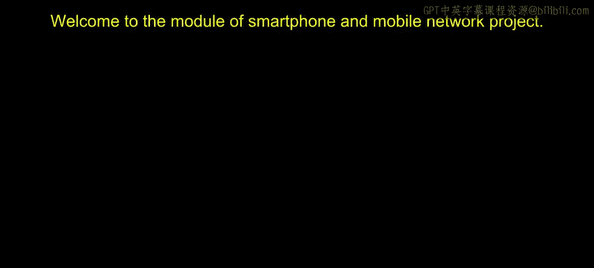
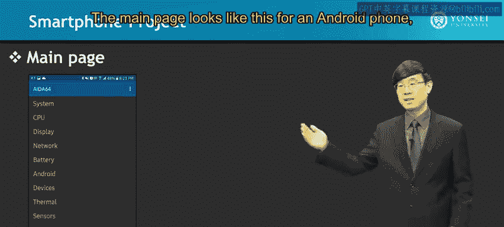
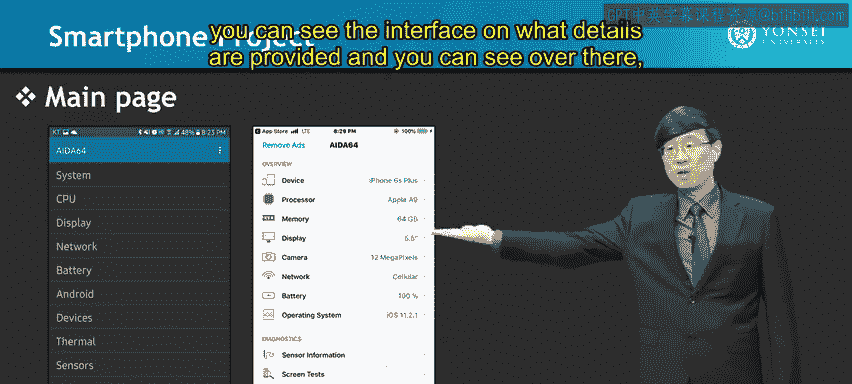
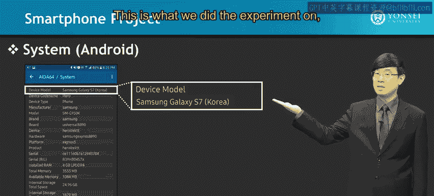
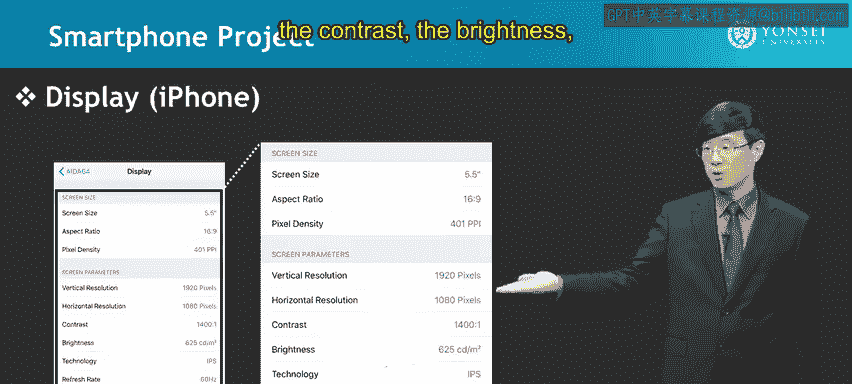
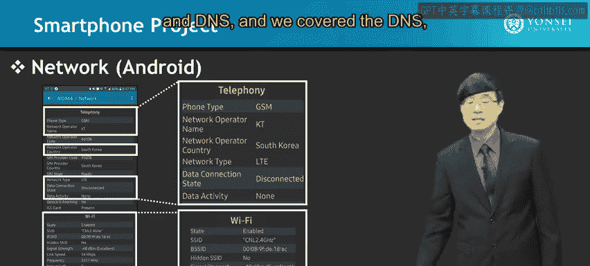
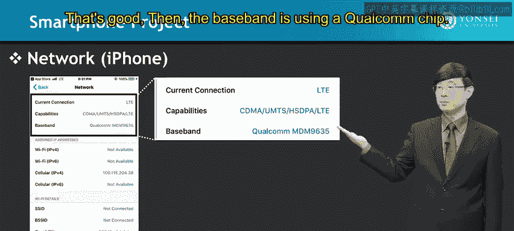
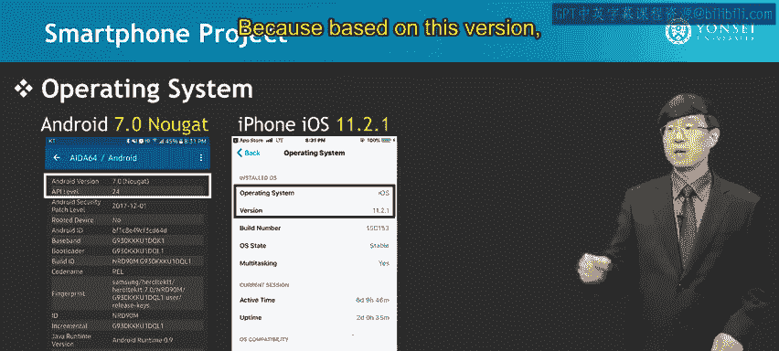
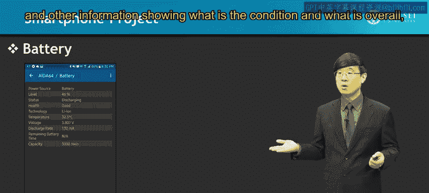
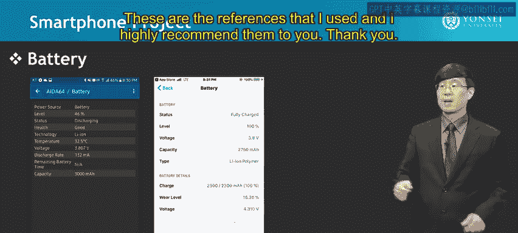

# 延世大学《新兴技术从智能手机到物联网再到大数据Emerging Technologies From Smartphone to IoT to Big Data》 - P70：34_6.1 智能手机项目.zh_en - GPT中英字幕课程资源 - BV18hpFewEcG

응。🎼Oh。Welcome to the module of smartphone and mobilebi Network Project。Through this course。

 we studied a lot about the hardware， software and various aspects of smart devices and how they are going to be used。

In this project， we're going to look into some real measurements。

 measuring inside the smartphone and also measuring the smartphone network。Here we go。

 We' are going to start with the AIA 64， which you see right here。

 This is available in the Google Play Store and the Apple App Store。

It provides hardware and software information of your smartphone。

We're going to analyze the specifications of your smartphone in the details of the system information。

 CPU， network， battery， operating system， and much， much more。

The main page looks like this for an Android phone。

And it looks like this for an iPhone。Looking into some of the features。

 you can see the interface on what details are provided。

 and you can see over there that all the details are provided， so this is very cool。

Let's look into the Android interface and you can see that the device model here is representing a Samsung Galaxy S 7。

 This is what we did the experiment on， and you can see the memory units that are in here。

 I want you to notice that a lot of cases we will only consider the installed RA is this  four gigtes。

 8 gigs。

And other values。 Well， that's one。 But look at all of the other storage and memory units that are there。

 Look at the total memory， the available memory， the internal storage， total space。

 the internal storage， free space。 Then also there's the external storage， total space。

 external storage free space， all of these numbers are listed here。😊，For the iPhone。

 we can look into the details here in which the memory units are described here。 First。

 the device models， memory， the total storage and available storage that we can still use。

 Then there's a total RA and available Ram。 These specs are all provided in the memory unit。😊。

And going back to the CPU and processors。You can see the SOC model， system on chip model。

 and the core architecture here。You can see the Samsung ExonOS and Octa and the details where the manufacturing process is a 14 nanometer technology like we explained in the lectures earlier。

Looking into the CPU core， we can see that there is eight where the CPU clock ranges from a 442 megahertz going all the way up to 2。

6 gigahertz， which is very high。Then you can see the clocks that are running these eight cores and at this current state。

 clock7 and8 are sleeping， they're not doing anything。

 and also clock5 and6 are running at 728 megahertz。

 which is less than half than the clocks that are at the core 1，2，3，4。These are at much higher rates。

 however， far from the maximum clock range so just by looking at this you can see how what type of an operation。

 how fast of a processing capability is being used on your smartphone currently In addition from this you can see that my smartphone is not really running that much I have empty cores that are not doing anything and even these cores over here are running at lower rates once again。

 you need to think of the architecture that is in here and as we learn in the lectures the former lectures of this course when you go into the Samsung X and us eight octa structure is based on a big little architecture where you have four big cores and four smaller codes these smaller cores are the little cores So you have four bit and for little and based on that architecture。

 they're running speeds as well as there what type of a processing threads are they going to receive are different。

😊，The big cores are going to receive heavy duty work。

 the little cores are going to receive light work。And they're customized to be optimized in that。

 So the big core will consume little energy， although they are processing heavy duty operations and the little cores are going to be doing the lighter operations with very little energy consumption for the big ones are customized and the energy profile is optimized to use little energy and the little cores are also designed that way。

 So we have cores for big jobs and we have cores for light jobs those are the big and little cores and they're all in the big little architecture in the SOC model that we're looking at right here。

😊，On the iPhone side， we can see the CPU and processor where the CPU is an Apple A9。

 and as we described in our former lectures this is a Samsung device， this is a Samsung CPU。And also。

 you can see that the speed is currently running at 1。85 gigahertz。

The technology is 14 nanometers and you have two cores， the active core count is2 as well。

Then you can see the GPU information down here， which has six cores。

Going into the display of the Android device， you can see the screen resolution， the screen size。

 the screen diagonal， the pixel density， the GPU vendor and other GPU information ranging from the utilization。

 the clock range， the GPU clock and its cores， you can see that it has 20 cores and currently it's not utilized。

 so it's not doing anything， so you have 20 cores just laying around。In addition。

 going into the details of the display for the iPhone， what do we see here， the screen size。

 the aspect ratio， the pixel density， also you see the resolution values here。

 vertical and horizontal， the contrast， the brightness and supporting technology as well as the color gamma。

Back to the Android， looking into the network， the network shows that currently it is a GSM type。

 The network is LTE based。This is in Korea where I am and my research assistants are and we work together to design this lecture and the data connection state is disconnected。

 the data activity is none because it's disconnected。However on the w-fi side。

 other information is provided where it is enabled and it is using the 2。

4 gigerz ISM bad you can see the CNL in front of that and that is because CNL is the communication networking laboratory which is my laboratory for me and my grad students where we do our research and that's why we named it CNL that's the name of the Access point and it's operating at 2。

4 gigHz right now so that's why it says CNL it's not a part of the protocol name。

 it is a part of my lab。In addition， you'll see the information ID of the base station is down there。

 single strength is at minus 48 DBM， which is excellent。DBM， what does that mean， DBM， well wait。

 I'll give you the details of it in the following pages。 In addition。

 it has 54 megabits per second that is supported， and you have a network I of zero， a gateway。

 net mask and DNS and we cover the DNS so that nobody will come and hack us。

Then we have our iPhone information and you can see over there the current connection information in which LTE based capabilities I can do LTE。

 I can do CDMA UMTS and HSDPA。 However， currently I'm using LTE That's good。

 Then the baseband is using a Qualcomm chip。😊。

In addition， we have wfi IPV4 wfi IPV6， we're not using that。

 however cellular is used and the cellular LT network is currently using an IPV4 address we can find that out there。

Does it also use IPV6， Well， not now， but it could， but not now。The sensors。

 the sensor list is listed here and look at all the sensors that you see inside。

 There's acceleration detection， magnetic information。

 there is other biometric information as well as gyros and other color sensors that are inside All this information is truly dynamic Also for the iPhone the display shows that is showing GPS information。

 the longitude latitude， Then there's the rotation information。

 The acceleration information and other magnetic information of what it's detecting in terms of magnetic fields。

😊，The operating system is shown right here and in the current parts。

 focus on that over there where you see that an Android 7。0 nuga is being used。

 and we've already explained this in this lecture what that means and what the major features and upgrades are then for here we have iOS based on version 11。

2。1 and that is being used inside here。Check the operating system。

 this is important because based on this version， you can tell what features are possible and what are not。

The battery so important， battery information is given and you can see that the battery level is in the 46% range and other information showing what is the condition and what is overall the temperature as well as what type it is。

Over here you can see for an iPhone the same related information over here， however。

 the battery is fully charged。And you can see the overall capacity of the battery and the battery type。

 and then other information is provided as well。

These are the references that I used， and I highly recommend them to you， Thank you。

