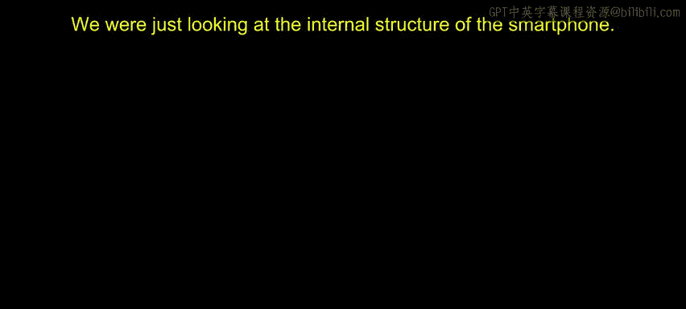
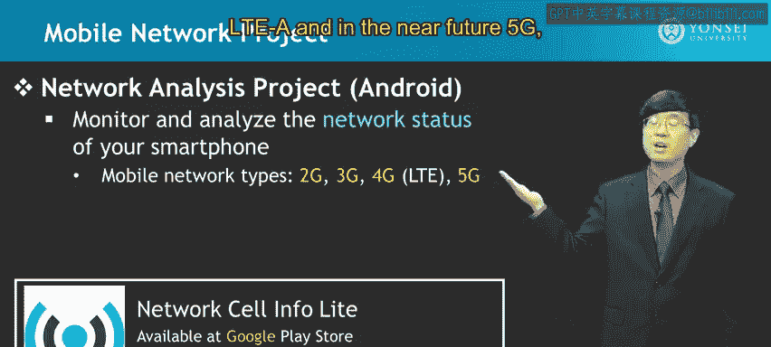
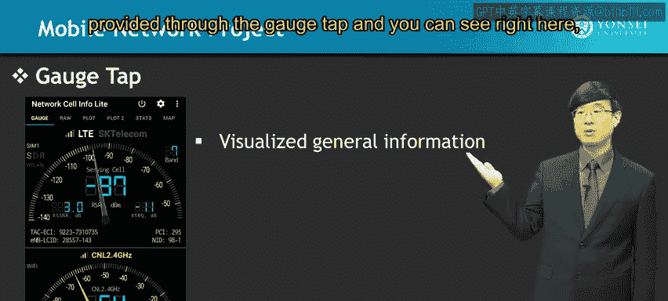
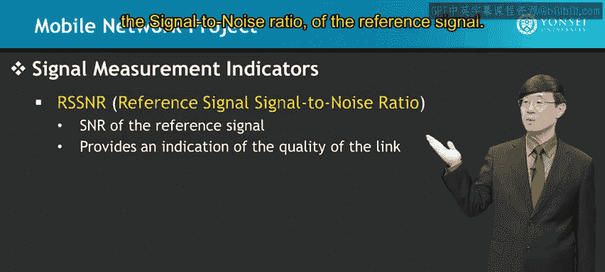
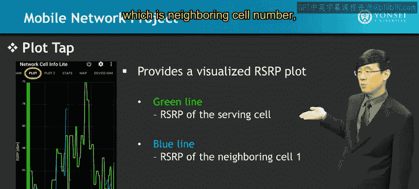
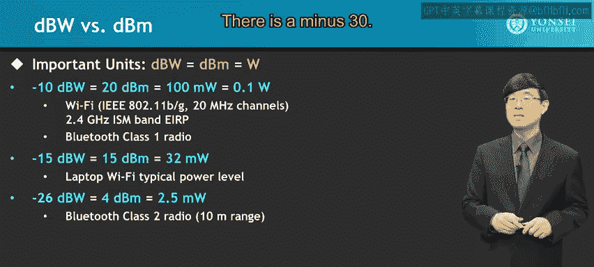
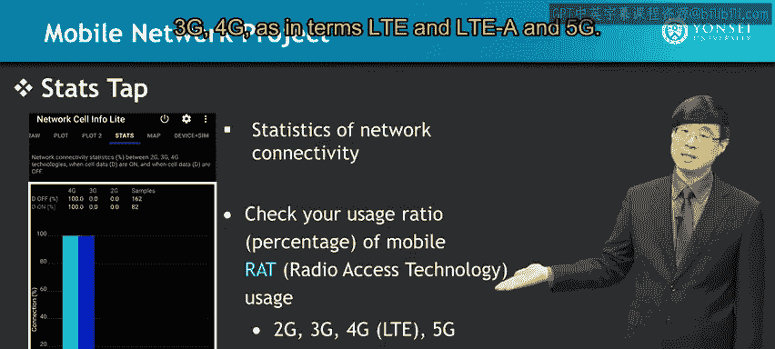
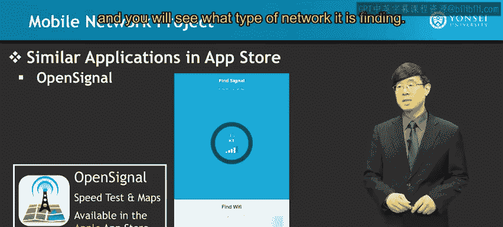
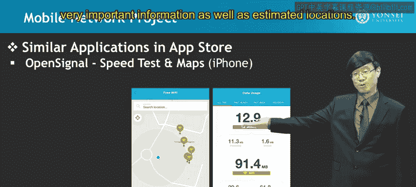
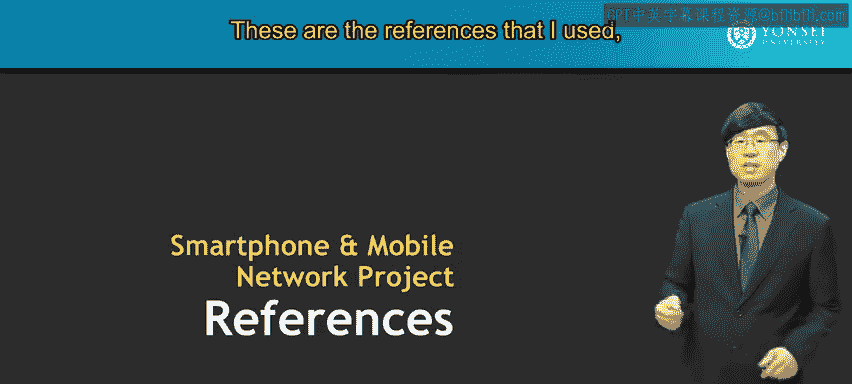

# 延世大学《新兴技术从智能手机到物联网再到大数据Emerging Technologies From Smartphone to IoT to Big Data》 - P71：35_6.2 移动网络项目.zh_en - GPT中英字幕课程资源 - BV18hpFewEcG

응。🎼Oh。🎼We were just looking at the internal structure of the smartphone。

 So now that we checked everything that's being used in our smartphone。

 let's check what our smartphone is connected to。 And I'm going to focus this lecture on the mobile communication network。

 This is because the Io based connections in which Wifi or Bluetooth are used。

 I'm going to include that in the next lectures。😊，Overall project in which IoT based wfi IoT based Bluetooth is going to be tested over there。

 so we'll go over the mobile communication network in this project。

 starting with the Network cell info application， which is available at the Google Play Store。

Other details for iPhones in the Apple App Store， I will soon give you details。

Network analysis project for Android devices， we're going to monitor and analyze the network status for your smartphone。

The network types we call this the rat radio access technology and there are various types so what is the rat type I know it sounds a little bit weird。

 but rat type radio access technology is the formal language So what is the rat type it is a 2G3G4G4G meaning like LTE LTA and in the near future5G which already started in Korea。

Singal string。Serving cell information and neighboring cell information can all be checked。

Visualized general information can be provided through the gouge tabs。

And you can see right here， it will show your cellular network status if you're connected or your Wifi status information if you're connected。

The rawt has this information in which it provides detailed information of the network status。

Where you can see the serving base station information， as well as the neighbor base stations。

Here this compares the RSRP， which stands for reference single Re power。

And it compares to the RSRP of the serving cell and the neighboring cells。

 and that information is over there。It compares the PCI over there in those red boxes。

This is the PCI， which is the physical cell ID。And it is compared for the serving sale and the neighboring cells。

This might be blank down here for the neighboring cells if you're in a range that doesn't have neighboring cells。

 so just keep that in mind if it shows a blank， don't be surprised。

 then you're just faced with this problem right here。

The RSSI receipt S strength indicator is our next focus item。

This is the average total received power observed。Based on measurement of bandwidth over and resource blocks。

 what are these resource blocks， these are the resource blocks that have been coming in through antenna port0 and currently we're looking at OFDM symbols。

Power measurement values include co channel serving sales。Non serving cells。

 adjacent channel interference， thermal noise， and other factors。

Single measurement indicators include RSRP， which is the reference signal received power we've already mentioned this。

 this is the power of the reference signal spread over the full bandwidth and narrow band Here we're talking about the LTE information in the former example。

And we see the RSRQ， the reference signal received quality。

 This is the C over I C based measurement that indicates the quality of the received reference signal。

 C is carrier to interference。 We're talking about carrier signals This is because OFTM signals are based upon these carriers that are densely located so dense they' are located in orthogonal positioning。

😊，And so therefore， we're going to see not just the overall signal。

 We're going to focus on each carrier to interference that is being measured。

 And that is what shows up in the RSRQ。😊，This provides additional information when the RSRP is not sufficient to make a reliable handover decision or a cell reselection decision。

In addition， we have the R SS and R， the reference signal signal to noise ratio。 This is the SNR。

 the signal to noise ratio of the reference signal。

 It provides an indication of the quality of the link。

Then we have the ASU， the obituary strengtheng unit。

This is an integer value proportional to the received signal strength measured by the mobile phone。

We have the CQI， which is the channel quality indicator。

 this is an indicator carrying the information on how good or bad the communication channel quality is。

The plot tab， which you see over there， provides visualized RSRP plot。

The legend is at the bottom where you see a green and a blue inside here。

In which the green represents the RSrRP of the serving cell。

 and the blue represents the RSRP of the neighboring cell。

 which is neighboring cell number one in this case。

Then we go into plot two， this provides visualized signal strength information of the serving cell。

The legends are down there and in there you can see DBM and DB values and you can see a green and two types of blue in which the green is representing the RSrRP of the serving cell。

 and the sky blue line is representing the RSRQ of the serving cell。

And the darker blue line is representing the RSNR of the serving cell Once again。

 all of these are based on serving cell statistics in which we're looking at the RSRP， RSRQ and RSNR。

Once again， the units that you see down there， which are small， however， if you closely look at them。

 they are in DB or DBM， what does that mean？Well， the DBM and the DB。

 the DB is representing the DB in terms of wts， so it's DBW。Checking this out。

 DBW this is the power ratio in Decibel in reference to1 watt。This is used in electrical。

 power and energy systems。 The equations to do the log is the 10 log 10。That gives you the DB。

 but the W is a1 watt based。Where the power is divided by 1 wat。

And the resulting x value is the DBW value。DBM is the power ratio in reference to1 millitt。

So it uses the same D and this is for， of course we're comparing it to a millitt signal and therefore this is used for much smaller electronic or optical signals where radio wireless communication microwaves or optical fiber signals。

 these are measured normally in this range， typically the calculation is instead of having a watt being the reference。

 this is based on a millitt and since millitt is one over100。😊，We use a small case M after the DB。

The DB is based on the 10 log 10 and the small case M is based on the 1 millitt reference。

 So whatever power single p is received， you divide it by either 1 wt or 1 millitt。

 then turn it into DB by using the 10 log 10 and the x value will be in DBW。

 the y value will be in DBM。So what does that mean， what values should I be aware of？

And that's about this。 We'll start with this。The 1000 watt， what is this used for？Frequently。

 this is used for your microwave vve， which you have at your home or office。

 or one of those convenience stores。In the microwave oven， normally they are at this1 kilowatt。

 this 1000 watt ones are the most common ones。 Of course。

 some houses have smaller ones that are 700 watts。But normally 1000 wts are the most common ones。

 you want to have enough power so that you can defrost something or heat something up quickly。

Then we have the2Watt case， and in the2Watt case， this is used in powerclass 1 UMTS 3G mobile communications。

 or it's used in the GSM， second generation mobile communications at the 850 or 900 megahertz frequency range levels。

This is the mobile phone's maximum output for these phones right here。Then we have the 0。5 watt。

 the 500 millitt case。This is the power Class2 used in 3G mobile communications for UMTS。

Another popular number is at the 0。251 wt that's the 251 milliWt case。

 this is a very popular number in which it is used for powerclass 3 in 3G mobile communications as the maximum phone output in addition it's used in Wifi based upon the 802。

11A at the 20 meHtz channels that are used in the 5 gigertz band。

The subband based one where the EIRP that's the effective radiiate power is based on this regulation。

So as a starting point， I want you to notice that the numbers that you will see。

 as in terms of communication specs， you will see from 3 DBW going down into negative numbers。

 minus numbers。Where the power watts are from typically two watts going down。And also。

 you'll see that you can consider this as a very strong power， which is used in microwaves。

 not in communication， but heat up foods。Then we go into smaller numbers going below the numbers we saw on the former page now we're going into the range of 100 milliWts。

 0。1 watts， this is at 20 dBM or in minus10 dbW this is used in Wifi based upon 802。

11 B or G that uses 20 megatz channels at the 2。4 gigahertz band。

Where this is focused on also Bluetooth Class1 radio systems， so as you can see。

 this is a very popular number to see in DVW or DVM or in Wats。

Then another very popular number is the wfi level that is used in typical laptop computers。

 tablet PCs， your iPad and other devices， very popular number is 32 millitts。

 which results in 15 DBM or minus 15 DBW。You'll see the Bluetooth Class 2 radio。

 which is typically for 10 meter ranges， reaches down to 2。5 millitts。

And you can see the 4 DBM or-24 DBW。 By now， I think you notice the difference between DBM and DBW。

 What is the consistent difference between them。There is a-30， right。 So for the DBM value。

 you make a -30 and you convert it into the DBW。 And that is the same for all the numbers。

 including the numbers on the front page。

Next we go down into Bluetooth Class3 radio， this is for very short range communication。

This is up to 1 millitt， which is 0 dBM， which is minus 30 dbw， a popular number again。

We go down to this number and this is like the bottom of what you will see。

 So this is a popular number you can use as a reference that you want to stay above if you want to do some type of connectivity What is this number。

 this number is 0。1 piawats。 This is100 dBM。 So if you see a reception number that is below-100 dBM or below-130 dbW。

 you can think that oh， I can't connect to it because most devices in mobile communication。

 wi-fi or Bluetooth will not be able to support any successful communication below this number。

 This is like the far edge。Then anything above this is good enough that's not true either even if you're right above this。

 let's say in the minus 95 DBM or minus 90 dBM range。

 still you may not be able to get successful communication you may be able to get a bare little of a throughput possible but you're not going to get high quality communication so keep that in mind。

 so now you have an idea of what the upper bound is and what the lower bound is and what reasonable numbers are。

Within mobile communication， Wifi and Bluetooth。And for this， this is for Wifi。

 the bare low minimum of a received signal power below this， Wifi will say， I don't know。

 I didn't detect anything。Going on into the stats tab， this is a tab to give you statistics。

 statistics of the network connectivity。 Check your usage ratio。 This is in terms of percentage。

 So the maximum value over there is 100。And you can check it for different types of rat usage。

 rat as in terms of radio sex technology， in terms of 2G， 3G， 4G， as in terms of LT and LTA， and 5G。

 which will soon be coming in your place a radio available in Korea。

Similar applications that are in the app Store for Apple are open signal。And in here。

 you can find free Wifi connections， Wi Fi and cellular network， speed tests， check data usage。

The interface will seem like this， and there will be this circle in the middle。

 which will also have the level of antenna connectivity。

And you will see what type of network it is finding。

The typical information that you'll see out of it shows very important information as well as estimated locations。

 pretty cool， isn't it？

Find free Wi Fi near your smartphone， In addition， conduct speed tests and compare the performance of mobile communications to Wifi。

There is another one for iPhones， which is available in the Apple App Store。

 which is the field Tester。Evaluate the strength of your phone's signal and the quality of your data。

 Wifi network。Available for iOS 10。And the interface looks like this。

Where you can see that the overall connection， the phone signal。

 as well as you have latency information。Is it active or inactive as in terms of data network and WiF status？

In addition， you can see other information that is very important， including GPS information。

 providing longitude and latitude， pretty cool， isn't it？There is also network utility。

 which is available for iPhones at the Apple App Store。

 and what this can provide is information about your network， WiF and cellular network information。

Looking at its interface over there at the top， you'll see Yze University as the Internet service provider。

 the ISP， and that is because that's where this experiment was conducted。In addition。

 other information about WiF， the IP， the gateway， the mask data usage and other things are provided here。

And we covered up some numbers so that you won't hack us。In addition。

 we can check out the cellular network information where the vendor， the RA type。

 the data usage can all be checked。Other information。

 as in terms of the iOS field testmo can be used。 This is a very powerful tool already on your iPhone。

 so I recommend that you use it。😊，The serving cell measurements measured RSSI， average RSRP。

 and physical cell ID can be seen here。You may be worried if I use the field test mode。

 what will happen to my phone well how can I turn it back to normal well don't worry。

 just tap on the home button and it will directly return you to your home screen mode。

How do I do this on my iPhone， I'm going to type that number sequence over there， the asterisk 30，0。

1， sharp，1，2，3，4，5， sharp， and then the asterisk。Then I'm going to press the call button。

 the green button down there in the middle， and I will enter the field test mode。 Pretty cool。

 isn't it。😊，You can see a lot of important information inside。

You can find the single strength of the serving cell as in terms of RSSI and RSRP and the PCI。

 the physical C ID， all available。These are the references that I used， and I recommend them to you。

 Thank you。

