# 延世大学《新兴技术从智能手机到物联网再到大数据Emerging Technologies From Smartphone to IoT to Big Data》 - P72：0_介绍.zh_en - GPT中英字幕课程资源 - BV18hpFewEcG

Yeah。🎼Yeah。Welcome to the course IoT Wire and cloud emergingging Technologies This is a course in the specialization emergingging technologiesn from smartphones to IoT to big Data I'm Professor Zhong Wenchng at Yzei University and I welcome you to this course。

The course has the following modules， starting off with IOT business and products。

Going into IoT architecture and technologies， then IoT networks。🎼Focusing on Wifi and Bluetooth。

Then we will go into cloud based technologies。And we will have a project that deals with IoT。

 Bluetooth， IoT Wifi， and the AWS EC2 project。Looking into some details， the IoT market and industry。

 we will review this in detail， as well as the functional units and the services。

 which you can see over here will be dealt in further details。

We will also take a look at IoT market and industry details。

Then we will focus on some of the most representative groups in which are providing IoT support。

 services and devices。

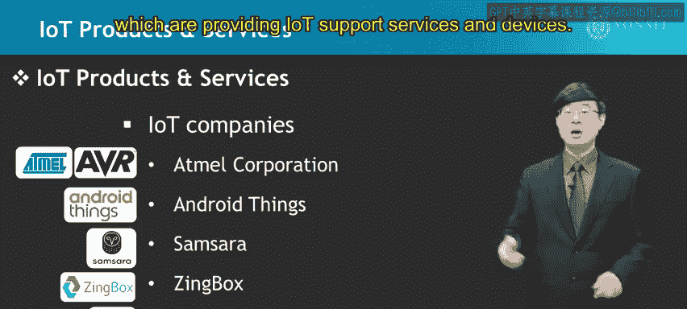

Also looking into the IoT and M2M machine to machine ecosystem。

 we'll take a look at what type of descriptions， service models and vendors are supporting this。

Then we will go into the IoT architecture layers and see how those layers and these details work together and their functional relationship。

Then we need to look into the sensors， there are so many different type sensors with specifics that you need to learn about because the sensing information enables the IoT network to find what's going on and then after its process。

 the IoT network will be able to respond by providing services， control and protection。

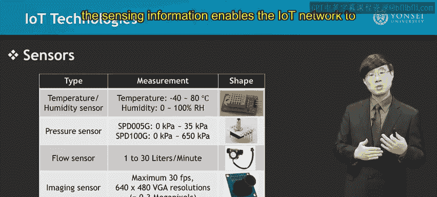

In addition， we will need to study about RFID units and also the different RFID types。

 their specifications。The next topic will be IoT technologies and the major popular platforms that are being used。

 focusing on Arduino product types， as well as raspberry Pi and beleboard systems。

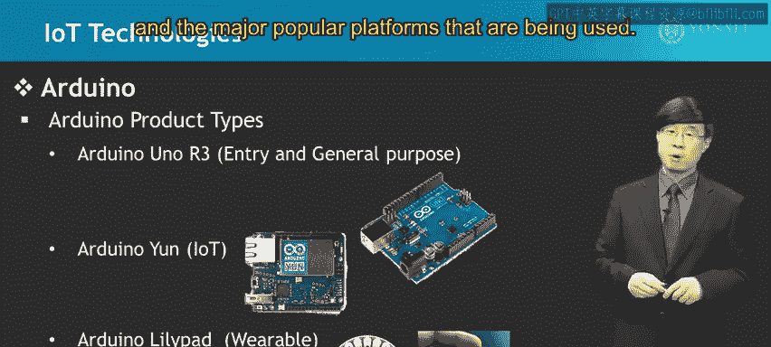

We will go into the details， the specifications， and look into the pros and cons， the advantages。

 disadvantages， and the features that they include。

Then we will go into IoT network architectureitecture。

Which leads us into wearable IoT networks as well to see how these connect together and help provide us with biometric and health monitoring systems。

In addition， we will go and look into the ISM frequency band。

 This is because the ISM frequency band is a very commonly used frequency band for IoT services。

Which services in terms of wireless local area network technology， WLN， which is represented by Wifi。

 also W Pan， wireless personal area network technology represented by Bluetooth。

 ZigB and SixLpan In addition， we'll look into LP WAN。

 which is low power wide area network technology represented by Laura and SigFox。In the details。

 we will see in terms of the data rate and service range how all of these techniques need to coexist and their specific service characteristics。

Looking into further in Laura and SigF， we will take a look at their operation mode and their service platforms。

Also looking into the server logic of Laura， as well as the SigF Cloud。

Then we will go into mobile communication based IoT support technology as in terms of the 3GPP standards designed for IoT support。

Looking into the evolution of how these various releases are designed into specific service modes to help IoT services。

We will also look into WiF， the wireless land market， the major vendors， and who has what。

 and how much of the market share。

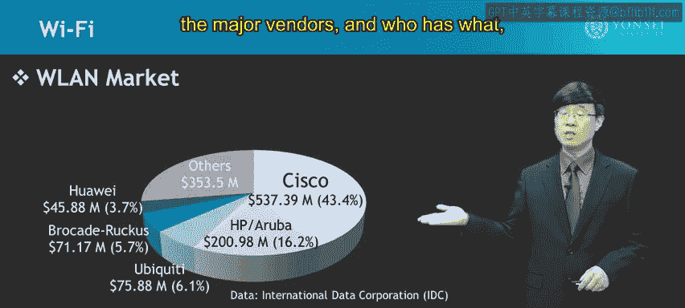

Then we will look into the infrastructure mode and ad hoc mode。

 as well as other Wifi network architectures and how it actually works。

We will also take a look into dual band technology as we have 2。

4 gigHtz and 5 gigHtz devices having dual band， what advantages can this provide will be the focus。

Going into Bluetooth， we will focus on the network of Bluetooth， the Pconnet。

 as well as its service channels， for example， the BLE， the Bluetooth low energy channels。

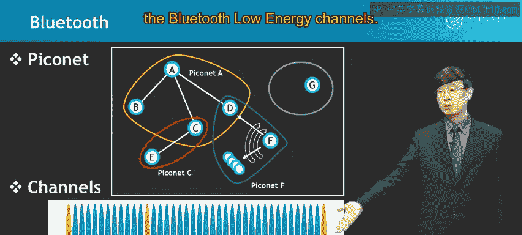

In addition， we'll look into the overall evolution of Bluetooth technology and where the technology evolves into a newer version。

 we'll talk about the details and why that division is there。In order to do that。

 we will need to go deeper into the protocol and actually understand the technical characteristics。

Then we will go into cloud computing technology， the looking into details of the overall market share。

 the major services and product categories。We'll focus on the big Four， which is Amazon Web service。

 Microsoft， IBM and Google， although we will talk about the overall technology groups。

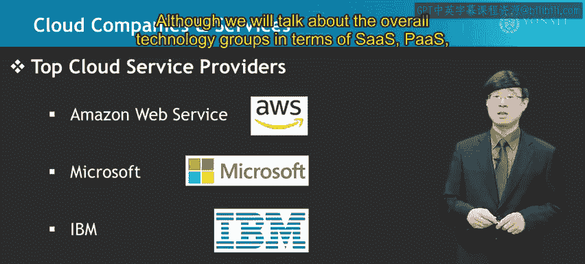

In terms of Saas， Pa and Ias， which we have software as a service。

 platform as a service and infrastructure as a service。 What are these， How do they work。

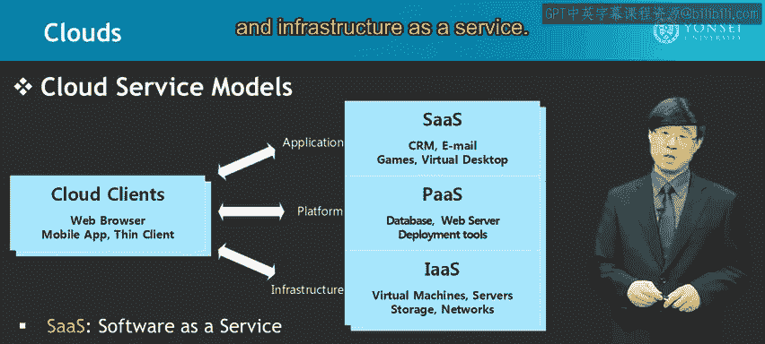

In details of I ask where a virtual machine， how is that delivered to a user and what is the overall operation mode？

In addition， for pass， how is this service provided， In addition， what does the IDE。

 the integrated development environment do？As well as for softwareft as a service， SaS。

 what is the relation in the overall connection to your cloud。

 as well as how is the SaS orchestration being conducted？

Then we will go into the edge computing techniques。

 which are the cutting edge in cloud computing systems。

This is taking the cloud computing systems directly near to you。

 such that the overall traffic load in the backbone network is minimized， as well as your service。

 delivery of cloud services is provided in minimal amount of time， a win- win situation。

 depending on these techniques， as in terms of fall computing， mobile edge computing and cloud led。

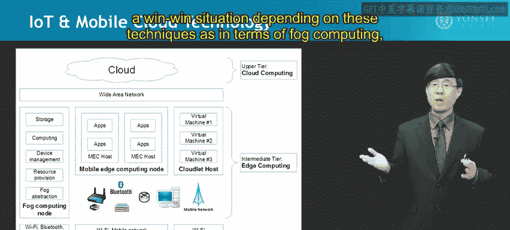

Then we will go into a project with Bluetooth scan where we will look into the proximity to see where the devices are。

 as well as the scanner will actually show the details。

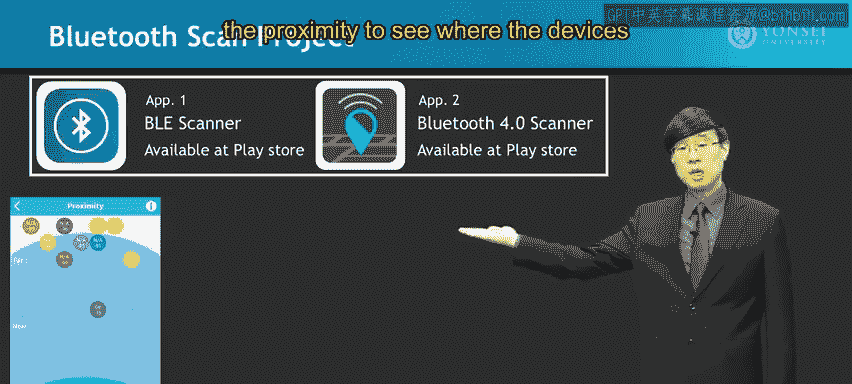

Let's say we're looking into the gear S3， then the technology will enable us to look into further details of this。

In addition， we can see the actual signal characteristics as well。

Then we will go into various aspects of Wifi networks。

 where we will look into network characteristics， single reception， in addition。

 we will be able to look at what is going on and what sub channelss of the 2。

4 gigHtz as well as the 5 gigertz channels are being used by Wifi。

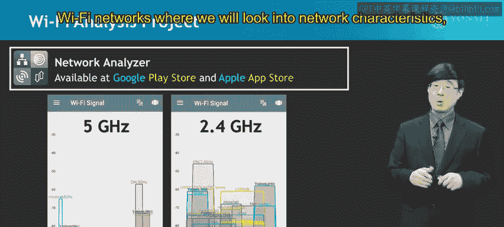

Then we will go into the AWS EC2 project where you will actually create a EC2 virtual machine cloud computing system for yourself how do you do that and then what can you do will be the focus of this part of the lecture。

This is the part where you will go into and create a solution and then build more solutions in the discussion prompt to complete the overall project。

Overall。For this content that is included in here， I welcome you to the course IoT Wire and Cloud emergingerging technologiesnologies。

🎼I look forward to seeing you in the lectures， thank you very much。😊。

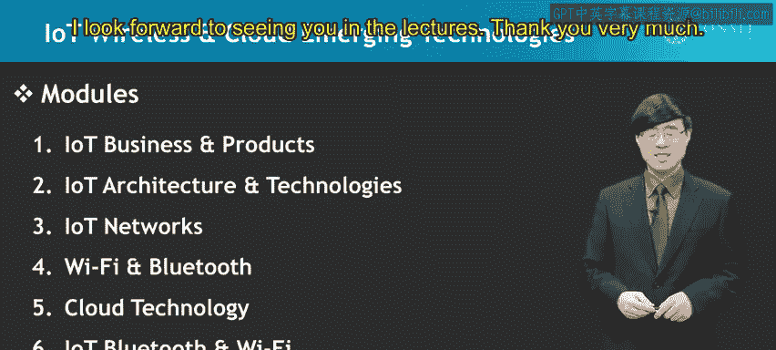