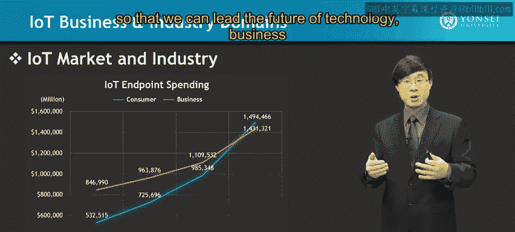

# 延世大学《新兴技术从智能手机到物联网再到大数据Emerging Technologies From Smartphone to IoT to Big Data》 - P73：1_1.1 物联网商业和行业领域（第1部分）.zh_en - GPT中英字幕课程资源 - BV18hpFewEcG

Yeah。🎼Yeah。For the lecture module， IoT Business and Products， I'll start with the first lecture。

 IoT Business and industrydutry domainomains。First， Internet of things。

IoT networking is one of the key features that needs to be supported by IoT。 It's connecting things。

 people， applications and data， and in order to connect networking is essential。

It connects through the internet， so that's why we have internet of things IoT as the overall name for this new emerging technology。

 it's basically targeted to connect everything that can be controllable and needs to be monitored。

It enables remote control， management， interactive， integrated services。IoT network scale。

The number of mobile devices will exceed the number of people on earth The number of people is approximately 7。

6 billion and the number of mobile devices are expected to exceed this number based on the fact that some people will have more than one smart device more than one mobile device supporting their needs Think about it already you may have a smart tablet or a smart pad as well as a smart In addition you may have a smartwa and soon in the future you're going to have smart glasses that support。

Augmented reality and various virtual reality interactive services。

 and there is going to be smart wearable devices such as your shoes， your belt。

 your neck tieie and various other components， considering that。

 expecting for the number of mobile devices， especially smart devices to exceed the number of people that is very obvious。

Then predictions are made that there will be 50 billion things。

Connected to the internet by 2020 that is a tremendous number in addition。

 you need to consider the fact that look at the overall population of 7。

6 billion compared to the 50 billion things so therefore in our workplace when we're transporting from home to our office or back or what we have at home you consider the number of things that are surrounding individual users and then you average it out then you can see the massive spectrum of where and how IoT devices will be placed。

And that's what makes IoT service support so important。We have so much to do in this area。

 Some advanced IoT devices will need to collect， analyze and process segments of raw sensor data and turn it into operational control information。

You can think of it this way when I say raw sensor data， these are numbers， these are metric values。

 these are symbols， these are text values that may not have specific meaning。

 however once you collect it and you put it together with other information that is collected together。

 then you get information， something that has a meaning to it， something that gives you directions。

 something that tells you about an alarm or what to do or what not to do。

 typically that's what we mean of transforming data into information。😊，IoT network scale Well。

 some sensor databases may have massive sizes due to the large number of IoT devices。

Then IoT databases will need cloud computing support because of this massive size of data that is collected。

 In addition， in order to make data that we have coming down and turning into information。

 Then cloud computing is also going to play the foundation of where the big data technology is applied。

 This will enable for big data services to support the transformation of information through。😊。

Our original data sources。In order to do that， what the big data engine needs to do is first。

 it will use various filtering technologies to filter out the useless information。

Integrate what is important， weight the more important ones compared to the less important ones。

 aggregate it into a form such that we can get exactly answers to what we want to know。

 and that is going to be our core information。Influence of IoT。Evidently。

 it is massive and it is going to change the world in various ways。 first， starting with people， us。

 more things can be monitored and controlled and people therefore will become more capable。

Process wise， more users and machines can collaborate in real time。

That will result in more complex tasks that can be accomplished in lesser time。Then data。

 collect data more frequently and reliably。And these results will enable us to get more accurate decision making such that we can control these millions and billions of IoT modules。

 such that we can get safer and more productivity out of the same infrastructure that we have。

In addition， things。Things become more controllable mobile device and things become more valuable Think of it this way。

 you have a switch that you can turn on your light， however。

 if there was a way such that the light could be dimmed and turned on brighter and then change colors as needed。

 just thinking of a simple application like that that would make your light supply or your light sources more useful in so many different ways。

It is like that if there is a way to control something in a very specific way that fits your needs。

 then it becomes so much more valuable。 that is what IoT technology is going to provide you。😊。

North America IoT market and industrytry， looking at here， overall， there are 2。

888 companies and products that emerged and this is based on this very outstanding reference that I recommend for you to go through in details。

In addition， $125 billion in funding。95 unicorn startups。

 that means that the unicorn startups are startup companies that have resources exceeding $1 billion from various investments。

95 of these。In addition， the number of employees that result from the IoT market and industry domain。

That's 342，000 employees and exceeding to become even a larger number Overall。

 the gross value 613 billion was created due to IoT technology in North America。

 typically talking about the United States of America and also Canada。

Looking at the IoT market and industry in trends where we have consumers in blue and the business in orange。

Then one thing that you can see that maybe is a little bit surprising is that the aggregated combination of this is based on IoT unit installed。

That the overall consumer domain is larger than the business domain。

What that means is that these individual components that individual customers are buying and using aggregates to something more than the overall core business is actually using itself。

This shows that there is so much more of a larger potential talking about it。

 Blue ocean market for the future， definitely this right here， especially in the consumer domain。

 because when consumers decide that they want something to change。

 there's a new product out there that can add on to the value of what they do or make the work that they do easier。

 than evidently not just one， but in the numbers of hundreds of millions to billions of people will want it。

 need it， get it and make their lives more efficient and more effective。So therefore。

 when you think of it， this blue line representing the consumers in number of IoT units installed is in fact。

 a blue ocean itself in the future of the market and industry domain of IoT。

Continuing on IoT endpoint spending， naturally because it's an endpoint technology。

 there are more business oriented uses and more business or industry based applications than individual users you might think。

 however， even that trend look at it right here， compared to the business line that you see right here。

 the overall individual consumer line crosses over here。At this point， and then afterwards。

 you can expect for this to separate even wider。 In addition， look at the values that we have here。

 This is in units of over there millions。So the base number here right here， the lowest number6，466。

 the6 is 6 million to start off this number right here， so this number。

 these numbers are truly significant in the ranges of hundreds。

 thousands of trillions and beyond is what we're going to expect as we go into the future and as this line goes up and up and up and we get more services we're talking about that level of a domain where we are going to go into a market that is assuming to be in the range of hundreds of trillions within。

The range of about 2030 extending this line， think of what will happen in the future if this continues and it is expected to continue in that trend。

 so take more attention to this course， join with me so that we can we can lead the future of technology。

 business and industry Here we go Con on。😊。

