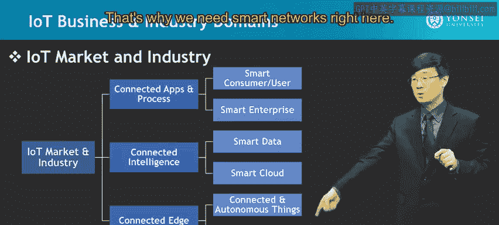

# 延世大学《新兴技术从智能手机到物联网再到大数据Emerging Technologies From Smartphone to IoT to Big Data》 - P74：2_1.1 物联网商业和行业领域（第2部分）.zh_en - GPT中英字幕课程资源 - BV18hpFewEcG

Yeah。🎼Yeah。

The domain IoT market and industry dividing into three segments， connected apps and process。

 which have smart consumers and users as well as smart enterprise inside of its domain。

 then we have connected intelligence which has smart data and smart cloud technology inside just wait smart data and smart cloud this is talking about。

Big data engines， aggregating and collecting various types of semistructured， unstructured。

 as well as of course， structured data， bringing it in together， filtering it out。

 picking the key values that are necessary， the keys and the values from various big data technology。

 weight them on what is more important， and then extracting useful information out of it。Therefore。

 big data engines naturally include machine learning。

 artificial intelligence engines in various ways to make data smart。

 such that we can extract core information and we can control everything in order to host this large size of data。

 then put meaning to it， and then extracting what we need to do into the future。

 we definitely need cloud support， cloud computing， what do you mean smart cloud。

 what is in a smart cloud， typical things as supporting the infrastructure， the platform。

 as well as various functional software to enable applications to run。

 that is what cloud computing does。I know I'm making it a little bit hard to understand without giving you the details。

 but don't worry in the following modules of this lecture。

 I'm going to dedicate more to focus on cloud computing itself as you know this course is about IoT wireless technologies and cloud computing and of course I will get more into the details of this in the following module lectures however for now。

 just consider smart cloud needed and here we go connected edgedge。Connected edge。

 What's an edge Well， think of this， connected on autonomous things。Connected and autonomous things。

 This means that we are having new objects， new things。

 new entities that are connected to the mainframe infrastructure。😊。

That are receiving intelligent information and guidance。

 and also they are operating automatically based upon what they were told to do where small decisions。

 immediate things that they need to do are preprogrammed so that they are safe and stably and reliably operated however。

 the overall scope of what and how they need to do things are guided by an overall larger scale system as well as human control and monitoring。

 that is what we mean by this。Think of smart cars， self driving cars。

 untonnomous vehicles as unautonnomous things。They are connected into a overall gross structure which has intelligent transportation system。

 an ITS system in which there are roadside units and onboard units。

 the onboard units are on the vehicles， the smart bike， the smart car， the smart truck。

 the smart motorcycle， the smart train， these type of things have onboard units that are the smart device control overall brains of the autonomous moving vehicles。

 then connecting them together with the roadside units that are connected to the intelligent transportation system mainframe that provides navigation control traffic control safety features as well as emergency features to support things like ambulances。

 fire trucks， police cars， and other support features that are needed all that comes together with being connected and then having self-controlled things。

That is what we are talking about connected edge， that means that you're connected all the way to the edge devices that are providing direct services to human beings that what we mean by connected edge in addition。

 in order to support something connected un autonomous things。

 we of course need a smart network that will connect us to the edge。And that is what we have。

 Why is this important， It's connecting it to the edge， isnn't that what a network is supposed to do。

 Does the network have to be smart， Yes， it's about like this because the network type will change stage by stage by stage。

 the technology and network type， as well as the protocol control modules。

 security domain that you use in the core network that connects countries through satellite through ocean optical fiber cables and then you connect it within your country all the way connecting cities and cities together that are hundreds or tens of kilometers miles away from each other。

 then the technology that you use to connect within a city within a region。

Then once you go into the region， what type of technology will I use to connect inside of my building。

 inside of my factory， inside of my school campus？All of these are different networks。

 they have different protocols， they operate different ways。

 they are secured and managed and adminrated in different network entities and sub network groups。

Connecting this all together such that they work homogeneously。

 just like they are one overall connected network that has the same protocol and everything is uniformly operated and maintained。

 that is a miraculous combined group of technology that needs smart support because once again。

 in the future that we're talking about the IoT market and industry。

 these things of IoT are going to all move around switching what network they are connected to consistently。

In that case， we need smart networks What do you mean they're going to be moving around and switching Well what if I had a smartwatch。

 a smart， a smart tablet in my pocket， a smart belt and smart shoes altogether along with my smart augmented reality glasses then if I move around all of these will move around with me and based upon their support service that they need from various clouds and various network domains they will be connecting to different entities receiving different support。

For example， when you look at my smartphone， the primary connection may be to the mobile communication network。

 but if you look at the smart tab that's in my pocket right here。

 this may be connected through Wi-fi， such that it's providing services broadband through w-fi various technologies what w-fi various technologies is there more than one w-fi of course there is and that's what you're going to learn in this class as well as there are a variety of Bluetooth technologies and yes just way a couple more modules later in this course and we'll cover all of that so there are such a diverse range of technologies that need to be controlled in an intelligent way that's why we need smart networks right here。

