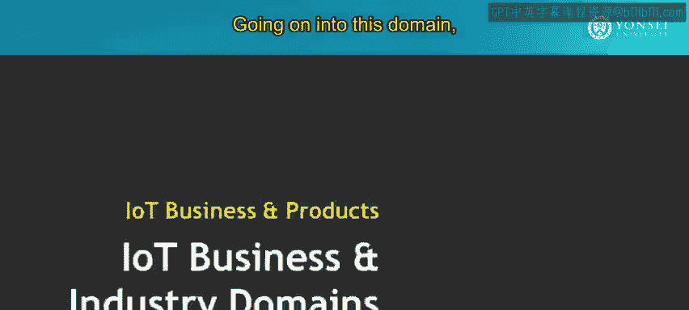

# 延世大学《新兴技术从智能手机到物联网再到大数据Emerging Technologies From Smartphone to IoT to Big Data》 - P75：3_1.1 物联网商业和行业领域（第3部分）.zh_en - GPT中英字幕课程资源 - BV18hpFewEcG

Yeah。🎼Yeah。

Going on into this domain where we have connected apps and processes。

 you see such a wide variety of things here。And going into the first one， smart consumer and user。

Number one， we have facilitative reality， Google Glass。😊，And Microsoft。

 these other companies supporting these various products。What do you mean by this。

 We're talking about augmented reality， We're talking about mixed reality or partial virtual reality combined techniques such that you can provide guidance to where to go。

 entertainment on wherever and whenever you want it and need it。

 that's what we're talking about here as in terms of facilitative reality。😊。

Then we have connected homes。Connected homes is a concept where the Io T modules within your home are connected to a cloud that is being monitored and supported by whatever support services you want。

 This may be linked to。Things like what type of food supplies am I lacking in my refrigerator or in my cabinet space。

 I would like that to be automatically ordered and the supplies to be delivered to my home when the supplies are delivered to my home I may not be at home。

 so I want them to be stored in a secure place that has the right temperature control and pressure and humidity control until I get home to take them out and put them into the cabinet or my refrigerator when I want to do it。

In based upon the convenience that fits my schedule。

 and that's what we're talking about having connected homes， smart homes。

Then we're talking about connected cars， connected cars， what more can I say on autonomous vehicles。

 smart vehicles， smart cars that drive around themselves。

 or even if they don't drive around themselves， then you are driving it， but various techniques。

 such that support you from not going out brought to wrong places。

 they are looking ahead of you to prevent accidents。

 theyre looking ahead of you such that you don't violate various crossroads and signals so you don't get ticketed。

And you can keep your license。And you don't get fined in addition。

 all of these type of security mechanisms as well as automatic driving systems， in addition。

 support services that are once again connected to the intelligent transportation system backbone network ITS frame。

 which supports you through roadside units or roadside equipment。

And you have devices on your vehicles。That are onboard units or onboard equipment。So。

Then we have the next domain that is called Smart Health。Smart health。

 what more can I say you already know what this is monitoring your pulse if you have blood pressure issues。

 then monitoring your blood pressure， if you have diabetes issues then measuring the diabetes level of your blood hopefully without blood samples and there are new technologies that do that more and more the better In addition。

 what about your heart rate， overall sweating nervous level。

 are you going to black out What if you do blackout， can you automatically call for help。

 What if you are choking， what if you have a heart attack。

 what if you have high blood pressure and you are expecting a seizure and you're worried about it and you want to have immediate ambulance support to support you well。

 that is what smart health is going to do。Then shared economy， of course。

You know that your health conditions are connected to what you purchase and what you buy and what you need to buy。

In addition， when you make your own operations or when you make purchases。

 or when you do business to business， B2 B decisions or B2 C business to consumer based decisions。

 you need to run your infra and you need to take advantage of the shared economy technologies。

 which are based on IOT。Going further into this actually jumps you directly into the domain of smart enterprise and smart enterprise services go all the way。

That take what we've already talked about into a deeper level of supporting business。

 administrating it， making sales， and then actually making the things manufacturing industry Here we go transportation transportation when we talk about transportation。

 of course we're talking about the block right above is connected cars。

 If you want to have your smart car connected， you have to have a smart car If you want to have your smart car connected to the intelligent transportation system。

 the overall network， then you have to have an intelligent transportation network。

Having all of this is what is supported in the transportation business In addition。

 mass transportation businesses that we're going to talk about when it comes to supporting。

Things like Uber technology and various other things。

 we're going to soon talk about those in targetrget services very soon。For now， we go on to retail。

Talking about smart enterprise for retail， the IoT market and industry。 Well。

 this is just so obvious this is the first thing that we've been seeing for such a long time that nothing really exciting。

 we already know that it's coming it's going to become even more common and general everywhere to everything and then we're going to be using it every day。

Naturally retail what are we talking about， in part。

 this is talking about logistics of getting the right products that are going to be sold at the right place at the right time。

In addition， not more or not too less just the right amount In addition， not only logistics。

 what are we going to do if we cannot get that delivered to a person at a store。

 what if we need to deliver it to their house or their home or their business。

 then all that combines into here， such as companies like Amazon， Walmart。

 they're doing such great businesses in doing Iobased smart enterpriseter retail。Continuing on。

 building and construction。You think of this area and then well building what about IBS intelligent building systems。

 these are the new trend of buildings that have the HVAC system like the heating。

 the air conditioning， the lightning as well as the entire infrastructure all tied together such that resources are not wasted。

 it is warm enough， it is cool enough， it is humid enough， it is dry enough。

 it is bright enough to do the right things at the right place within the building however you're not wasting resources and you're keeping the infrastructure safe and also you're preventing weird accidents as well as crimes from happening that is what we're talking about when you talk about a smart building。

 an intelligent building system， IBS。Then， of course， if you want to have an ideas。

You have to construct it， you have to make it if you want to have an intelligent bridge that prevents accidents that prevents skidding。

 that prevents various multi collision accidents of vehicles and things like that that controls the overall friction as well as the condition of the roads and the lightnings。

Based upon various conditions of having freezing conditions， raining conditions， as well as fog。

Then all of this needs intelligent technology when you build it you have to put it in for it to work properly and that is what we're talking about smart enterprise based construction technology Then we go on to manufacturing already we have it listed here。

 but also，Manufacturing becoming smart。 Well， smart factory based technology， in other words。

 not making everything and then sending it to places。

 hoping that it will sell Why not just make everything exactly customized to what users want and then have it delivered to their home within a few days in a perfect matching with additional accessories added to it that perfectly fit their needs and their desires。

 Then you can save。You can save time， effort and material of making things that will not be sold so you can prevent waste of resources。

 you can prevent waste of storage area because once you make something that doesn't sell。

 you're going to have to save it somewhere in a storage area until you can sell it at a dumping price at a super sale。

Well， how do I avoid all of that typically manufacturing。

 smart manufacturing is what this is talking about then we go into oil， gas and energy， of course。

 of course， energy consumption， smart meters， not the original gas and electric electricity meters that you're talking about that are just analog that are just showing what's going to happen。

 what has been done is recorded， no， actually making predictions of future usages。

Controlling the amount， making sure that you don't waste energy。

 having these smart meters connected to your home， connected to your business connected to the rooms is basically what we're talking about In addition。

 oil and gas， oil and gas think of it this way。Electricity is a little bit easier to turn on and turn off。

Basically， not exactly is it easy to control at。The overall plants。that generate energy。

 these entities are so large， it is difficult to turn these on and off and they take time， of course。

 however， the delivery system of electricity is relatively controllable at certain joints and units that provide you with a controllable access。

However， when you talk about gas and oil， these fluids or gases that exist are not exactly as easy to control their flow dynamics。

 because once again， they are based on a fluid type operation characteristics and having smart enterprise controlled services that are these oil and gas entities。

 making them smartly controlled provides you with number one。

 you're delivering your needed resources to locations that need， in addition。

 when they are not needed， you can stop the flow and use whatever is left over to support other regions that do need it。

Think about it Overall， the sun comes up and the sun goes down。 the resources we need in the daytime。

 in the morning， in the afternoon and night， as well as the resources we need while we're sleeping they all change。

 In addition， where we are all changes as well。 So giving the right resources at the right time。

 where they are needed when they are needed in the right amount is exactly what we talking about in oil。

 gas energy smart enterprise services。😊，And then we have healthcare。

 smart enterprise based healthcare。Typical things that you can expect are that patients。

Are preventing various accidents。And also insurance companies are saving money In addition。

 what we have in our overall system that we have multiple hospitals that we may be going to and our overall information that we have at one hospital or the overall prognosis that was made based upon the symptoms that were revealed at one hospital are saved and moved over to a cloud and the data is in a form that is interoperable with。

Health data as well as the doctoral system or the doctoral assisting system that medical doctors use to make prognososis of how to cure a certain disease。

 how to treat a certain person based upon their certain symptoms at a later time at a later place。

 and in order to do something like that， you need to have your old files。

Save in a cloud and delivered to other places based upon different data formats that may be used at that hospital or that medical service system or at the insurance companies。

Then in order to interoperate with all these different databases， all these different protocols。

 all these different software platforms， then that is where healthcare services that are being smart can help you。

