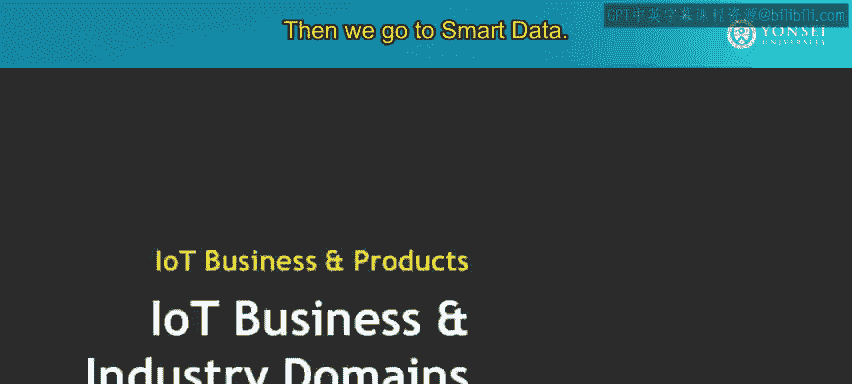

# 延世大学《新兴技术从智能手机到物联网再到大数据Emerging Technologies From Smartphone to IoT to Big Data》 - P76：4_1.1 物联网商业和行业领域（第4部分）.zh_en - GPT中英字幕课程资源 - BV18hpFewEcG

Yeah。🎼Oh。

Then we go to smart data， data has many types。When you're talking about data。

 there are basically the format that already has a structure。

 like the type of data that you already have in your database。

If you're using like a Microsoft Excel file， then you open it up。

 you open a worksheet and then you start putting data inside。

 then you need to put data in there the right way if you put something in wrong。

 then the Excel worksheet will not take it in， it will show up as either an Excel sign or a dash sign or non-acceptable or some type of other symbol that shows that it is inappropriate to have that value there。

This is the type that we call structure data， In other words， data that's already in a database。

 data has to be in the right format， in the right range。

 and then it needs to be placed in the right place of the overall database。

It needs to be placed in the right column in the right row。However， not all data is like that。

 actually。Almost all data is not like that until it is formed into that type of a structure。

 that data is called structure data， the other types of data that exist as in terms of what we have from our pictures from our various other documents as well as what we exchange as messages and other type of characters on our social network services。

 or when we go to something like Google or Yahoo or some other place and we search a certain keyword。

Then what we're looking for does not have the right format。

Then this type of data is called unstructured data。

 or if it has a little bit of structure that may be acceptable， we call this semistructured data。

 changing unstructured data and semistructured data into a database in which we can extract massive amounts of hidden information from it is what big data does。

I have a separate course that is called Big data emergingging Techologies that is in this specialization in which teaches you about the further details of big data technology。

 I highly recommend that you take that course if you're interested in this domain， in that course。

 various aspects of business， as well as what is being done and how it's being done。

 as well as various big data engines and how they actually operate and their characteristics and architecture are all discussed within that course。

Next is data security， smart data data has to be protected。

Data has to be moved around in small cases， as well as individual files， but also in some cases。

 data files need to be moved around in massive sizes where the entire database or a part of a database is moved around。

 There are various techniques that support big data engines to move big files around from one place to another with various levels of security。

Things like flume and other techniques are what support that。Data security is very important。

 especially some data that we have needs to be protected at levels at much higher degrees of protection than other that is why data security is so important and new techniques as well as new venture companies that built intelligent or deep learning based security I will talk about that soon in my next lecture。

We also have artificial intelligence and machine learning techniques。That can do various things。

This is a new era of artificial intelligence， machine learning， deep learning techniques。

I have a separate course in Courra that is called Deep learninging for Business that talks about various AI and machine learning and deep learning technologies in much more detail。

 however， right now， AI and machine learning techniques are used everywhere。

 not just once or two instances they are used everywhere from the data collection。

From the data concentration。From the data aggregation to the data format exchange。

Changing visual data into text， changing text into voice， audio。

 and then changing one video information format into a different video format。 It is used everywhere。

 AI and machine learning is the source of what we have as the word smart even on this page。

 you see smart data and smart cloud on the left side。 What is making it smart。

 It is big data technology， artificial intelligence and machine learning。

 So this AI and machine learning applies to everything and everywhere。

 and especially to Internet of think technology。Smart cloud。

You need a cloud and we are going to talk about clouds in much more detail in this course。

 not in this module， but in following module， so in the following weeks when you study the later modules of this course。

 we will talk much more about cloud computing however， what do you mean by IoT supported Cloud。

 Why is this so important？It is definitely like this。 IoT modules need intelligent control。

 They are going to collect various types of sensor data in massive amounts。And deliver it to a cloud。

 the cloud needs to filter out the important things。

 make intelligent decisions and then control the IoT modules in order to get the type of services we want。

 where we need it in the form exactly that fits our needs。In order to do that。

 we need a cloud technology。 This is because especially IoT devices are not all going to be equipped with the full support of decision making and data processing。

 In addition， even though they may be equipped to process the data that is created or delivered to that device。

 in order to make really intelligent decisions，You need to combine your data with the data of a larger scale。

 looking at what other devices are seeing in that area。

 looking at what's happening to the environment or other surrounding places like if you're a student。

 what's happening in the school or other schools， if you are at your business and office。

 and you're doing your professional work， what is happening in related areas that are going to influence my personal business or my line of work。

You need intelligence， information combined and collected。

 So even if your device is able to process and make intelligent decisions alone in its on standalone mode。

That will not be accurate enough to help you to become as fully functional or smartly operable as you really want it to be。

 That is where smart cloud technology needs to be supported。 However， in a lot of cases。

Your IoT module will not have that type of intelligence。

 it will be normally very lowproed in terms of processing capability and it will have just limited scope of what it is sensing。

 then in order to combine and make intelligent large scale。

 microcopically in collected information based intelligent decisions you need a smart cloud。

And that's why smart Cloud and IoT technology go hand in hand。

 and that is why this course is about IoT and cloud computing。

Cloud life cyclee this is talking about extending the life cycle of your IoT devices IoT market and service domain through cloud computing technology。

There are so many ways that this can be done， just looking at the surface if your IoT devices are turned on and turned off。

At the right time， such that they are saving energy in the meantime and the overall I O T。😊。

Doomain that you are governing or monitoring or administrating has a longer life cycle where you do not have to exchange batteries or switch components because the lifeline of your overall IoT network that you are controlling is well in the ways that it is saving energy then hey。

 you are extending the value of it， in addition you are saving additional infrastructure investments that need to be made win win win in every way you look at it typical things that can be accomplished are based upon this In addition。

 event and cloud integration。Various things happen。In event based scenarios。

 and then cloud computing technology integrates this and helps you make intelligent decisions。

 because if events occur。And things change in the environment or basic domain of how services need to be provided。

 then you need to make intelligent decisions， and in a lot of cases。

 systems are not programmed with every possible scenario on how to respond and how to control。

Basically， when something unexpected occurs， you will need to make an intelligent decision。

 your system will need to make an intelligent decision and respond to whatever problem or whatever issue needs to be responded to that is what basically various technologies are needed。

Data center。Once again， we are talking about cloud computing， where we are collecting data。

 we have multiple databases based on data types that are collected into an overall data warehouse。

 which is located at a data center。How do we control this， in addition。

 various things that are included inside that need to be controlled various modules。

As well as various stored modules， the overall data center itself needs to be monitored and controlled because it is one super big data center that is。

Filled up with computers and memory units and a ton of networking that connects it all together and a huge power supply and of course。

 air conditioning and various other sensors to prevent water sprinkling humidity levels and various other accidents from occurring in order to do that。

 you need tremendous technology to support your data center and having that smart， of course。

 is a smart way to invest and protect the resources that you already have。Data security。Already。

 we've been talking about this。 But in a smart cloud， once again。

 this is where all the important information is。 Natural。

 it becomes a place where hackers would love to penetrate and。😊。

Do ransomware type attacks or denial of service based attacks， or just secretly go in。

 compromise a system， make it a zombie computer and extract important information either way。

 whatever it is， you do not want it。You do not want your cloud to be contaminated or attacked or being spied upon。

How do you protect that， that is what you need。IOS。

 this is infrastructure as a service in cloud computing， we have。

Basically three fundamental service modes that is this one infrastructure as a service。

 the one on your right which says pass， which we will soon talk about， that is platform as a service。

 and then we have software as a service SaS so Ios is supporting what we're talking about as infrastructure and that is it in other words processing capability as in terms of databases as well as networking security。

 massive levels of connectivity that you are not able to access。

 however through your cloud connection， the cloud connects you。

 the cloud provides you with infrastructure interfaces that you get to use that are not yours。

 however through your cloud services that you are subscribing to you are able to use these massive resources。

 that is what infrastructure as a service is。Pa is platform as a service。

 whatever platform technology that you do not have。

 including database success and processing capabilities and various other domains of platform services that you do not have one example could be like your operating system。

 you need various operating systems on various computing platforms， as in terms of Microsoft。Linux。

 Uniix。Various Utu， various other operating systems need to work on various。

Cases of processing systems。And they need to access various types of databases。

What will provide you with that Well， that is Po， that is platform as a service， and there's more。

