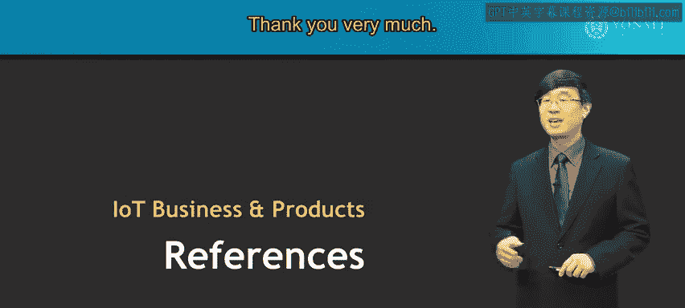

# 延世大学《新兴技术从智能手机到物联网再到大数据Emerging Technologies From Smartphone to IoT to Big Data》 - P77：5_1.1 物联网商业和行业领域（第5部分）.zh_en - GPT中英字幕课程资源 - BV18hpFewEcG

Yeah。🎼Yeah。Then we have connected and untonnomous things， we've already talked about this。

 but in specific domains there are wearables。Where we have wearable devices that we have and they support various healthcare。

 various services， various transportation devices， as well as protecting you。

 protecting your equipment， protecting your children， that's what these are about。Vehicles。

 fundamentally having vehicles with smart intelligent IoT supported technology。

 you have one symbol here that's Uber and we're going to talk about more about Uber as one of the domains of connected and untonomous things that are supported through are smart IoT technology。

Then we have drones， this is a drone era， the number of drones that you see right now are going to increase in massive amounts of number and portion and they are going to play a wide range of services that are not being supported right now through drones or other robotic technology this is one domain that is going to be your unautonnomous things domain in which various things are delivered or various things are taken away or rescued or monitored or governed。

 this is where drones will become very very useful as well as essential components into our IoT domain。

Robotics， of course， robotics in various domains， drones are a part of robotics。 However。

 robotics also are talking about various other components。

 There are so many different types of robotics that are supported。

And these domains can apply to us in microscopic levels in MEs technology that are used to help our small computing devices to wearable devices。

 to even implants that we put in our bodies， in addition。

 large scale robotics that work at factories， smart factories that are working in various transportation and logistic movement type industry levels。

 all that is included。Machines， of course you need machines， and these machines have two domains。

 some of them are mechanical and infrastructural， but some are also microelectronical and some exist on both domains like MEM's technology。

 which have both micro level of electronics and micro level of mechanics combined together。

These could be used to combine even larger mechanical infrastructure systems。And here atM。

 as well as other companies that drive various smart machines are all a big part of that。

 we're going to talk more about this in our following lecture。Smart networks once again。

 Internet of Things， IoT is based upon the fact that everything is connected to a network that is connected to the bigger network。

 the mother network， the Internet。Therefore， connecting to the internet gives you access to everything in almost everywhere。

Therefore， smart networks once again is a necessity。

 it is something that drive and connects and make IoT possible。

VPN and network security network security I've already talked about， but in addition。

 virtual private networking， what is that well various companies and buildings and talking about the above boxes。

 which are drones and robots， you may want a separate private network controlling your drones and robots。

 because you don't want other people to monitor to use your resources to defile your quality of services level that you're receiving that may incorporate your overall services may create delays may hack your system you do not want that。

 and many， many services， especially luxury of space services， high protective services。

 expensive protective services， want private networks。In reality。

 it is very expensive and very difficult to provide your own private network。

 so that's where VPN kicks in， this is a virtual private network。

 it's really not your private network， it is a public network， it is a shared network。

 it is a hybrid network that has a large capacity supporting many， many users。However。

 if you configure it the right way such that you have a dedicated connection that is protected at a certain level where your quality of service support is provided in a very reliable and secure and monitorable and administrativeable way that is what we're calling a virtual private network it is virtual in the fact that no it is not a private network it is you are on a shared network however you are getting all of the private network features that you want and you asked for and you're paying for that is why it's called a virtual private network。

 it is on a common platform a shared network however you get all of your private network features through virtual special smart network technology。

Ethernet Wid。What can I say we are connected to Ethernet networks。

These ethernett networks are what connect our computers and our WiF units and our Bluetooth obsessed points and things like that to tobacco Baco network。

 and every building， every home， every school will use some parts of Ethernet network connectivity that are wired。

That connect your TV， that connect your personal computer that connects the access point that is enabling you to use wfi in whatever region you're using This ethernet technology is so important and it is based upon wire networks that is why still ethernet wire networks are showing such good growth and utilization and they will become an integrated key component of smart networks so they are very important platforms。

You see platforms in various other services， this is unavoidable IoT devices have various platforms and new platform that is really easy to use versatile that will dominate the market everybody is looking for something like that and if you have a good idea and a good way to support it then evidently you have a good chance of making a big run in owning a big part of the blue ocean of the IoT industry and market domain here we have three icons in here and Sam Sarah I will talk about further details of this later on in my following lecture。

😊，Satellite technology eventually this is the ultimate long haul wide area network connectivity。

 no matter what being able to communicate from one side of the world to the other side of the world being able to communicate from one continent to another continent。

 satellite communication provides you with services that you cannot find in any other technology ever satellite communication also provides you with locationbased service support as in terms of providing like GPS global positioning information which provides you with your longitude and latitude information that you can find your position。

 you can find your location so that you can use various locationbased services， LBS technology。

So automatically， satellites will play a huge role in smart networks because our smart networks are connecting things on other continents。

 other places throughout the world。And satellite communication provides one domain of wireless connectivity in a versatile way that is used in so many different applications。

Then we have Wi-fi Wifi technology is one of the protocols that are the most widely used wireless technology in the world。

 it is so popular， it is on every smartphone， it is on almost every ethernet network has an access point that connects Wi-fi overall also think of your smartphone on your smartphone。

 you have mobile communication， you have w-fi and Bluetooth。

 that is the common three technologies that support wireless and mobile connectivity to your smart device。

Wifi is a default option， sometimes you may not have。Mobile communication。

 sometimes you may not have Bluetooth， but if you have a tablet。

 a laptop or some device almost guaranteed you will have w-fi， so Wi-fi is so important and yes。

 we will talk about this we have a separate module that will focus on this and in the broader scale for IoT service technology we will talk more about this in the following lectures。

These are the references that I used， and I recommend them to you。 Thank you very much。😊。

