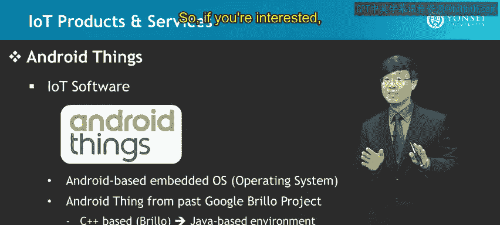
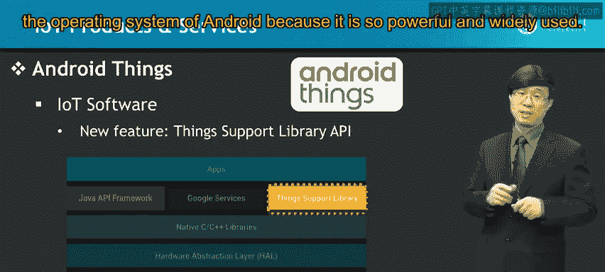
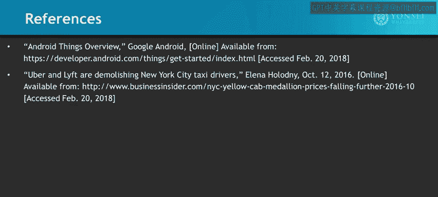

# 延世大学《新兴技术从智能手机到物联网再到大数据Emerging Technologies From Smartphone to IoT to Big Data》 - P78：6_1.2 物联网产品和服务（第1部分）.zh_en - GPT中英字幕课程资源 - BV18hpFewEcG

Yeah。🎼Yeah。IUT products and services。IoT companies that we're going to look into。

 starting off with Atel Corporation。Android Things， Sams， Zingbox， Uber。

 there are so many companies out there that are doing outstanding IoT services and we looked at a broad scale of them in my former lecture However。

 we're going to select some diversifying things maybe we can look at this as a representative from each of the big domains。

😊，And then look at some of the companies that are just emerging。

 what and how do they do such that they are getting such good attention and they are moving up the market and receiving tremendous levels of investments。

If you know that， then that is almost as interesting as looking at how the big corporations are doing as well。

 So therefore， I combine this together and here we go。😊，Hatmill， IoT hardware。

 no matter what you need hardware， you need a processor。

 you need to save data and then you need to process it。

 and that is a foundation of everything and everywhere fundamentalaly you need this of course on top you need software。

Therefore， IoT hardwareware at Mel， this is a semiconductor manufacturing and design company。

 it develops various microcontrollers， RF devices， flash memory。

And also application specific products。And so much more。2015， the revenue was $1。

17 billion and a large part of that overall revenue came from microcontroller and a lot of this is going to be for IoT hardware in the future。

One product line is AVR， this is AtM AVR， AtMil Microcontroller family brand。

 in which one of the first microcontrollers in the world to use on chip flash memory for program storage。

That means that other companies didn't do that Well other companies， yes。

 a lot of the other microcontrollers use like one time programmable RAm Eprom。

 Eprom and other techniques and this on chip flash memory provided faster access and good advantages that provided the overall AVR。

Microcontroller chips with faster processing capability， lower power consumption。

 and that is what made At Mel's products so attractive。IoT hardwareware， mega A VR， AVR， mega AVR。

 and A mega is what we're going to be talking about in the product lines。

These are a series of microcontrollers that are adopted as the Arduino physicalical computing platform。

Aduo what is that in my following lecture when we go into IoT technologies。

 I will focus and give you more details on this right now I'm just going to focus on products and services so even though some of the details that you may be itching to listen to and learn about may not be provided here in this lecture but just wait in the following modules I will give you much more details about this。

 so let's just focus on the product levels and what type of services we can get from these devices。😊。

As in terms of this， what you see right here。There are Arduino boards and the description。

 the description looking down the middle column we have entry level IoT and wearable technology devices and different devices in addition。

 different Arduino boards support the R&D research and development based upon these different things and the microprocessors that are on these are different these are microprocessors that are customized to fit the proper services over here and as you can see these atm AVR modules。

 microcontrollers are sufficient to provide entry level support of IoT technology that for Arduino Uno and Arduino Leonardo based IoT development environments are just perfect in terms of that what do you mean perfect in terms of that Well I'm talking that their processing capability also how many of instructions per second？

How many floating point operations would be needed for an entry level IoT device are customized in these modules and the development boards over there are what supported。

IoT based operations in further details are the Arduino Yuun and also Arduino ethernet based devices and the processors。

 the AVR processors that support that are over here。

Some of the processing capabilities that we will look also into is typically the at mega 328 and this module has a 328P as well as this is also used way down here We'll talk about this later on in the following lecture。

Then we have the Arduino boards that will be good for development of wearable devices used to support IoT applications。

 that's where the lily pad of Arduino comes in and the processor types you can see are supported right here。

Android things Android， Android， you've heard about it because most likely it is on your smartphone among the smartphone market that is out there。

 among all types of smartphones， over 70% are supported by Android。

 So Android is the operating system for smartphones and smartphone tablets and smartphone pads throughout the world。

 the most dominating protocol。 and therefore it becomes an IoT software that becomes very attractive。

 However， like I said before， IoT devices have lesser computation capability than smartphones normally have。

😊，So therefore， we want a Android operating system that is lighter and also helps support the IoT。

 the internet of things applications， that is where Android things comes in。

It is an Android based embedded operating system where Android things come from the past Google project。

In which it is C++ based programming。Is also based upon the Java based environment。

Because of these applications and the way that the programming language is made。

 it can be used and operated in such dynamic domains。

This supports the Raspberry Pi3 and Intel Edison for initial prototyping of Android Thingss products。

Now the Raspberry Pi3， what is that， of course， I will talk about that。

 but not now in a later lecture when we talk about Iobased technology， So if you're interested。

 just wait a little bit longer Android operating system architecture looks like this and if you look into the overall structure。

 this part right here， the things support library is a library that has the Iobased Android things functions and procedures all programmed in here and they're saved in this library So if you need to do something based upon the app level above or Google services next to it or the Java API framework or coming down to the basic native C and C+ libraries interfacing through up and down this layered architecture of the Android operating system that is on top of the Linux kernel。

😊。

This level provides you with further details and the functionalities that you need to do and develop very effective IoT techniques that will work wonderful with your Android smartphone because they are based upon the same operating system。

 they have special features and technologies that are already integrated in a very efficient power optimized and process。

 speed optimized way based upon their operating systems that are both lying upon Linux kernels。Now。

 not this lecture， not this course， but in my other course of smart device and mobile emerging technologies in that course I talk about the iOS operating system and also the Android operating system in further details that is all a part of the bigger specialization of emerging technologies from smartphones to IoT to big data in this overall specialization。

 I recommend that you go to that lecture and study more on the operating system of Android because it is so powerful and widely used。

Further details， things support library API is fundamentally based upon a couple of API units。

The peripheralial input output API supports these type of physical connectities。 In addition。

 the user driver。APpiI， this where apps become able to communicate with hardware events。

How do you do that that is in this API， that is why we call it a driver。

 the user driver makes the user run applications able to communicate with hardware units。

 embedded system components， as well as accessory units。

 as well as input output devices in order to make this process you need a driver and that is what the user driverver API is about。

And then。This is what also controls the touchpads， the keyboards， the game controllers。

 and the physical motion sensors。In other words， if you have a game and you have a joystick or you have a remote controller that you're playing your game with。

 either wireless or wired， then you need your userDriver API such that that is controlled on your joystick or your control panel controlled to the main game console box that is connected to your TV and your surrounding environment sensors that is connected to the internet。

Then you need something to make all of these connections and connect them and provide services in low latency。

 high reliability， high throughput services， so there could not be any interruption in your game playing experience。

You don't want to have a disadvantage in your game score or lose a game because your network connectivity and your IoT support was poor。

If you have to lose， it has to be because you are not a better player， right。

 So you want this to be as reliable as possible。 and that's why we need these user driverver APIs。

In addition， featured preferial kits for the Android Things developers offering Android code examples。

Where we have a project kit， in addition， there's a rainbow hat based hardware device attached on top such that we can have various easy to develop applications developed and using what they have here as from these kits to develop quick development modules that can be customized into various products。

You will see more of this and the market for this is growing even more I will just show you a glimpse in this lecture of IoT products and services。

 but later on when I go into the next lectures following lectures of this course。

 you will see more details。😊。

