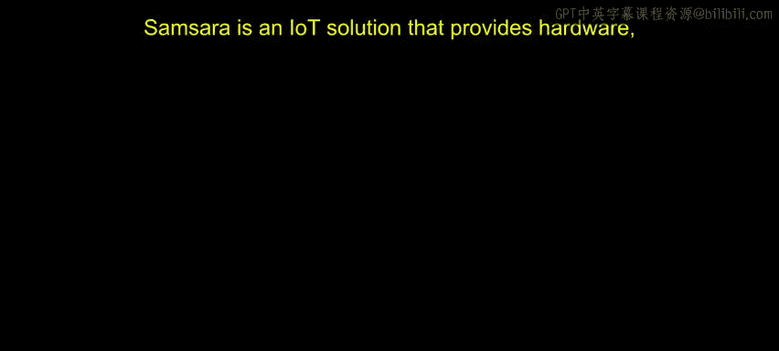
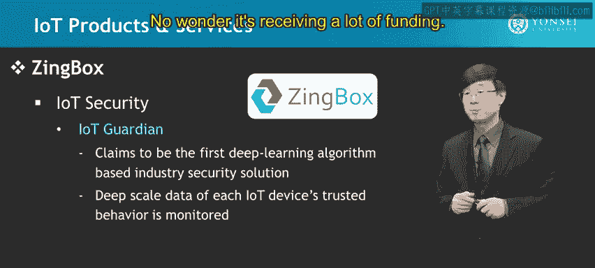
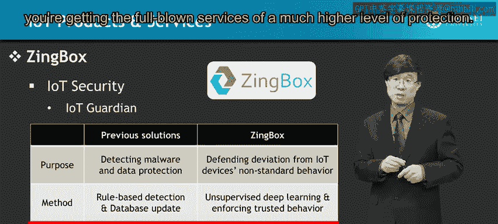
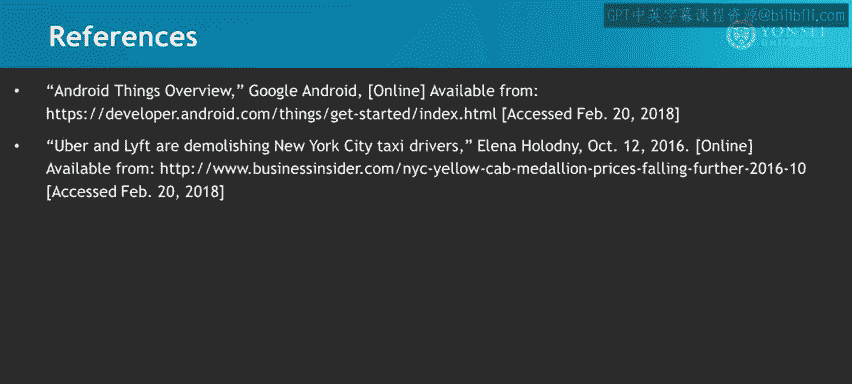
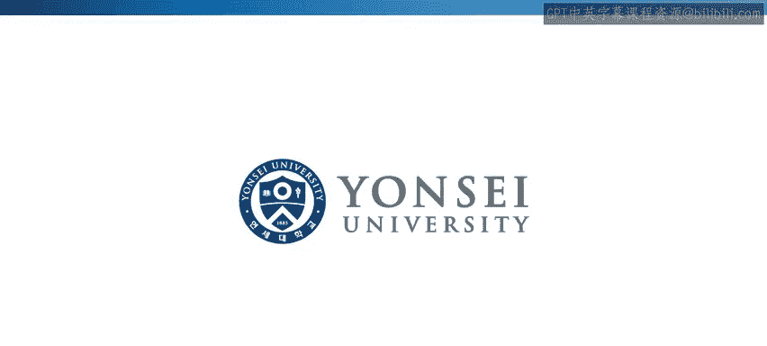

# 延世大学《新兴技术从智能手机到物联网再到大数据Emerging Technologies From Smartphone to IoT to Big Data》 - P79：7_1.2 物联网产品和服务（第2部分）.zh_en - GPT中英字幕课程资源 - BV18hpFewEcG

Yeah。🎼Yeah。Sam Sarahra is an IoT solution that provides hardware， software and network connectivity。

 It was founded in 2015。 Oh， that's recent。It was introduced in Forbes and fortune as one of the future leading IoT companies in 2015 what it was founded in 2015 and it gets announced on its potential this is what IoT technology if you have the right item。

 the right technology and you have some niche areas that are identified that your services and your products can provide then yes。

 you can become like a unicorn startup。And that is what this domain is doing。

 and that is what this lecture is about。😊，It provides IoT integrated platforms for IoT gateways。

 cameras， sensor modules and software for mobile apps and cloud based dashboards。Evidently。

 what will you use this for， you will use this for all different types。

 various types of IoT device development。Provides easy to deploy IoT technologies for industry。

This is so important， nobody wants something that's hard to program。

 nobody wants something that's hard to debug， nobody wants something that's hard to learn。Of course。

 this is an attractive feature that has to be included。

 supports under 15 minute intuitive installation by adopting plug and play technology。

I can spare 15 minutes to get this set and if if that will lead me into easy to deploy IoT solutions that I can directly develop and have just only 15 minutes of setup time。

 that sounds very attractive。 No wonder it was mentioned as one of the leading potential companies of the future。

And some of the gateways for vehicles， wireless environment monitors and software solutions definitely attractive and if you have these features in this area and at this time domain。

 yes， I look forward to seeing your company as one of the leadings so therefore when I upgrade this lecture your company will be talked about in my PowerPoints In addition for Samsra fleetleet management industry IO2 solutions are possible and definitely where is fleet management used in industry so many places that is why Samsra is receiving so much attention。

😊，Providing GPS tracking， dashcam technology， WiF hotspots， and various other features。

One example of a WiF hotspot and fleet service operation from this website link， I borrowed it。

 and you can see all the technologies that are provided。Zingbox for IoT security。

It is a startup company that develops enterprise IoT security solutions。

It discovers and protects connected IoT equipment。It is nominated as one of the Gartner's cool vendors in IoT Security of 2017。

That's impressive， it must have something outstanding， let's look into what it is。Founded in 2014。2。

3 million in angel investor funding， and it raised 22 million in series B funding round from Dell technology。

 Capital and Tri Ventures。And it launched IoT Security So IoT Guardian on February 9th of 2017。

IyoT Guardian， What does it do， What is the potential that is drawing in so much large scale investments。

 This claims to be the first deep learning algorithm based industry security solution。

 deep learning is a technology， that is a subpart of what we call machine learning。

 and in machine learning， that is a subpart of the overall artificial intelligence。

So looking at artificial intelligence， we have machine learning techniques that self-lear what's going on and how it needs to respond。

 even though it was not fully programmed to respond or take that type of a situation through its supervised and unsupervised and semi-upervised learning mechanism。

 it figures out what it needs to do among machine learning technology。

 deep learning technology is based on convolutional neural networks and recurrent neural networks that enable it to learn and make really precise decisions in accurate levels。

Once again， I have a separate lecture that is called Deep Learning for Business that talks about this in further details。

 and I recommend for you to take it if this is interesting to you。😊，So overall。

 deep learning technology implemented into an industry security solution and being the frontier leader is impressive。

 no wonder it's receiving a lot of funding， deep scale data of each IoT device。

 trusted behavior is monitored。

And enforces a trusted behavior to IoT devices。Fouse is on data protection。

This is really cool going into further details previous solutions compared to Zingbox。

 let's see where it spices up in its technology domain Pur wise。

 previous solutions were detecting malware and data protection as in terms of zingbox this is defending deviations from IoT devices non-standard behavior。

What will enable you to do that， that is where deep learning technology that is a machine learning technology that is doing supervised and unsupervised and semiupervised learning that is where it's getting its technology and that is exactly what the method is explaining。

 The previous solutions are rule- based They database update。😊，They are looking for。

 they have a preset。Group of rules and if it falls into this rule。

 then it is this and you will block it this way through your firewall。

 you will do this to that you will apply some type of antivirus or some type of a vaccine such that you solve that problem。

 but whatever happens out of that scope is not prepared to solve whereas Zingbox uses deep learning technology。

In an unsupervised， deep learning mechanism to enforce trusted behavior。

The operations where previous solutions are end point installment of products here in Zingbox。

 This is client less。 No install and management of software agents are needed。

 Can you see the advantage of this。So that it is self learning。

 it is very accurate because among machine learning techniques， it's using deep learning。In addition。

 it is client list operated and no specific installation of this management and control agent is required such。

 but still you're getting the full blown services of a much higher level of protection。

H， no wonder it's receiving a lot of funding。Uber。You know what this is probably because it's such a famous company overall in a massive scale of providing a new edge to the transportation industry。

 which has such a big investment and such a big domain， it is an amazing technology that is emerged。

Why should you be interested in this？This is because it is like this， what we eat。

 what we eat and drink， what we wear and what we will prepare to go to work and come back to our homes。

 these are necessities that will always be used。And if there is some type of edge， convenience。

 or savings in money that they can provide in this domain and makes my life easier， more effective。

 more secure， and saves money， then evidently people will want it and they will use it。

That is why if you're going to invest into IoT applications that focus on the necessity domain of what people will use。

 then the chances are if you do the right thing the right way， and you advertise your edge。

 your niche area。That makes it more attractive in comparison to other companies。

 then I'm looking forward to listening to your。Details of how your business became a unicorn venture startup company。

 Until then， we're going to talk about these further details。 Uber， this connects cars。

 which are the things to servers， which is connected through the Internet to users。

Location sensor data of the driver and the passenger。Their smartphones， their mobile devices。

 will collect and help information to mix and match the best combination。

Such that the Uber backend cloud system will provide analytics， statistical information。

 collecting the data， turning it into useful information to make a decision and control。

 such that the optimized driver and passenger pair are coupled together。

IoT applications where led Uber2 in 2018， this will support services in 84 countries in over 760 cities。

Uber owns a 77% share of the right hailing market in the United States。Looking at it overall。

 from 2015 to 2016， that blue area that you see was 15% in April of 2015 becomes 27% in April of 2016。

 a major increase in its overall percentage of the overall market of the share of trips in New York City。

In just a one year period。This is truly significant and naturally you will see how this will grow and grow in the future。

 that is why Uber is such an attractive and representative IoT company based upon transportation service innovation。

Funding and value and revenue， It must have been some massive structure。 Well， let's take a look。

 total funding amount from Bc's，22。2 billion。Uber's gross revenue in 2016。

 20 billion look at the funding and look at what is brought into is just one year。

Net revenue in 2016， 6。5 billion。Net revenue。That's significant。Company valuationation in 2017。

 $69 billion。Ubers drivers average income $364 per month in 2017。

 all of these numbers show why it is such an outstanding company and how it is changing the way we are going to use IoT technology。

As more IoT technology becomes available， the way and the features and the services of Uber are going to even grow。

 and there's going to be new things， new services， new stuff added to your services that you're going to receive from Uber。

 and we're looking forward to that。

