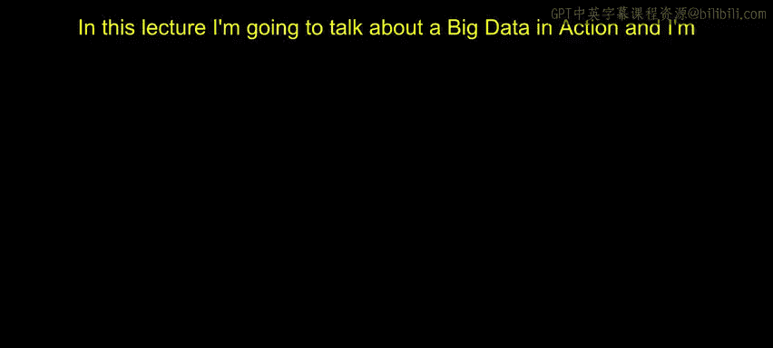
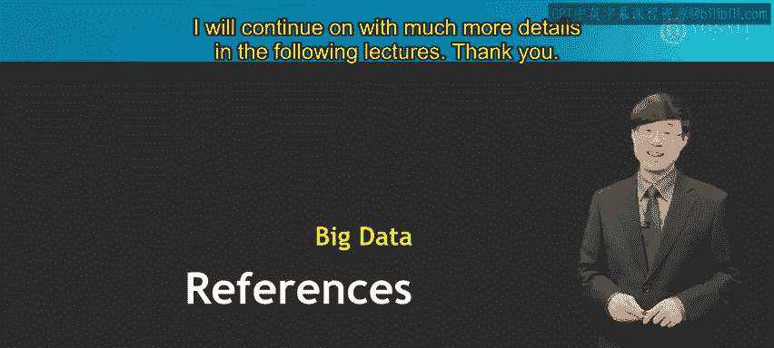

# 延世大学《新兴技术从智能手机到物联网再到大数据Emerging Technologies From Smartphone to IoT to Big Data》 - P7：6_2.1 大数据实践 2.2 大数据特征.zh_en - GPT中英字幕课程资源 - BV18hpFewEcG

哦。In this lecture， I'm going to talk about big data in action。

And I'm going to use an example where big data technology was actually used。

 such that a lot of people became aware of it。 And this somewhat triggered the evolution and the rapid development and investments in big data technology。

The story starts like this。 A new flu virus starts in the United States。It is the H1M1 flu virus。

 and it started to spread into the United States in 2009。

This virus is a combination of the bird flu and the swine flu。 And therefore。

 since each one of these are scary enough， the combination was even more horrifying。

The United States Centers for Disease Control and Prevention was only checking diagnostic data of medical doctors once a week。

And because of this reason， using the CDC information to find how the flu was spreading would have an approximate two week lag。

This is far too slow compared to the speed of how this virus was spreading。

The following questions arise。 what vaccine was needed， In addition。

 how much was needed and where do we need to place it。

Vaccin preparation and delivery plans could not be set up fast enough to safely prevent the virus from spreading out of control。

This is why when a paper from Google was published in the Journal of Nature。

 this brought up tremendous interest。It showed that Google could predict the spread of the winter flu in the United States accurately using its search window information。

 and also the specific regions and the states could be found in detail。

This paper was published in the Journal of Nature a few weeks before the H1N1 virus was made a headline news topic。

What was published in this journal article， Well， detecting influenza epidemics using search engine query data。

 Once again， this is not database data which is from the CDC。

 This is data from the search engine of Google。 the one that you type in and look for things。

Using that information， what you can see here in this graph is that the black lines are the estimates using the search engine query data。

 where the red lines are actually the CDC data that was used。 and as you can see。

 there is an accurate matching。But this is in a large scale， year by year by year。

Going in further details， let's look at it a little bit more microscopically。

 And you can see right here。 the black lines are from the。

The search engine query data and the red lines are from the CDC information of actually what was going on where the winter flu was spreading out。

 As you can see right here， from a more microscopic point of view from early February to early March to late March and then going into mid May you can see how the progress of the curves were actually found out pretty accurately。

 and this triggered a lot of interest in how this information could be used。😊。

Where millions of the most common search terms and millions of different mathematical models were tested on Google's database in order to find where this H1N1 virus was spreading。

 Google receives more than 3 billion search queries a day。 So therefore， using this information。

 we can find what's going on where。And analysis systems was set to look for correlation between the frequency of certain search queuees and the spread of the flu over time and over space。

 looking into specific locations of where this epidemic flu virus was spreading。

Google's method of analysis did not use data provided from hospitals or from medical doctors。

It used big data on the most common search terms Now。

 if you remember how what type of information you type into the search engine of Google to look for things。

 you can remember that not everything you type in is in a formal structured data form a lot of it may be semistructured data form。

 which is not perfectly the type of data that you would put into a database， In addition。

 a lot of cases we put in incomplete words， incomplete terms。

 a lot of cases we put in words or things that we think are words but actually have a lot of typing errors。

This type of unstructured data， as well as semistructured data were actually used in the search engine。

 The amazing thing is that this database uses this type of information to find what was going on and how this flu was spreading so quickly。

😊，Google systems proved to be more accurate and faster than analyzing actual government statistics that especially focus on medical treatment。

Let's take a look into some big data characteristics。

Where will compare big data analysis to traditional data analysis， category 1。

Analysis of the whole data set is what big data does compared to the traditional data analysis。

 analysis on sample data is actually done。Now， because it's sample data， the error margin。

 reliability rate needs to be indicated， along with the statistics that are given out。

 This is because it is sample data。It is also big data， very highly scalable。

 You can increase the data set to terabytes， to petabytes on and on and on， increase it in structure。

Still， it will process it quickly and accurately。 On the other hand。

 traditional database management or data analysis schemes were very limited in scalability。

 They can work with the database is sufficiently small， but when they increase， you can't use them。😊。

In addition， big data analysis is very， very powerful。 You can use it on structure data。

 semistructure data and unstructured data。However， traditional data analysis can be only used on structured data。

Then big data analysis is also extremely effective on clusters of databases and network nodes。

 and data is processed in a highly distributed way。 On the other hand。

 traditional database systems analyze data on a centralized system。

 they gather everything together in one place， and then they analyze what's there。In addition。

 big data analysis systems can be implemented and are implemented on commodity computers and servers。

 which means that they're not specifically custom made computers and servers like the ones that were commonly used in traditional data analysis systems。

In addition， the network that they use big data analysis will use commodity computers and also commodity T fast networks。

 In other words， you will see big data connections of big servers and systems and soon you'll see a Hadop distributed file system where a lot of cases the file system nodes will be connected through Ethernet or gigabit ethernet running at 100 megabits per second or gigabit per second speeds On the other hand。

 in a lot of traditional data analysis systems not only were the servers， custom made。

 but also the network was a storage area network， a specific network that was made for specific servers。

 computing servers。These are the references that I use， and I recommend them to you。

 I will continue on with much more details in the following lectures。 Thank you。😊。

