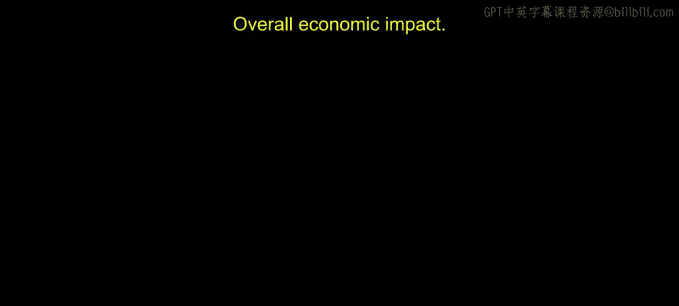
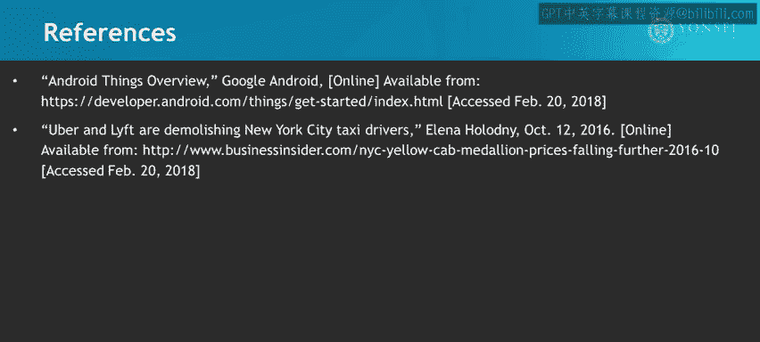

# 延世大学《新兴技术从智能手机到物联网再到大数据Emerging Technologies From Smartphone to IoT to Big Data》 - P80：8_1.2 物联网产品和服务（第3部分）.zh_en - GPT中英字幕课程资源 - BV18hpFewEcG

Yeah。🎼Oh。Overall， economic impact， well， predictions are all around。

One of the thing is that IoT has the potential to increase the global corporate profits by 21% in aggregate by 2022。

In domains of things like this， where has asset utilization， employee productivity。

 supply chain and logistics， customer experience， innovation， and even these numbers right here。

 these numbers。They are growing now that IoT is coming and coming。

People are predicting that even these numbers were conservatively predicted。

 so we're looking for more。Impact of M2M M2 P， P2M and P2 P This is talking about M2M is machine to machine One part of IoT is that you have these intelligent modules where you have a sensor and an IoT device that is communicating with a server。

The server is a machine and this device， IoT device is a machine， that is M2M。On the other hand。

 you have a combination of other things which involve people， people as people， in other words。

 you have a device that is connected， it provides you with an alarm。

 it provides you with your own home surveillance or protection of your credit card information or something then you make a phone call to another person and get the type of services you want that IoT technology is helping you get better services at the right time。

Person to person， person to machine， like me communicating with a server and getting the information I need to help me make smart business decisions。

Maybe I'm not communicating with my server， maybe I'm not making that active app， maybe the device。

 my smartphone detects that I may need this， goes out and fetches that information and displays it to me because my smart device determine that I may need this。

😡，When I do come to this certain situation。That is service prediction。

 that is content provisioning in addition， in order to get that service in time when I need it immediately at the right time。

 that service and the contents and the network functionality needs to be predicted needs to be fetched。

 brought to a close location and then displayed to me at the right time。For example。

 if I'm wearing an augmented reality smart glass， I'm looking around doing business and at the right time at the right point。

 even though I never requested for it， the right information shows up on the inside of my glass I'm the only one that can see it and it provides me with information that I just need right now how do you do that how do you predict something and get it there。

All of this needs to be a combined， collaborative structure that uses smart network， a smart cloud。

 and smart devices with smart software， smart hardware altogether。

It is a comprehensive collection of smart technology that comes into one aggregated。Wonderful。

 marvelous technology。 How do you do that， That's what this course is about。 Hang in there。

 Although augmented reality and various video services。😊，There is a separate lecture for that。

 a separate course in this specialization that just talks about augmented reality and various video technologies that are used。

In to promote various new emerging services for the future。

 if you're interested in further details of that， I recommend you take my other course that is in the specialization package。

We will not talk about too much unugmented reality because that course needs to talk about the details of that and there are so many details in there that it is separated in a different course。

In this specialization。In addition， overall revenue， look at the percentage and revenue。

 M2M alone stands in its own class， having machines communicating with other machines。

 and the domain is 45% of the overall comprehensive total。

Having humans communicating with other humans or humans communicating with a machine。

Still combines to 55% aggregated， and that is the domain of our overall economic impact。

IoT applications as in terms of security， supporting surveillance， alarms。

 real time object and people tracking and monitoring。Transportation， supporting fleet management。

 road safety， toll payment， real time traffic monitoring， and of course。

 the comprehensive network system structure， ITS， intelligent transportation systems。

This is what transportation domain of IoT can provide。In addition， manufacturing， smart factories。

Supply and provisioning as in terms of distributed monitoring， vending machines。

 and various other things。Facility management of your home， your business， your building。

 your campus and various other domains。Utilities， as in terms of smart metering devices， in addition。

 provisioning， measuring， billing of utilities， all of this falls into this domain。

Healthcare services， e healthcarethcare， personal security， body sensor devices。

Looking into this overall domain of the IoT and M2M ecosystem， here we go， starting with services。

The description here。First upon。BSP， business service providers and business solution providers。Also。

 we have system integrators and IoT solution providers for enterprises。On the network domain。

 we have network operators， communication service providers， transport infrastructure providers。

On the software domain， we have the software manufacturers。

 software and not only that but middleware as well as firmware， as well as your operating system。

 as well as the software that is in your devices that are running the kernel like the Linux kernel of your smartphone。

 these type of technologies are what the software domain needs to provide。Then you have hardware。

As in terms of GPS modules to show your location， wireless sensors， wearable devices， actuators。

 embedded hardware devices， we will talk much more about this later in this course there is a module there is lectures that talk about IoT technology。

 sensors， actuators and other components， so until then this is just how much I'll talk about this topic。

These are the references that I used and I recommend them to you and the following lectures will go more into the technology。

 so stay with me and I'll see you in the next lecture， thank you。😊。

