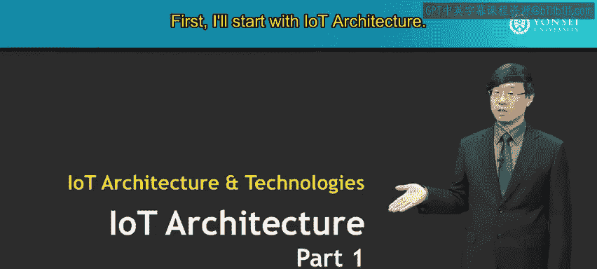
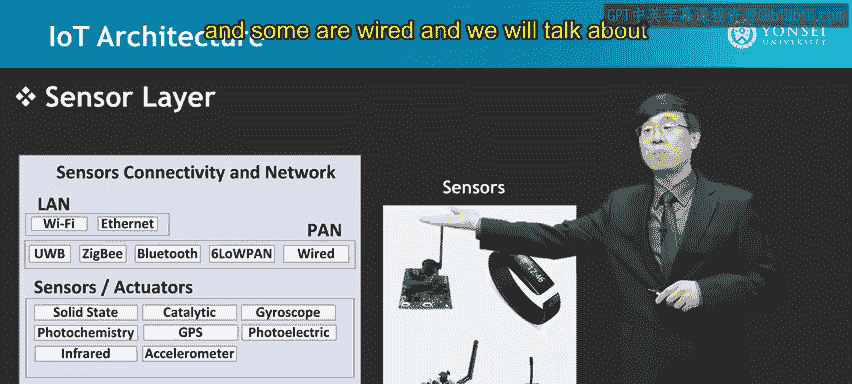
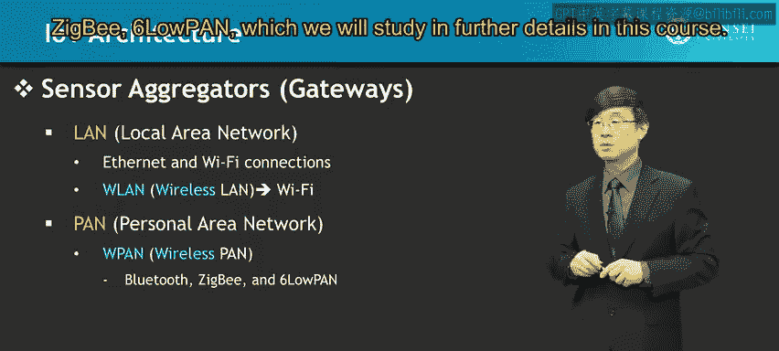

# 延世大学《新兴技术从智能手机到物联网再到大数据Emerging Technologies From Smartphone to IoT to Big Data》 - P81：9_2.1 物联网架构（第1部分）.zh_en - GPT中英字幕课程资源 - BV18hpFewEcG

Yeah。🎼Yeah。This module is about IoT architecture and technologies。

 First I'll start with IoT architecture。

Looking into the IoT architecture layers， you can see that type of a division where the bottom parts are where we have the more fundamental techniques such as sensors and networking technology moving up to management。

 overall at the top is where the applications exist。Starting at the lower levels and moving up。

 we start with the sensor network and including sensors， actuators， tags， as in terms of RFID tags。

 barcode tags， various other sensing techniques， they are connected over there。

 which is connected multiple modules are connected to gateways and networks。In order to do that。

 we need networking technology where we have mobile communication that provides us connectivity to the large scale wider area network in which GSM。

 second generation mobile communication， UMTS， third generation mobile communication， LT LTA。

 fourth generation mobile communication techniques provide this level of connectivity。

 both wired and wireless fashions。In addition， we have WiF。

 Ethernet and various gateway control to provide us with connectivity to gateways and the overall network。

In addition， we have service provided management tools these are based on device modeling。

 configuration and management components that will be controlling the data flow。

 security control and various other features of the IoT network All of this is existing to support the direct needs that are requested by the application layer in which environmental people tracking retail。

 healthcare， energy， transportation， supply chain， various things are supported and are needed in the application layer these technologies。

Are supported by those layers groupings together to provide overall IoT network services。

We'll first focus on the lowest layer and then move up looking into further details。

In the sensor layer， you're talking about these components， but at the bottom。

 these are where you have your tags， your various sensors。

 these are in these type of devices that are placed to provide surveillance， detection of motion。

 temperature。Humidity， brightness， various other gases， and sensing various things。

 as well as health monitoring devices included。These individual sensors and tags that are collecting and generating information are basically what we have focused on the hardware level that is supported by the overall sensors and actuators。

We have various things that are included inside that tell us how much we're tilted。

 how much movement we have， how much shaking we are experiencing， what is the change in velocity。

 what is the change in direction， what is the change in light level。

 all these things are based upon the sensors， as well as the tags working together and then we have our basic network connectivity which you see right here are mostly wireless and some are wired and we will talk about the further details of this in the following lectures。

😊。

The sensor layers made up of sensors and smart devices。

Real time information to be collected and processed。

 and sensors use low power and low data rate connectivity。

We have wireless sensor network formation that is connected in an ad hoc network form that has various formalities。

 meaning that it could be a string， a long sequence of sensors that are set upon a roadside。

Or they could be covered in multiple layers doing building where we have multiple sensors on each floor and the overall building is one entire sensor network domain and various other formats。

 so will they have what form is all based upon the application and the domain。

 the environment that the sensing needs to protect and collect and manage。

Sensors are grouped according to the purpose and data types， in other words。

 when you're talking about heat， temperature。Humidity or other things。

 these type of things maybe these type of sensors may be connected to the， of course。

 fire alarm system。Detecting smoke and other things together， in addition， various other things。

 as in terms of energy conservation， looking at the light level。

 looking at your air conditioning as well as your heater system and how they're being used。

And are there people in that area or not？That's what basically you're looking at when you're saying that the purpose will divide how the overall sensor data is collected and monitored and networked together。

So overall， environmental sensors， military sensors， body sensors， home sensors。

 surveillance sensors， they all have their own domain and network connectivity formats。

Then we have gateways that are aggregating the sensor data because overall we need to collect them。

 we need to filter out the unnecessary things， and send whatever important information to control units such that they get more attention and when needed。

 they get a response in control operations。Local area network。Could be Ethernet or Wifi connections。

Now when I say land， that means local area network。

 like the Ethernet is a local area network connecting you using wires within your building。

 within your floor， within your laboratory， within your office， they'll be using like Ethernet。

 a local area network that is wired。We have wireless local area networks， WL。

These basically are Wifi， and we'll talk more about this soon。

The networks that are smaller than a local area network are called personal area networks What would be a personal area network Well look in the room that you're now in you see various things in the room you may see your computer you say may see your monitor。

 you may see your laptop computer there are switches over there that have controls to the air conditioning and heating。

 there are switches over there that are controlling the curtains， the shades。

 the blinds for outside viewing throughout my window as well as sunshine blocking there are various switches and modules that I have within this personal area。

 the room that I am in the modules that I see directly with my eyes that's your personal area。

There are protocols for this， such as Zigby， Bluetooth， while when you talk about Wifi。

 you're talking about a slightly larger network， not just one room， not just your personal area。

 but the room that is in your next door through that wall over that window across that door in the hallway。

 our entire floor of rooms。That could be like your local area network and if it's done in a wireless fashion。

 the most common protocol is Wi-fi so the range is like this a wireless LA has a service range targeted to be around about 30 meters or 30 yards to 40 yards and something in some cases even larger than that like 50 meters to 100 meters maybe at largest where your personal area network you're talking about more in the range of about like maximum5 to 10 meters these are very short range communication technology and their wireless mode is called wireless pan。

 W pan and that is like Bluetooth Zigby6 little pen which we will study in further details in this course。

Sensors that do not require connectivity to a land gateway can be directly connected to the internet through a wide area network。

 so what that's saying is that if there are some sensors that are in the room and you don't have a Bluetooth master or you don't have a wireless success point that is going to collect the data。

 then my smartphone has a mobile communication unit that will directly send me to the mobile communication wide area network。

Then I will use my mobile communication module， my LT connection， my Uan connection。

 my G ran connection that is going to go to。😊，The overall mobile communication backbone network。

 and it will find my cloud， my server to support my service needs。

