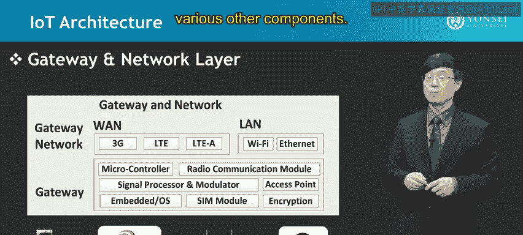
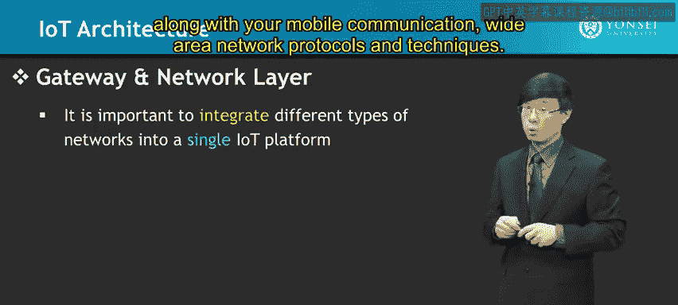

# 延世大学《新兴技术从智能手机到物联网再到大数据Emerging Technologies From Smartphone to IoT to Big Data》 - P82：10_2.1 物联网架构（第2部分）.zh_en - GPT中英字幕课程资源 - BV18hpFewEcG

Yeah。🎼Yeah。

Going to the next level， which is this one right here， Gateway and network。In order to do that。

 we need more wireless LA， wire land and wider network technologies that are focusing on mobile communication techniques in addition to support this level。

 we need routers， we need hubs， we need switches， and that's why we need a lot more hardware technology to form the gateways that will collect and aggregate the data that needs to be connected and service to the internet。

In order to do that， of course we need radio communication modules， microcontrollers。

 signal processing units， access points， and various other components。

This must support massive volumes of IoT data produced by wireless sensors and smart devices。

Massive amounts。How much are we predicting？In my other lecture that is my other course。

 smart device and mobile emerging technologies there we talk about fourth and fifth generation mobile communications。

 fourth generation mobile communications is LTE and LTE events we already have that Fth generation mobile communications is what's coming in the near future already in the 2018 Pyeongchang Winter Olympics in Korea there were already demonstrations of fifth generation mobile communication modules demonstrated in various platforms and devices so it's already here and it's already being spread out throughout the world and you're going to see it very soon。

What type of massive volume of IoT connectivity if you look at the fifth generation mobile communication specifications？

It's talking about within a square kilometer， like  one kilometer by 1 kilometer square。

1 kilometer square area， we're talking about 1 million IOT devices or maybe even more。

That is what we're talking about， massive volumes。Think about it。

1 million in a square kilometer area or more。Naturally， why do you say or more。

 think of a tall building that has 60 floors。And multiple floors under the ground and multiple floors over the ground。

 skyscraper building。Naturally， in a building like that。

 you will have more that you will need to deal with。

This requires robust and reliable performance if you're going to have this level of hyperconnect。

 U level connectivity required， you must be supported by a robust a reliable performing network and gateway connectivity。

You need to support private， public and hybrid network models。

You need to support quality service requirements。Low latency， error probability。

You want as less of that as possible， high performance wise， high throughput。

 high efficiency in terms of energy。High levels of security and scalability What do you mean by high levels of scalability scalability is an issue where some networks when they are small。

 they work well， but when they become 10 times larger。

 100 times larger than they may not work because their protocol is not scalable。

 the network management and operations are not scalable， meaning that when they grow。

 then the overall additional work that needs to be done becomes so burdening that it cannot operate well in other words。

 when the network was small， in one second I got a result from the operation that are requested。

 but when I have 100 users using it at the same time。

It takes minutes and minutes and hours to get a reply or get the results done。

That is a result of not being scalable， scalability is so critical。

 especially for massive volumes of IoT data， where you need to aggregate it and connect them together to provide services to the network。

It is important to also integrate different types of networks into a single IoT platform。Networks。

 there are so many different types， even in this lecture in this course。

 we will be talking about various types of wireless LA and wireless pan techniques。Such as Rola。

 all the way going to Bluetooth， we're going to be talking about Wifi， we're going to talk6 lo Pan。

 Zigby， they're such a wide variety and they all have their own protocol and own characteristics。

And that's just the wireless pen and wireless LA techniques。We have so much more。

 even when you say wfi， there are such a wide variety of wfi techniques。

 when you talk to say Bluetooth， even within Bluetooth。

 there are so many protocol different specifications that came about。

 which I will talk about in the following pages。So keep in mind that even within WiF。

 there's a variety of different modes， even within Bluetooth， there's a variety。

 but then among Bluetooth， Wifi， Zigby， SixL Pan， all these are different。

 then you need to integrate that along with your wire techniques。

 along with your mobile communication， wide area network， protocols and techniques。

IoT sensors are aggregated with various types of protocols and heterogeneous networking techniques。

 and therefore you need to provide very capable， integrated。Homogeneous interoperable services。

IT networks need to be scalable once again， because of the massive structure。

 because of the massive domain of number of devices that will be operating within your domain of a network that you need to collect。

 aggregate and provide gateway services to provide。

Network security services to provide quality of service support。Automatically。

 scalability needs to be there。