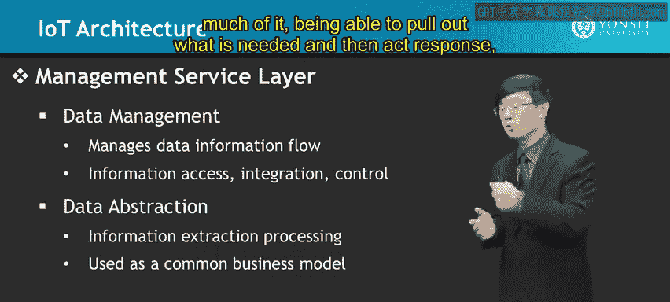

# 延世大学《新兴技术从智能手机到物联网再到大数据Emerging Technologies From Smartphone to IoT to Big Data》 - P83：11_2.1 物联网架构（第3部分）.zh_en - GPT中英字幕课程资源 - BV18hpFewEcG

Yeah。🎼Yeah。Now going to the next level of management services。

 assuming that all that sensor data and sensor information is being brought up through the hardware software and all the networks are working well。

 then you need to manage it the right way because the management level is right there in between the application and the network gateway domain。

What type of management services First， OS operational support systems such as device modeling。

 configuration。And also performance management， security management。

Then we have billing support systems， BSS。And this is about billing reporting and if you find somebody using beyond their service package of what they already pay for。

 you need to discontinue or request for additional payments before you provide services。

 let's face it。Services and companies are providing services and technology for a payment。

 they need to make a revenue， they need to be able to pay their employers and pay for the resources that enable them to make that service possible for you。

 that is why although this is a small block， when you look at it from a business side。

 it is the most important one。Service analytics platform， this is statistical data， data mining。

 text mining， in memorymory analytics， predictive analysis， all of this is important。

 especially right here， predictive analysis， analytics。

 this is becoming even more more important when we talk about IoT technology a lot is going to go into faster services。

 immediate response services， tactile IoT， tactile internet services in which。😊。

It is like we are feeling the real thing， we have a feel of exactly what's going on immediately。

From our virtual services and our smart device interfaces。

Such that the haptic experience is so real that we feel like we're in an immersive environment。

 although in reality it's all virtual。If you want to provide services like that。

 then you need to be able to deliver services on an immediate response level with minimum delay or zero delay that means that you need to predict what the response is。

 what type of contents you need to bring and fetch over and then deliver it that's where this becomes more and more important。

Then security， need I say more， this is so important， access control， encryption， identification。

 access management。Then we have business rules management， BRM， rule definition， modeling。

 simulation execution， and also business process management， BPPM， workflow process modeling。

 simulation execution and various other things are included。

The management service layer is in charge of information analytics， security control。

 process modeling， and device management。Data management wise。

 it is something that you need to consider because you have so many IoT devices that are sending in information。

 some of these devices are sending in periodic information， in other words， they will report。

 they will sense it and report it every second。Then you're going to be flooded by this information and delivering all of that to the management service module。

 the management server may not want all of that at lower levels before it reaches。

 you want to have all the unnecessary information filtered out okay you're in a good state that sensor is in its normal state。

 Nothing new or alarming is detected then you just change the aggregated data into a long-term report and submit something simpler。

Then it becomes easier to manage in order to do that。

 you need some type of filtering and management mechanism。But on the other hand。

If some type of behavior， some type of environment， such that a sensor detected that it was too hot。

 there was extreme levels of gas or smoke， or it was something too humid， that it was weird。

 or some type of abnormal behavior in a certain area was detected， then you need a periodic。

 immediately responsible， immediately reportable alarm messages delivered。

And these need to be with priority In other words， they cannot equally wait for and they cannot equally wait at the cure or the server or the other network modules at the same level as normal response periodic data。

 they need to be delivered top priority。😡，Then you need a network service and a management module that can do something like that that can support the urgent needs。

 as well as the ordinary normal operation needs both altogether in one network in an efficient way that is what management service layer needs to work with a network layer to provide these type of smart networking services。

Data management， you manage the data information flow， information access。

 integration and control based on what type of business you're doing， in other words。

 the CEO of the company， as well as the CFO as in terms of who is in charge of the financing。

And who is in charge of the actual technology development， the CTO。

 then the information that they need to look at is different and the information that their underworkers need to look at are also different and they need to be classified based on what type of work。

 research development and planning they're doing in order for that you need to control information because information is one of the key resources that a company has。

Information access， integration control is critical data abstraction is another critical domain information extraction processing used as a comm business model is so important if you look at the data like I said。

 there's so much of it being able to pull out what is needed and then act response。

 make a reply or respond on that。

Is what needs to be done in order to do that， you need to pull out the important data。

 and that is what this is talking about。

