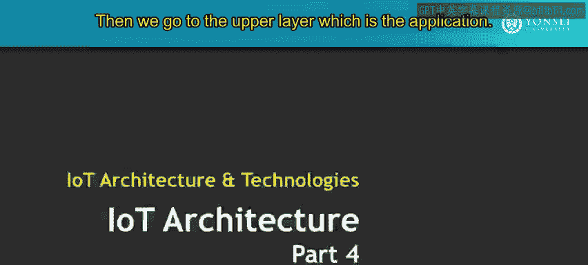
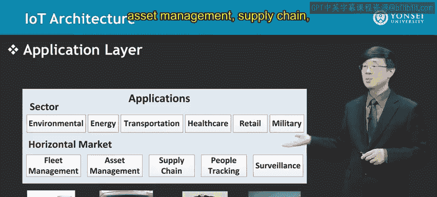
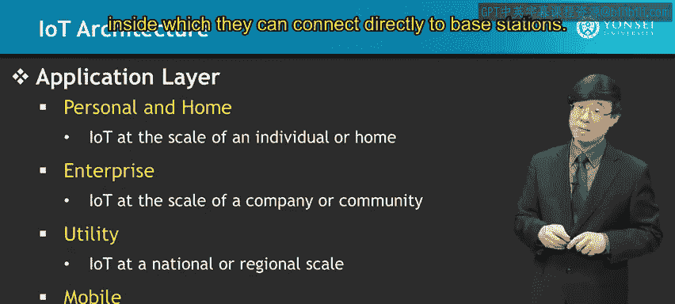
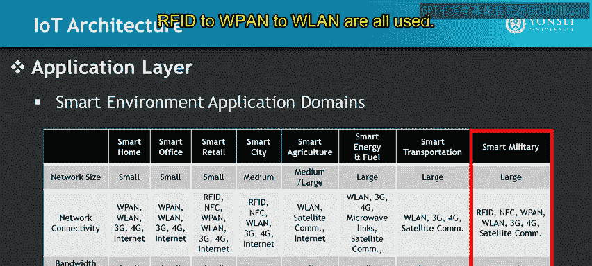
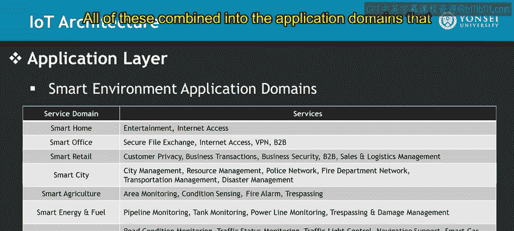
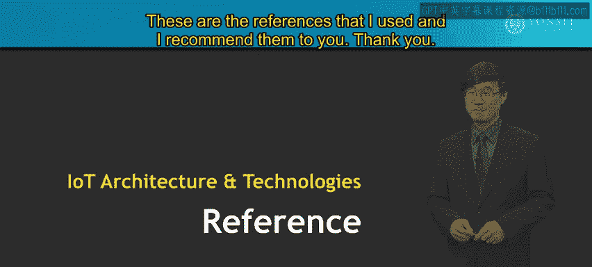

# 延世大学《新兴技术从智能手机到物联网再到大数据Emerging Technologies From Smartphone to IoT to Big Data》 - P84：12_2.1 物联网架构（第4部分）.zh_en - GPT中英字幕课程资源 - BV18hpFewEcG

Yeah。🎼Yeah。

Then we go to the upper layer， which is the application， this is what interfaces with users。

You know that there are so many sectors on how you can use IoT。 how many sectors。

 basically everything that you know about is your application domain。

 Is there something that is excluded。 No， there isn't。

Maybe there is no sensor or IoT device for that specific application now。

 but believe me in the near future， there will be， and it will be naturally included into the overall IoT domain based upon various applications so what are the hot ones that we know now that is what I have summarized in here and you see that there are sectors。

From environment， energy， transportation， healthcare， retail military， and horizontal markets。

 as in terms of fleet management， asset management， supply chain， people tracking， surveillance。

 and other things。

Stepping into a little bit further details， various applications of industry sectors can use IT service enhancements。

Application classification can be based on model of the business type of the network， availability。

 heterogeneity。Coverage， size， real time or non real time requirements are attached。

 these are the classification basiss that will tell you how to divide。Then personal and home。

 for example， you know what needs needed here， as in terms of the IoT at a scale of individuals or homes are the overall domain。

Then we have enterpriseterpri， IoT at a scale of a company and a community， utility wise。

 this is talking about national or regional scale， where just the utilities that are of a common ground or related are connected together。

Then mobile， mobile devices are usually separated and they are spread across wide domains。

 they are separated on who they are connected to based upon cellular regions。

 so what cell you're connected to is depending on what cell your smartphone is connecting to what base station。

That is how they divide the subdivisions， just like the internet is divided into somenets。

 so there is a basic hierarchy on how the mobile communication network and the smartphones are connected to and when IoT devices are connected to the wide error network in terms of mobile communication network。

 then once again the smartphones can be used as interfaces to the mobile communication network or IoT devices may have mobile communication modules inside which they can correct directly to base stations。

😊。

Looking into smart environment application domains， this is based upon the division of network size。

 network connectivity and bandwidth requirement。These are the major domains and we will be talking about service categories based upon these three major categories smart home because it's a home it's relatively small。

 if this became an apartment that had multiple homes together then it would be a different story however smart home itself is relatively small and in here of course you want WP。

 WL and mobile communication technology as well as wired internet。

 maybe through Ethernet connected within bandwidth requirements are proportional to the number of people that live in the home together。

 but looking at it in comparison to the other domains that are on the right side of this table， yeah。

 definitely it's small then smart office once again this is not an entire building an intelligent building we're talking about we're talking about an office。

And of course， similar to what is in a smart home， this has about the same domain。

Smart retail Now this is talking about a retail business and because it's retail。

 if you look at the network connectivity， RFfiID tags and RFID readers as well as NFC nearfield communication to do product identification and purchasing these type of components need to be added。

 and these two are what differentiate smart retail from the needs of smart Office and smart home。

Smart city yeah， a totally larger domain so therefore the network size becomes medium or large based upon what city you're talking about Of course。

 when you look at the overall domain， all existing network connectivity technologies need to be included。

 including RFID， NFC， wireless land， wireless Pan， 3G4G internet and needs like that one component that you can see here is that the need for wireless personal area network at a city level may be a little bit lower but then again don't count it out。

 definitely it will be needed。Then smart agriculture When you go into here you're talking about an agriculture domain that is talking about farming when you do that definitely you're talking about a wider area that has low data rate needs。

You need much more surveillance and management and control of a much wider area that you may not be able to go and visit simply easily。

 So therefore， you need wide area network coverage through satellite communication。

Also internet and wireless local networks， some wireless land techniques。

 some modes of wF are made for outdoor environments at low data rates。

 but are very large in distance support between nodes。

 and that is where wireless land technology for outdoors as well as agriculture support can be possible。

Then theres smart energy and fuel you can see here that microwave links and satellite communication are included this is because a lot of cases。

 the smart energy and fuel domains， they are transported using cables and pipes and they have their own towers that connect the cables together。

That means that smart energy and fuel， either underground。

 overground or using big towers to connect large cables。They have their own infrastructure。

 so they can set up satellite links。Over a wide area or use microwave technology between these large towers or major connecting points。

To support their needs of communication on a separated wireless or wire network。

 this is an advantage that smart energy and fuel components have。Smart transportation。Basically。

 it's running on wireless land，3G，4G and satellite communication。 Now。

 if you look at the lower below this table， you can see WL， Wifi and then there's wave W A V E。

 This is wireless access for vehicle environments。W A VE Wi Su for vehicle environments。

 and among the protocols next to it on the right side， there is IEE802。

11a/lash B/ G/ P there is a P letter there。That 802。

11p is what the wave protocol uses for vehicle environments。

 and that is also one of the core technologies that is included in smart transportation networks。

 wireless land and that is another attractive technology then you have smart military and in smart military you need the full scope because you're going to go into combat。

 you're going to go into war and whatever advantage in your communication services that you can get you need to use。

 and that is why the full scope of from satellite communication to RFID to WP to WL are all used。

In this table， you can see the application domains and how they are used。

 their service domain and services from smart home that's supporting entertainment。

 Internet access to smart Office that's providing secure file exchange， internet access。

 virtual private networking and business to business， B2B services。Smart retail。

 which supports customer privacy， business transactions， business security。

 also business to business transactions， B2B transactions， sales and logistics management。

There's also smart city， city management， resource management， police network。

 fire department network， transportation management， disaster management。Smart agriculture。

 area monitoring， condition sensing， fire alarm， trespassing。Smart energy and fuel。

 pipeline monitoring， tank monitoring， power line monitoring， trespass and damage management。

Smart transportation， road condition monitoring， traffic status monitoring， traffic light control。

 navigation support， smart car support， traffic information support。

 and the overallfrar intelligent transportation system ITS。Smart military， command and control。

 communication， sensor networks， situational awareness， security information and military networking。

 all of these combine into the application domains that are for smart environments supported by IoT technology。

These are the references that I used and I recommend them to you， thank you。

