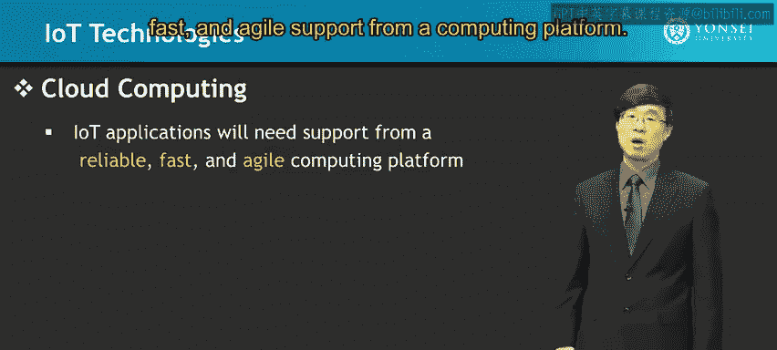

# 延世大学《新兴技术从智能手机到物联网再到大数据Emerging Technologies From Smartphone to IoT to Big Data》 - P85：13_2.2 物联网技术（第1部分）.zh_en - GPT中英字幕课程资源 - BV18hpFewEcG

Yeah。🎼Yeah。IoT Technologies， we will now take a look at what type of technologies make IoT networking and services possible。

First， we'll start with wireless sensor networks。Efficient， low cost。

 low power devices for use in remote sensing applications is what wireless sensor networks are about。

Low power， integrated circuits and wireless communication basically is what is the core technologies that enable it。

A large number of intelligent sensors collect raw data。

 and they create information out of it after analyzing it and processing it and filtering it。

 and then once it's in information form， the form that we want， then we can use it。

The basic challenges are focused on limited processing capability at the IoT or wireless sensor network nodes because these have to be low power and low cost so the CPUs on them are with low processing capability so limited processing capability Also the memory modules on them you cannot put a large memory module on a low cost device because memory itself is very expensive。

That is why storage is another challenge。And then IoT will sense it， send it somewhere。

 and then a control signal needs to come back， and somewhere a reaction needs to be made to block something。

 to open something up， to control the temperature or something like that。

That is why cloud computing support is needed。Cloud computing is needed。

 you can think of it this way。Your hands and feet and will sense touch things。But then again。

 once you decide what to do， they will move things around and walk and run。But then again。

 the decision is made at your brain in your head and also the memory of what was the input and what was the decision is also in your brain So you can think of it like this。

 the sensors are out there sensing and then you have auators that are going to make remote control responses But then again where do you store this and make intelligent decisions is that the cloud This is like the brain of the overall IoT technology network。

So for advanced IoT services， you need somewhere to collect。

 analyze and process segments of raw data， and turn it into information that is used in control。

Advanced IT services will need support of cloud computing。

Numerous IT connections will be made to various devices and sensors。

Many IoT devices will not have sufficient level of processing capability or memory in addition even if they have enough memory and processing capability to process their data。

 their data alone at that small regional sensing range is not the collective whole and that is not enough to make an intelligent overall decision on what and how to do so therefore either way。

 even if it did have sufficient processing capability。

 even if it did have enough memory to save multiple hours of sensing data。

 still that would not be wise to make a response and action just based on that。

So cloud computing based IoT applications need reliable。

 fast and agile support from a computing platform。

IoT devices can overcome lack of software， lack of firmware， lack of memory。

 lack of hardware processing capability， and everything through cloud computing。

One other thing is this， h if you're not computing it， if you're not saving it。

And if you're not dealing with all these things， that'll save you a lot of energy。

 You just sense it and then send it， and then you go into sleep mode until it is your next sensing period。

Then。Using cloud computing itself will give you energy savingaving reasons that will make your battery lifeline longer and that is another true benefit of cloud computing In addition。

 your data is saved at a remote location securely and using a comprehensive view of all the sensor data in that region all the data that needs to be considered together in making an intelligent decision is done that way。

 and that is the power of cloud computing This type of operation of whatever operation and processing that I do not have。

 I will backlog it， or I will do some type of remote processing here is what we call offloading process offloading So saving it a backlog of data as well as processing it somewhere else so I can save energy is what we call offloading computational offloading and cloud computing is what。

It is supporting IoT， but at the same time， cloud computing is not only supporting IoT。

 it's supporting smartphones， supporting your laptop computer。

 it is supporting iPads as well as tablet PCs， it is supporting also augmented reality and game consoles as well。

This type of computation offloading is why we need cloud computing。

 not only that when we're extracting information， making intelligent decisions we need。

We need artificial intelligence， we need machine learning， we need deep learning。

 we need a big data engine， and you need large computing skills as well as a collective amount of data to be together to do that。

 In other words， if you're going to do big data processing。

 you need big data if you're going to train your overall machine learning system。

 deep learning system if you're going to train it with data。

 then you need to have a lot of data so that you train it the well way In other words。

 if you're going to become smart， you need to study a lot， that means you need a lot of books。

 that means you need someplace to store all that information so that you can go through it and that is where the cloud computing kicks in and is so effective。

Cloud service models include software as a service， platform as a service。

 and infrastructure as a service。Meaning software， whatever software your smartphone does not have。

 then it can receive services from that from a virtual machine。In terms that， in other words。

 on your smartphone， you may not have a certain software， however。

 when you download the app from the cloud， you can use that game。

 you can use that application immediately。So downloading something from the cloud from an app store。

 that is cloud computing， and what you downloaded is software， that is SaS， software as a service。

 you've been using it every day， so you've been using cloud services every day on your smartphone。

Platform as a service， if you need a specific type of operation use of a certain database。

 then you need more than just the software to be delivered to your smartphone。

 you need to be connected to the mainframe and use their processing platform you need to use their database structure that is what platform as a service is about that infrastructure as a service as in terms of using some other network。

 using some other special security option and things like that。

 saving large amounts of data onto a backbone cloud。That is what you need hard drives。

 you need large scale memory， you need network support， you need service support。

 that is what the infrastructure as a service is providing。

 These therefore are what you can get through cloud services。 Basically it is everything。

 you can get everything you need。

