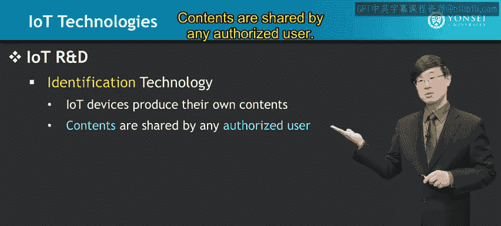

# 延世大学《新兴技术从智能手机到物联网再到大数据Emerging Technologies From Smartphone to IoT to Big Data》 - P86：14_2.2 物联网技术（第2部分）.zh_en - GPT中英字幕课程资源 - BV18hpFewEcG

Yeah。🎼Yeah。Now， many IoT devices have small memory， limited processing， and communication capability。

 and they are also battery operated naturally。IoT requires integration of multitechn networks to a common IP network platform and a common IP network platform is the internet。

 which is the Internet of things， which is the IOT concept we are studying about。

 then IPV4 and V6 because it is the internet， this is the blood， this is the ingredients。

 this is how the components， the blood cells of the internet is actually running on IPV4 and IPV6 packets。

 with routers and routing tables inside the gateways。

This is what is the operational mode and having internet of things means that you're going to connect things to the internet。

 naturally you need to use IPV4 and IPV6。Now， I have a separate course that is called Introuction to TCPIP details that are useful to you。

On IPV4 and IPV6 and the internet and TCP and UDP are all included in there。

 and I highly recommend for you to take that course if you're interested in further details on this。

Now， IoT will have significant influence on future internet architecture。

 and that is why we need to study this in detail。IoT services must guarantee the security and privacy and integrity of information。

 user confidentiality now because we have sensors around us and we have sensors on us as in terms of wearable IoT devices then our personal information and all that we do may be recorded and if somebody gets control of this personal information we can be harmed both physically and financially in various ways。

 that is why confidentiality is so important because IoT information is about us。

Some key features in the research and development R&D of IoT include things authentication and authorization and user authentication and authorization。

Before you allow a certain device to use your network。

 you need to make sure that it is an authorized device and you need to check it。

 you need to authenticate it because what if it's a hacker device。

 what if it's looking just to find a way to validify its access to the network and then attack you throughom ransomware。

 what are you going to do， what if it provides denial of service features， what if it's hacking。

 what if it's going to compromise your unit。So therefore you cannot allow anything to be connected。

 you need to authenticate it， and then if it passes authentication， you need to authorize it。

 and when it's authorized， you need to give its authorization level。

 this thing is going to get access up to this much。

 up to this range and it can access these databases， but not more。User authentication， of course。

 things need to be checked and authorized， but then people need to be checked and authorized。

IoT public and private key management， public and private keys are used to govern authentication and authorization to make sure that things that are protected are encrypted。

 and they can only be opened， decrypted by authorized users。

Thing to thing access control Remember in my former lecture。

 there was machine to machine communication， which was connecting thing to thing。

That was one big domain of the IoT domain， which we other options we had human to thing and we had thing to human or we had human to human。

 These type of other options did exist as in terms of the things were the machines。

 so we had H to H we had H to M and M to H and the M to M machine to machine communication domain was the largest this alone consumed approximately about 45%。

Then there's low overhead protocols and low complexity processing you will see that we will talk about some wireless personal area network technologies and other low power low processing capability devices and techniques that are used in IoT networks that are focused on this specific objective。

 such that they have a very long lifeline。They go on very long。

 but they're doing a specific task the right way。Mobility support once again。

 for the sensors that are on you， like your smartwatch， your smartphone， your smart tablet。

Your smart belt， your smart shoes， your smart glasses that are supporting augmented reality。 Well。

 they're going to move with you when you move around。 So all of these devices need mobility support。

 The network needs to switch you over to different places such that you are consistently receiving services wherever you go。

😊，And your connecting points are switching over， and the network needs to support that。

Then it needs to be changed and upgraded and switched over not only the connection。

 but the overall end data flow from your device to the other server。

 your device to another person that needs to be connected through the entire way。

 so mobility support in a small scale as in terms of your small wireless switching at the edge of the access point to the mobile communication base station to your Bluetooth point to your ZigB access point or master node。

Two， the backbone network and all the access network switching over together。

To provide you with seamless。Non disconnected services all the way。

Mobile platform based IoT enables enormous range of future applications。

 it is very difficult to support， but then again once you get it working， it has so much extra value。

Location based services， LBS can be supported social networking from anywhere and any time。

 environment monitoring and interaction， all of this becomes possible with。😊，IoT， mobile support。

Energy and resource management， so important。 So energy issues are related to optimization of energy harvesting。

 conservation and usage。 And these are essential for。

IoT development what we're talking about here is energy harvesting， what is that， Well。

 think of it this way。A lot of devices have various energy resources around them。

Light sources that they can charge from， some can use wind。

 some can use radiation from microwaves or local wfi components or mobile communication signals so that they can whatever pick up and save and charge themselves In addition。

 a lot of wireless charging techniques are available now In other words。

 wireless charging pads that come from various vendors。These are available。

And as wireless charging remote techniques become more and more possible。

 you will have multiple opportunities to charge the battery of your IoT devices。

 then you want to save that energy and then use it when you need to use it。

 that is what we're talking about energy harvesting number one。

 you do not use energy that is going to be wasted whatever you have。

 you use the minimum amount in the most conservative way， number one， number two。

 whatever opportunity you can charge， you take advantage of that and you charge and then number three。

 you save it and use it just when you need to。That altogether is what we talk about when we're looking into the research and development of IoT focused on energy harvesting。

If you are interested in wireless charging techniques through wireless charging pads for IoT devices or smart devices。

 then please consider to study the smart device and mobile emerging technology lecture that I have in this specialization in that course。

 wireless charging techniques wireless charging protocols and standards are discussed in further details。

It is also important to consider resource restrictions。Wake up delays， power consumption。

 battery capacity， packet sizes， all of this needs to be considered in IoT research and development。

Identification techniques IoT devices produce their own content。

Contents are shared by any authorized user。

So identification and authentication technologies need to be converged and interop at global scales。

This is because you have one device on one side of the world communicating to another device on the other side of the world or somebody on the other side of the world。

 so therefore authentication protocols here may be different there。In addition。

 authentication protocol on this network may be different from that network。And once again。

 since Internet of Things is about connecting things and people on the internet which can be located anywhere in the world。

 most likely the protocol here and the protocol there will be different。

 the authentication here and authentication there will be different。

 the authorization here and the authorization as well as the policy there and the policy here will be different。

That means that eventually you need to have some convergence and interoperability supported。

Management of unique identity of things definitely needed。

 this is a part of what needs to be authenticated。Handling of multiple identifiers for people and locations。

 obviously that is necessary。